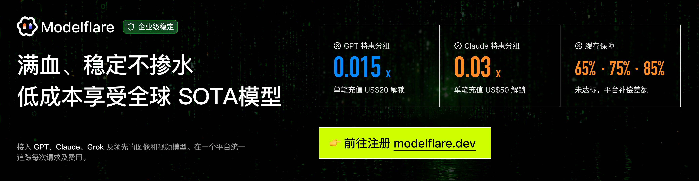

# TradingAgents-CN 社区版（Community Edition）

**English**: TradingAgents-CN Community Edition is a hybrid-licensed (Apache-2.0 core engine + proprietary source-available application layer) multi-agent stock research assistant for the Chinese A-share market. It orchestrates LLM-based analyst agents for debate-style research, natural-language stock screening, paper trading and study courses. For learning and research only — **not investment advice**.

[-blue.svg)](./LICENSE)
[](https://www.python.org/)
[](https://vuejs.org/)

基于多智能体协作的 A 股研究辅助系统。由多个扮演不同角色（大盘/板块/市场/基本面/新闻分析师，乐观/审慎研究员等）的 AI 智能体协作完成研究流程，帮助你系统化学习多智能体框架与 AI 大模型在股票研究中的应用。

> 本项目是研究辅助工具，所有 AI 生成内容仅供学习参考，**不构成投资建议**。

<p align="center"><b>白金赞助商 · Modelflare</b></p>
<p align="center">
  <a href="https://modelflare.dev/sign-up?utm_source=github&utm_campaign=tradingagents-cn">
    
  </a>
</p>
<p><sub>感谢 <a href="https://modelflare.dev/sign-up?utm_source=github&utm_campaign=tradingagents-cn">Modelflare</a> 赞助本项目！Modelflare：满血稳定不掺水，低成本享受全球 SOTA 模型。站点由美国 LLC 主体 Havenbyte LLC 运营，支持 GPT、Claude、Gemini、Grok 等主流模型和常用兼容协议，还支持 40 多种图片和视频模型，支持大陆正规商务合作。</sub></p>
<p><sub><b>缓存补偿是一大亮点：</b>部分 OpenAI 价格优先、稳定和高级分组提供每日 65%、75%、85% 的缓存命中率保障，符合条件的请求没达到目标的，平台补偿差额，结算后可在用量看板查看。</sub></p>
<p><sub><b>特惠活动：</b>单笔充值 US$20 即可解锁 0.015 倍价格倍率的 GPT 特惠分组，单笔充值 US$50 即可解锁 0.03 倍价格倍率的 Claude 特惠分组。通过 <a href="https://modelflare.dev/sign-up?utm_source=github&utm_campaign=tradingagents-cn">专属链接注册</a>即可参与。</sub></p>

## 致敬源项目

感谢 [Tauric Research](https://github.com/TauricResearch) 团队创造的革命性多智能体交易框架 [TradingAgents](https://github.com/TauricResearch/TradingAgents)！

**我们的定位与使命**：专注学习与研究，提供中文化学习中心与工具，合规友好，支持 A 股的分析与教学，推动 AI 金融技术在中文社区的普及与正确使用。

## V3.0 发布主线 —— 从分析工具走向 AI 助手

> 当前版本：TradingAgents-CN v3.0.1，聚焦统一 AI 助手入口、自然语言选股、Agent 自主规划分析与 Skill 能力扩展。

### 四个核心能力

- **统一 AI 助手入口**：将分析、报告、股票关注列表、模拟交易等操作收拢到统一入口，减少页面切换成本
- **自然语言选股**：直接用自然语言描述选股需求，输出结构化候选结果并无缝进入后续分析
- **Agent 自主规划分析**：根据问题自动识别分析路径，组合工具与能力完成复杂任务
- **Skill 能力扩展**：围绕自然语言需求自动生成、测试、验证并注册新能力，持续扩展系统边界

### 核心特性

#### 全新技术架构

- **后端升级**：从 Streamlit 迁移到 FastAPI，提供更强大的 RESTful API
- **前端重构**：采用 Vue 3 + Element Plus，打造现代化的单页应用
- **数据库优化**：MongoDB + Redis 双数据库架构，性能大幅提升

#### 核心功能

- **用户权限管理**：完整的用户认证、角色管理、操作日志系统
- **配置管理中心**：可视化的大模型配置、数据源管理、系统设置
- **缓存管理系统**：智能缓存策略，支持 MongoDB/Redis/文件多级缓存
- **实时通知系统**：SSE+WebSocket 双通道推送，实时跟踪分析进度和系统状态
- **股票关注列表管理**：个人股票关注列表收藏、分组管理和跟踪功能
- **个股详情页**：完整的个股信息展示和历史分析记录
- **模拟交易计划**：虚拟交易环境，验证投资策略效果

#### 智能分析增强

- **动态供应商管理**：支持动态添加和配置 LLM 供应商
- **模型能力管理**：智能模型选择，根据任务自动匹配最佳模型
- **多数据源同步**：统一的数据源管理，支持 Tushare、AKShare、BaoStock
- **报告导出功能**：支持 Markdown 格式专业报告导出

#### 重大 Bug 修复

- **技术指标计算修复**：彻底解决市场分析师技术指标计算不准确问题
- **基本面数据修复**：修复基本面分析师 PE、PB 等关键财务数据计算错误
- **死循环问题修复**：解决部分用户在分析过程中触发的无限循环问题
- **数据一致性优化**：确保所有分析师使用统一、准确的数据源

### 技术栈升级

| 组件 | v0.1.x | v3.0.1 |
|------|--------|--------|
| **后端框架** | Streamlit | FastAPI + Uvicorn |
| **前端框架** | Streamlit | Vue 3 + Vite + Element Plus |
| **数据库** | 可选 MongoDB | MongoDB + Redis |
| **API 架构** | 单体应用 | RESTful API + WebSocket |
| **部署方式** | 本地/源码 | 本地源码部署 |

### 推荐体验路径

1. 从统一 AI 助手入口发起任务或问题
2. 使用自然语言描述选股或分析需求
3. 让 Agent 自动规划分析路径并生成结果
4. 按需扩展 Skill，把高频需求沉淀为新能力

### 中文增强特色

相比原版新增：智能新闻分析、多层次新闻过滤、新闻质量评估、统一新闻工具、多 LLM 提供商集成、模型选择持久化、实时进度显示、智能会话管理、中文界面、A 股数据、国产 LLM、源码部署、专业报告导出、统一日志管理、Web 配置界面、成本优化。

## 核心功能

- **单股研究**：多智能体辩论式分析（5 级深度），多情景观点呈现
- **通用研究**：自然语言提问，研究任意市场主题
- **股票筛选**：自然语言 + 条件筛选，从 6000+ 只股票中发现标的
- **选股助手**：按研究需求描述匹配候选股票池
- **智能助手**：联网搜索 + 工具调用 + 事实记忆
- **AI 记忆**：项目级记忆与事实沉淀
- **Skill 中心**：创建和管理自定义数据获取技能
- **学习中心**：免费系统课程（发现阶段 5 课）+ 8 篇学习指南
- **模拟交易**：纸面交易与复盘

## 版本演进

| 版本 | 定位 | 核心变化 |
|------|------|---------|
| v0.1.x | 开源起步期 | 中文本土化起步：国产 LLM 接入、A 股数据源、Web 界面与源码部署 |
| v1.0 | 多智能体分析工具 | 单股研究 + 批量分析，多个分析师智能体协作完成 A 股研究流程 |
| v2.0 | 分析融入研究闭环 | 统一分析引擎 + 可视化工作流，新增持仓分析、操作复盘与阶段性复盘 |
| v2.1 | 研究辅助合规化 | 报告表达、提示词模板、界面文案全面对齐"研究辅助"定位；新模型接入与稳定性提升 |
| v3.0 | 从分析工具到 AI 助手 | 统一 AI 助手入口、自然语言选股、Agent 自主规划分析、Skill 能力扩展；架构升级为 FastAPI + Vue 3 + MongoDB/Redis；首次发布免费开源社区版 |

## 社区版与 Pro 版的差异

| 能力 | 社区版 | Pro 版 |
|------|:------:|:------:|
| 单股研究 / 通用研究 / 股票筛选 | ✅ | ✅ |
| 学习中心（免费课程） / 模拟交易 / Skill 中心 | ✅ | ✅ |
| Agent 工作坊（创建、发布、管理自定义 Agent） | — | ✅ |
| 交易系统（策略创建 / 优化 / 模板调试） | — | ✅ |
| 定时分析 / 批量分析 | — | ✅ |
| 专业报告导出（Word / PDF 多格式） | — | ✅ |
| 高级课程（进阶 8 阶段） | — | ✅ |
| 许可 | 混合授权（核心引擎开源 + 应用层专有） | 商业许可 |

Pro 版面向有更高阶研究工作流需求的用户，获取方式见项目主页或联系作者。

## 快速开始

### 环境要求

- Python 3.11
- Node.js 18+
- MongoDB 7.0+（推荐 8.0）与 Redis 6+（推荐 7）—— 需自行安装，见下方「安装 MongoDB / Redis」

### 安装 MongoDB / Redis

本项目不自带数据库，请先自行安装并启动 MongoDB 与 Redis（版本要求见上）。任意一种安装方式都可以，只要**账号密码与端口和下一步的 `.env` 保持一致**。

| 系统 | MongoDB | Redis |
|------|---------|-------|
| Windows | 官网安装包 https://www.mongodb.com/try/download/community （安装后作为服务自启） | WSL 里运行 `redis-server`，或使用 Memurai 等兼容实现 |
| macOS | `brew tap mongodb/brew && brew install mongodb-community && brew services start mongodb-community` | `brew install redis && brew services start redis` |
| Ubuntu / Debian | 参考 https://www.mongodb.com/docs/manual/installation/ | `sudo apt install redis-server && sudo systemctl enable --now redis-server` |

也可以用 Docker 只跑这两个数据库（需要本机已装 Docker）：

```bash
docker run -d --name ta-mongo -p 27017:27017 \
  -e MONGO_INITDB_ROOT_USERNAME=admin -e MONGO_INITDB_ROOT_PASSWORD=<你的密码> mongo:8.0
docker run -d --name ta-redis -p 6379:6379 \
  redis:7-alpine redis-server --requirepass <你的密码>
```

MongoDB 需开启认证（`authSource=admin`），并自行创建管理员账号；把用户名/密码、主机与端口写入下一步的 `.env`（本地默认 `localhost:27017` / `localhost:6379`）。

### 启动步骤

```bash
# 1. 克隆
git clone <本仓库地址>
cd TradingAgents-CN

# 2. 后端环境（Python 3.11）
python -m venv env
env\Scripts\activate            # Windows
source env/bin/activate         # Linux / macOS
pip install -r requirements.txt

# 3. 配置（必填 MongoDB / Redis / JWT_SECRET，详见 .env.example 注释）
copy .env.example .env          # Windows
cp .env.example .env            # Linux / macOS

# 4. 启动已安装好的 MongoDB / Redis（账号密码与 .env 保持一致）

# 5. 启动后端（默认 8000 端口，与前端默认代理一致）
uvicorn app.main:app

# 6. 启动前端
cd frontend
npm install
npm run dev                     # 默认 http://localhost:3000
```

### 首次登录

后端首次启动时会自动完成初始化（无需手动执行任何导入脚本）：

1. 导入系统级配置（模型目录、提示词模板、Agent 配置、工作流等）
2. 用户表为空时，用 `.env` 中的 `ADMIN_DEFAULT_PASSWORD` 创建管理员账号 `admin`

| 账号 | 密码 |
|------|------|
| `admin` | `.env` 中的 `ADMIN_DEFAULT_PASSWORD` |

登录后请先在系统设置中配置大模型 API Key（OpenAI / DeepSeek / 通义千问等），并按需配置行情数据 Token。

## 文档

- 用户手册：[docs/02-user-guide/user-manual-v3.0.md](docs/02-user-guide/user-manual-v3.0.md)
- 学习指南：[docs/02-user-guide/](docs/02-user-guide/)（learning-01 ~ 08）
- 免费课程：[docs/07-courses/v3.0/phase-01-discover/](docs/07-courses/v3.0/phase-01-discover/)
- 完整更新日志：[CHANGELOG.md](CHANGELOG.md)

## 数据来源

行情与财务数据来自 [Tushare](https://tushare.pro/) / [AKShare](https://github.com/akfamily/akshare) / [BaoStock](https://www.baostock.com/) 等公开接口，需自行注册获取 token。

## 参与共建（招募中）

我们正在寻找**志同道合的开源人才**，一起把 TradingAgents-CN 做得更好。

**怎么加入**：直接提交 Pull Request。不看简历、不面试——**PR 是唯一的考察方式**，我们根据 PR 质量判断是否合适：

1. **解决真问题**：修复实际存在的 Bug 或补齐真实缺口，而非为改而改
2. **说明修改原因**：讲清楚"为什么改"，而不只是"改了什么"
3. **响应 review 意见**：积极回应评审意见并跟进修改

持续贡献高质量 PR 的伙伴将参与版本规划与关键模块开发。

**当前欢迎的方向**：

- 数据源适配：行情/财务公开接口的接入与维护
- 前端开发：Vue 3 + TypeScript 功能开发与体验优化
- Agent 编排与提示词工程：分析链路优化
- 文档与课程：用户手册、学习课程建设

**你能得到**：公开署名与流量（版本发布/公众号点名致谢）、多智能体系统的工程实战经验、项目商业化优先权。项目目前收入尚不足以覆盖基础成本，暂为志愿参与；收入覆盖成本后的分配原则（社区贡献基金 / 顾问费 / 分成路径）已提前写明。

**怎么联系**：
- GitHub Issues：[提交问题和建议](https://github.com/hsliuping/TradingAgents-CN/issues)
- 邮箱：hsliup@163.com
- 项目 QQ 群：1079484482
- 微信公众号：TradingAgents-CN（扫码关注）

  

提交流程、分配框架与贡献者协议（CLA）详见 [CONTRIBUTING.md](CONTRIBUTING.md)。

## 免责声明

- 本系统仅支持 A 股市场研究，输出为 AI 生成的研究参考，不构成投资建议
- 不提供目标价、止损止盈、买卖时机等交易指令
- 投资有风险，决策需独立判断

## License

本项目采用**混合授权**，详见 [LICENSE](LICENSE)：

- **Apache-2.0 开源组件**：`tradingagents/`（交易智能体库）、`cli/`、`docs/`、`tests/` 等——可自由使用、修改、分发
- **专有组件（Source Available）**：`app/`（后端应用）、`frontend/`（前端应用）、`core/`（核心功能层）——源码可见，允许个人使用、评估与教育用途，**禁止再分发与商业使用**（商业许可请联系作者）

提交贡献即表示同意签署[贡献者许可协议（CLA）](CONTRIBUTING.md)。

## 致谢

- [Tauric Research / TradingAgents](https://github.com/TauricResearch/TradingAgents) — 多智能体交易框架原版项目
- 所有通过 PR 参与共建的贡献者

完整致谢（含授权说明与数据源致谢）见 [ACKNOWLEDGMENTS.md](ACKNOWLEDGMENTS.md)。

---

<div align="center">

**如果这个项目对您有帮助，请给我们一个 Star！**

[⭐ Star this repo](https://github.com/hsliuping/TradingAgents-CN) | [🍴 Fork this repo](https://github.com/hsliuping/TradingAgents-CN/fork) | [📖 Read the docs](./docs/)

</div>