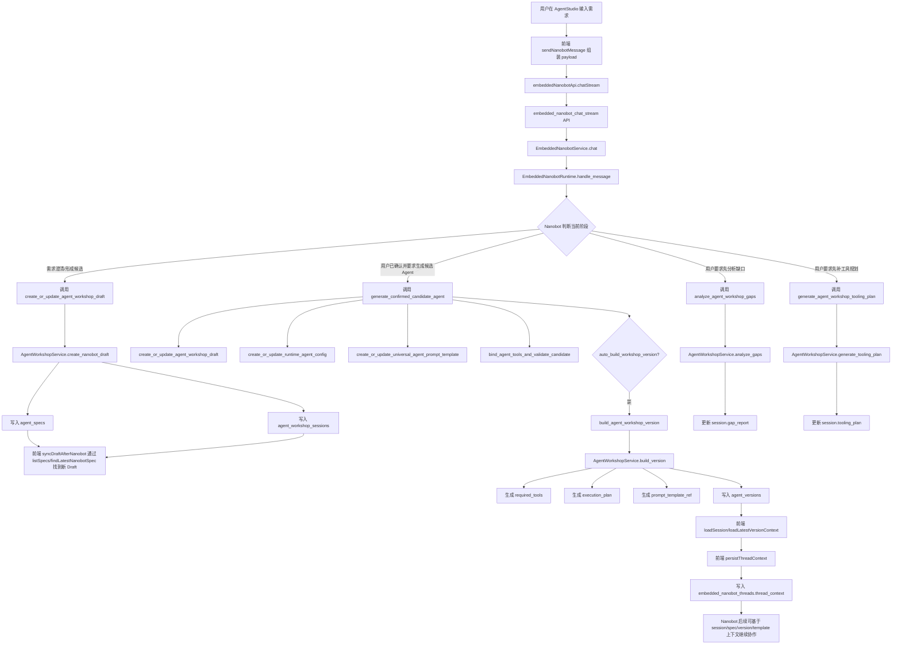
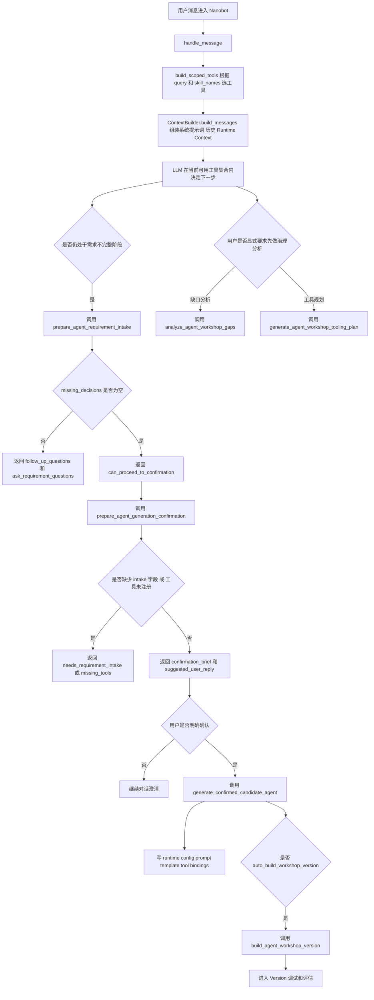
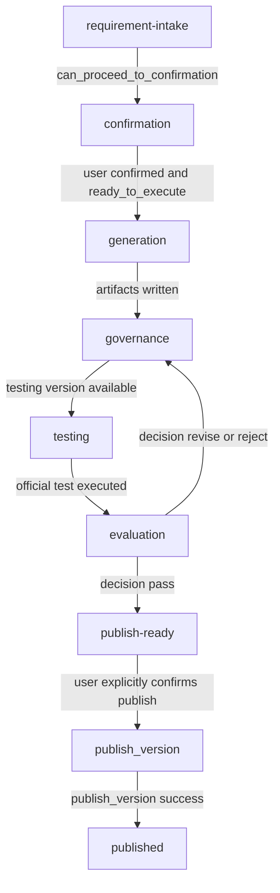
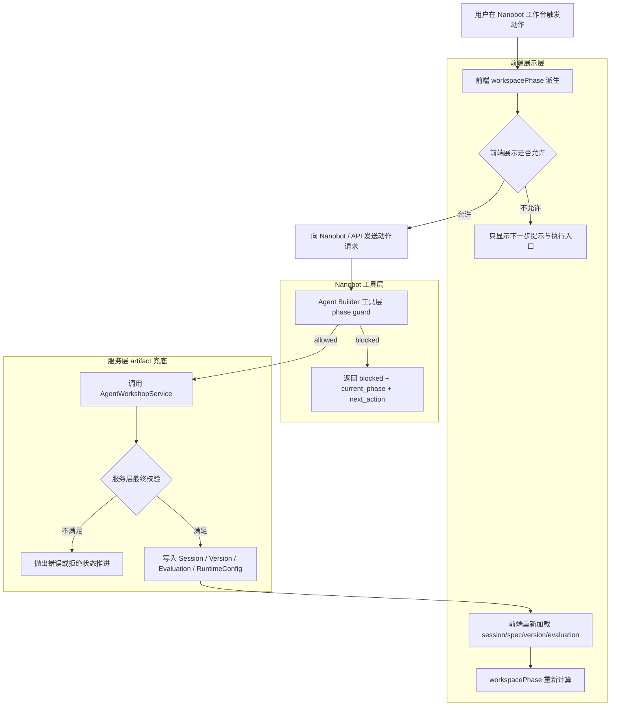

# Agent Workshop 端到端设计与缺口分析

## 1. 当前架构前提

当前实现不是“完全使用原始 Agent Workshop 页面和交互逻辑”，也不是“Nanobot 完全替代后端版本系统”，而是一个混合架构：

- Nanobot 是当前首选的需求讨论、上下文恢复、模板诊断和迭代协作入口。
- AgentWorkshopService 仍然承担底层持久化与 artifact 生成职责，包括 Session、Spec、Version、Prompt Template、Evaluation、Runtime Config。
- 也就是说，交互入口已经明显转向 Nanobot，但版本构建与发布链路还没有完全从原服务层剥离。

因此本文档描述的不是“已经回退到老流程”，而是“当前这套 Nanobot 主导、AgentWorkshopService 承载底层 artifact 的真实状态”。

这也是当前很多问题的根源：

- 上层使用 Nanobot 的工作模式。
- 下层仍有一部分沿用旧的 Agent Workshop artifact 生成假设。
- 两层之间虽然已经打通，但还没有形成一套彻底以 Nanobot 为中心重写过的统一设计。

## 2. 目标

本文档用于统一说明以下内容：

- Agent 从新建到发布的完整生命周期。
- Session、Spec、Version、Prompt Template、Runtime Config、Nanobot Thread 之间的关系。
- MongoDB 中各集合的职责边界。
- 前端、后端、运行时配置之间的真实数据流。
- 当前实现已经具备什么，仍然缺什么。

本文档的目的不是记录某一次修 bug，而是建立一套可以约束后续实现的整体设计基线。

## 3. 核心对象与职责

### 2.1 AgentWorkshopSession

表示一次“需求澄清与方案设计会话”。

主要职责：

- 保存用户和 Agent Workshop 的多轮对话。
- 保存当前阶段的规格草案快照 current_spec_snapshot。
- 保存 gap_report 与 tooling_plan。
- 保存当前轮构建出来的 proposed_version 预览。

关键字段：

- session_id: 会话主键。
- spec_id: 关联的规格 ID。
- stage: 当前流程阶段，如 gathering、gap-analysis、building、evaluating。
- current_spec_snapshot: 当前规格快照，是本轮讨论的工作副本。
- gap_report: 缺口分析结果。
- tooling_plan: 工具补齐/能力补齐方案。
- proposed_version: 最近一次构建出的版本快照。

### 2.2 AgentSpec

表示“这个 Agent 应该是什么”的结构化定义，是跨版本共享的规格层。

主要职责：

- 定义 Agent 的业务目标、职责、非目标、输入输出、成功标准、约束、偏好方法。
- 作为版本构建的稳定上游输入。
- 记录当前最新版本 current_version_id 与版本计数 version_count。

关键字段：

- spec_id: 规格主键。
- latest_session_id: 最近一次修改该规格的 Workshop Session。
- current_version_id: 当前最新版本。
- version_count: 当前累计版本数。

### 2.3 AgentVersion

表示某一版可调试、可验证、可发布的运行草案或正式版本，是运行层的核心对象。

主要职责：

- 固化当前版本的 required_tools、required_capabilities、output_schema、evaluation_policy。
- 持有 execution_plan，定义本版本如何调试和验收。
- 持有 prompt_template_ref，指向本版本实际使用的 Prompt 模板。
- 在发布后写入运行时 agent_configs。

关键字段：

- version_id: 版本主键。
- spec_id: 关联规格。
- required_tools: 当前版本绑定工具。
- prompt_template_ref: 当前版本关联模板的引用。
- execution_plan: 当前版本的执行验证计划。
- published_from_session_id: 该版本来自哪个 Workshop Session。

### 2.4 Prompt Template

表示运行时真实使用的提示词模板内容。

主要职责：

- 提供 system_prompt、user_prompt、tool_guidance、analysis_requirements、output_format、constraints 六段内容。
- 被 AgentVersion 通过 prompt_template_ref 引用。
- 在调试阶段可被 debug_template_id 强制指定。

关键字段：

- template_id: 模板主键。
- agent_name: 对于 Agent Workshop 版本，通常等于 version_id。
- content: 六段结构化内容。
- status: draft 或 active。

### 2.5 Runtime Agent Config

表示运行时调度系统真正可执行的 Agent 配置，存储于 agent_configs。

主要职责：

- 让发布后的版本被工作流引擎、运行时工厂和调试执行调用。
- 保存运行时工具绑定、prompt_template_name、metadata、output_field 等。

关键字段：

- agent_id: 运行时 Agent ID，通常等于 version_id。
- required_tools/default_tools: 运行时工具绑定。
- prompt_template_name: 运行时模板名。
- metadata.spec_id / metadata.version_id / metadata.template_id: 反向追踪信息。

### 2.6 Embedded Nanobot Thread

表示一个调试/协作线程，不是规格本身，也不是版本本身，而是一个“围绕某个 Agent Workshop 上下文的持续对话容器”。

主要职责：

- 保存用户与 Nanobot 的线程历史。
- 保存当前线程关联的 workshop_session_id、spec_id、version_id、workflow_id、node_id、preference_id、debug_template_id。
- 让 Nanobot 能基于线程上下文回答“当前生效模板”“当前版本绑定工具”等问题。

## 4. 数据库集合职责边界

当前核心集合如下：

- agent_workshop_sessions: 保存 Session。
- agent_specs: 保存 Spec。
- agent_versions: 保存 Version。
- agent_evaluations: 保存版本评估结果。
- prompt_templates: 保存 Prompt 模板。
- template_history: 保存模板历史。
- agent_configs: 保存发布后的运行时 Agent 配置。
- embedded_nanobot_threads: 保存 Nanobot 线程。
- embedded_nanobot_thread_messages: 保存 Nanobot 消息。

建议明确的职责边界：

- Session 是“讨论态”和“过程态”，不是最终运行态。
- Spec 是“规格态”，定义需求，不直接决定当前运行模板文本。
- Version 是“发布候选态”和“运行快照态”，是当前绑定工具、模板引用、执行计划的主归档对象。
- Prompt Template 是“文本实现态”，保存真正给模型用的结构化提示词内容。
- agent_configs 是“运行注册态”，只保存当前运行必需配置，不反向承担设计稿职责。
- Nanobot Thread 是“诊断协作态”，用于串联当前上下文，不替代任何主数据源。

## 5. 端到端流程

重要说明：

- 如果从“用户当前实际工作方式”看，首入口应该是 AgentStudio，而不是旧的 AgentWorkshop 页面。
- 如果从“后端当前 artifact 如何落库、如何生成、如何发布”看，核心仍然是 AgentWorkshopService。
- 所以下面描述的是底层真实数据流，不代表产品交互层仍应以旧 Workshop 页面为主。

### 5.1 新建 Agent

流程：

1. 前端调用 start_session。
2. 后端创建 AgentWorkshopSession 与初始 AgentSpec。
3. Workshop 通过 respond / preview-spec 持续更新 current_spec_snapshot。
4. 每次规格更新后，spec 会同步写回 agent_specs。

这一阶段的核心产物：

- Session 中的对话和待确认项。
- Spec 中的结构化需求。

### 5.1.1 从 Nanobot 收到需求开始的真实调用链

这条链路描述的是当前系统里“以 Nanobot 为入口新建一个 Agent”时，代码真实发生了什么。

要点先说清：

- Nanobot 收到需求后，不是直接回到旧 AgentWorkshop 页面逐步点按钮。
- Nanobot 先通过自己的运行时和工具系统理解需求、生成候选方案。
- 当需要把候选方案沉淀成正式可治理资产时，Nanobot 调用的是 agent_builder 工具。
- 这些工具再把结果写入 AgentWorkshopService 管理的 Session/Spec/Version/Prompt/RuntimeConfig。

也就是说：

- 交互编排层：Nanobot。
- 资产落库层：AgentWorkshopService。
- 这不是旧页面主导，而是 Nanobot 主导、Workshop 资产层承接。

#### 主链路 Mermaid 图

#### 这张图对应的关键事实

1. Nanobot 的第一入口是流式聊天接口，不是 AgentWorkshop 的 start_session 页面动作。
2. Nanobot 是否创建 Draft，取决于它是否调用了 create_or_update_agent_workshop_draft。
3. Nanobot 是否直接生成版本，取决于它是否调用了 generate_confirmed_candidate_agent，且其中 auto_build_workshop_version 是否为 true。
4. build_version 仍然复用了 AgentWorkshopService，但对于 source == nanobot 的 Spec，不会强制先做旧式 gap analysis。
5. gap analysis 和 tooling plan 在 Nanobot 路径里是可选治理动作，不再是每次新建 Agent 的强制前置步骤。

#### 当前 Nanobot 新建 Agent 的最常见两条路径

路径 A：先形成 Draft，再继续治理

1. Nanobot 对话澄清需求。
2. 调用 create_or_update_agent_workshop_draft。
3. 前端通过 syncDraftAfterNanobot 把新 Draft 挂到工作台。
4. 后续再由用户或 Nanobot决定是否做缺口分析、工具规划、版本构建。

路径 B：确认后一键生成候选 Agent

1. Nanobot 对话澄清需求并拿到用户确认。
2. 调用 generate_confirmed_candidate_agent。
3. 工具内部完成 Draft、runtime config、prompt template、工具绑定和 dry-run 校验。
4. 如果 auto_build_workshop_version=true，则继续自动调用 build_agent_workshop_version。
5. 最终生成一个可测试 version，并回到 Nanobot 工作台继续调试和迭代。

#### 代码落点

- 前端发送与同步：frontend/src/views/Workflow/AgentStudio.vue
- Nanobot 流式接口：app/routers/embedded_nanobot.py
- Nanobot 对话服务：app/services/embedded_nanobot_service.py
- Nanobot 运行时工具注册：core/embedded_nanobot/runtime.py
- Draft/Version 工具实现：core/tools/implementations/agent_builder/nanobot_agent_builder_tools.py
- Draft/Version 资产落库：app/services/agent_workshop_service.py

### 5.1.2 Nanobot 内部判断流程与提示词关系

这一节回答的是：

- 需求阶段怎么判断？
- 生成阶段怎么判断？
- 生成前有没有做工具发现？
- 这些判断是由哪一层提示词或规则驱动的？

#### 结论先行

当前 Nanobot 内部不是一个硬编码的“需求阶段 -> 生成阶段 -> 发布阶段”状态机。

真实机制是 4 层叠加：

1. 前端固定传入 skill_names = [nanobot-agent-design]。
2. EmbeddedNanobotRuntime 根据用户消息内容动态裁剪可用工具集合。
3. ContextBuilder 生成系统提示词，要求优先用正确的模板查询工具，不要凭空猜。
4. agent_builder 工具本身通过返回 recommended_next_step、missing_decisions、confirmation_required、confirmed 等结构化字段，把 Nanobot 推到下一步。

也就是说，Nanobot 的“阶段判断”不是保存在一个单独 phase 字段里，而是由：

- 当前消息内容
- 当前线程上下文
- 当前可用工具集合
- agent_builder 工具返回结果

共同决定。

#### 内部判断 Mermaid 图

#### 需求阶段怎么判断

需求阶段的核心不是一个后端 session.stage，而是 Nanobot 是否判断“当前信息还不足以进入确认稿”。

这一步主要通过 prepare_agent_requirement_intake 完成。它会检查：

- 单一职责是否明确。
- 输出形状是否明确。
- non_goals 是否明确。
- 是否已有工具偏好。
- 是新建还是覆盖既有 Agent。
- 对股票分析请求，是否明确估值方法边界。
- 是否明确生成后测试策略。
- 如果用户其实在问报告样式，是否明确只是结构骨架还是允许示例。

它的输出不是自由文本，而是结构化判断：

- missing_decisions
- follow_up_questions
- can_proceed_to_confirmation
- recommended_next_step

因此，Nanobot 在需求阶段的真实判断标准就是：

- 如果 missing_decisions 不为空，就继续追问。
- 如果 missing_decisions 为空，才允许进入确认阶段。

#### 生成阶段怎么判断

生成阶段的进入条件不是“模型觉得差不多了”，而是两道门：

1. prepare_agent_requirement_intake 认为需求已经完整。
2. prepare_agent_generation_confirmation 认为可以进入确认稿，并且用户明确确认。

prepare_agent_generation_confirmation 还会额外检查：

- 对报告类请求，报告边界是否完整。
- 对股票/估值类请求，non_goals、valuation_method_scope、test_strategy 等是否缺失。
- tool_ids 对应的工具是否已在 get_tool_registry 中注册。
- 是否存在覆盖风险，需要 allow_overwrite。

只有这些条件都满足，它才会返回：

- confirmation_required = true
- ready_to_execute = true
- suggested_user_reply = 确认生成 xxx

最后，真正执行写入的是 generate_confirmed_candidate_agent，它还要求：

- confirmed = true
- 如有覆盖风险，则 allow_overwrite = true

#### 有没有先做工具发现

有，但分成两层，而且不是每次都显式调用同一个“工具发现步骤”。

第一层是运行时动态选工具。

在 handle_message 里，EmbeddedNanobotRuntime 会先执行 build_scoped_tools：

- 固定保留核心工具，如 read_file、edit_file、list_dir、exec、web_search。
- 因为前端传入了 nanobot-agent-design，所以默认加入 AGENT_BUILDER_TOOL_IDS。
- 再根据 query 的关键词、类别匹配、tool metadata、related_tools 做一次动态打分。
- 最终从注册表能力里选出最多 16 个动态工具。

这意味着，Nanobot 在每轮消息开始前，确实先做了一次“本轮该开放哪些工具”的工具发现。

第二层是 agent_builder 领域内的显式资源侦察。

当需要更细地确认项目里现有哪些能力时，Nanobot 可以显式调用：

- search_project_capabilities
- inspect_agent_workshop_assets
- inspect_runtime_agent_configs

但这层不是强制前置动作。当前实现里，真正进入生成前最硬的校验不是“先搜一遍能力”，而是：

- prepare_agent_generation_confirmation 里校验 tool_ids 是否已注册。
- generate_confirmed_candidate_agent 里校验覆盖风险和写入链路。

#### 提示词关系是怎样的

这里要区分 3 类提示词。

第一类：Nanobot 自身系统提示词。

它由 ContextBuilder.build_system_prompt 生成，来源包括：

- Embedded nanobot identity
- workspace bootstrap files
- memory
- active skills / requested skills / skills summary
- Prompt Template Rules

这一层的作用是约束 Nanobot 作为“编排者”怎么用工具，不直接决定某个 AgentVersion 的业务提示词正文。

第二类：运行时临时系统引导。

如果 runtime 判断当前请求像“完整分析任务”，会生成一段 agent-first guidance，临时插入系统消息，提示优先尝试 callable agent。

这说明运行时会根据当前 query 动态追加系统引导，而不是只有一段固定 system prompt。

第三类：被创建出来的 Agent Prompt Template。

这是 create_or_update_universal_agent_prompt_template 或 build_version 生成的模板正文，属于目标 Agent 的运行提示词，不属于 Nanobot 自己的编排提示词。

所以当前有两个平行但不同的 prompt 世界：

- Nanobot prompt：决定 Nanobot 如何判断、追问、选工具、编排流程。
- Agent prompt：决定最终生成出来的目标 Agent 如何运行。

#### 当前设计上的真实问题

当前最大的问题不是“完全没有判断流程”，而是这个判断流程分散在 3 个地方：

- runtime 的工具选择逻辑
- ContextBuilder 的系统提示词逻辑
- agent_builder 工具自己的结构化门禁逻辑

因此它现在能工作，但不够显式。

更准确地说，当前 Nanobot 内部使用的是“隐式阶段判断”，而不是“显式流程状态机”。

这也是为什么后续应该补一份 Nanobot-first 状态机设计，把这些隐式规则收拢成统一的阶段定义。

### 5.1.3 Nanobot-first 显式状态机

为避免后续继续靠分散规则理解系统，建议把当前流程固化为下面这套显式状态机。

#### 状态列表

1. requirement-intake
2. confirmation
3. generation
4. governance
5. testing
6. evaluation
7. publish-ready
8. published

#### 状态机 Mermaid 图

#### 每个状态的真实含义

requirement-intake

- 含义：需求仍不完整，还不能安全生成确认稿。
- 入口判据：prepare_agent_requirement_intake 返回 missing_decisions 非空。
- 允许动作：追问、资源侦察、能力盘点。
- 禁止动作：直接写 candidate artifact。

confirmation

- 含义：需求已基本完整，可以生成确认稿，但还不能写库。
- 入口判据：prepare_agent_requirement_intake 返回 can_proceed_to_confirmation=true。
- 允许动作：prepare_agent_generation_confirmation、覆盖风险检查、工具注册校验。
- 禁止动作：在没有用户明确确认前执行生成写入。

generation

- 含义：已拿到明确确认，可以生成候选 Agent 资产。
- 入口判据：prepare_agent_generation_confirmation 返回 ready_to_execute=true，且用户明确确认。
- 允许动作：generate_confirmed_candidate_agent，或底层 config/template/binding 写入链。
- 禁止动作：把生成完成误报成测试通过或可发布。

governance

- 含义：已经有 Draft 或 Version 资产，需要继续做治理动作。
- 入口判据：Draft 已同步，或 candidate 已进入 Workshop 资产层。
- 允许动作：gap analysis、tooling plan、build version、asset 诊断。
- 禁止动作：把 suggested_tools 误当成当前真实绑定。

testing

- 含义：版本已经进入真数据测试阶段，但还没有证明通过。
- 入口判据：存在 testing-ready 的 version。
- 允许动作：debug_agent_workshop_version、run_agent_workshop_real_data_test。
- 禁止动作：在没有 pass 评估前宣称“可以发布”。

evaluation

- 含义：已经有正式测试结果，需要根据 decision 判断去发布还是回治理。
- 入口判据：官方评估链路返回 decision。
- 允许动作：解释失败原因、查看 acceptance checks、在 pass 时进入待确认发布、在 revise/reject 时决定 iterate。
- 禁止动作：忽略 revise/reject 结果直接发布。

publish-ready

- 含义：最近一次官方评估已 pass，但当前只进入“待确认发布”状态，不能自动发布。
- 入口判据：latest evaluation decision == pass。
- 允许动作：向用户汇报测试通过与当前状态；只有在用户当前回合显式确认发布时，才允许调用 publish_agent_workshop_version。
- 禁止动作：在测试 pass 后自动继续调用 publish_agent_workshop_version，或把 publish-ready 误说成已发布。

published

- 含义：版本已经 active，成为正式运行版本。
- 入口判据：publish_version 成功且 version.status == active。
- 允许动作：查看运行态配置、查看模板、发起下一轮迭代。
- 禁止动作：原地修改已发布版本并假装没有版本演进。

#### 关键状态边界

最容易混淆的边界如下：

1. generation 完成，不等于 testing 通过。
2. testing 开始，不等于 evaluation pass。
3. evaluation pass，不等于已经 published，也不等于系统可以自动发布。
4. publish-ready，不等于 published；它只是“待确认发布”，仍需要用户在当前回合显式确认。
5. gap_report.suggested_tools 和 execution_plan.suggested_tools 都不能决定状态迁移；真正影响 testing/evaluation/publish 的是 version、evaluation、publish 结果。

#### 后续实现应对齐这套状态机

当前代码仍然是隐式判断为主，因此建议后续逐步对齐到这套显式状态机：

1. 把每个 agent_builder 工具声明它允许在哪些状态调用。
2. 把前端工作台的按钮可见性对齐到状态机，而不是零散 computed 判断。
3. 把 Nanobot 的对外话术也对齐到状态机，避免“已生成”“已测试”“已通过”“可发布”混说。

#### 当前已经落地的对齐项

最近一轮实现中，这套显式状态机已经开始从“设计建议”进入“局部落地”状态，但还没有覆盖全系统。

已落地的部分：

1. Nanobot 工作台前端已经引入统一的 workspacePhase 派生层，不再让 draftStatusText、focusSubtitle、publishStatusHint、workflowStageItems、nextRequiredAction 各自零散判断。
2. 前端左侧 Agent 树、版本树以及右侧真实流程状态，已经开始统一使用 requirement-intake / confirmation / generation / testing / evaluation / publish-ready / published / blocked 这套语义，而不再直接把 version.status、spec.status 原样暴露给用户。
3. Nanobot 对外话术已经开始区分“待测试”“真数据测试中”“待修正”“待确认发布”“已发布”，避免把 generation、testing、evaluation pass、published 混说。
4. Agent Builder 工具层已经开始引入 phase guard：build_agent_workshop_version、debug_agent_workshop_version、run_agent_workshop_real_data_test、evaluate_agent_workshop_version、iterate_agent_workshop_version、publish_agent_workshop_version 在能够解析到 Workshop 状态时，会先检查当前 phase，再决定是否允许执行。
5. runtime guidance 已明确把 publish-ready 收紧为“测试 pass 后停止自动推进”，要求只有在 latest official evaluation == pass 且用户在当前回合显式确认发布时，才允许调用 publish_agent_workshop_version；对应的 handle_message 会话级回归已经覆盖“pass 后不得自动发布”。

这意味着当前系统已经出现三层约束关系：

- 前端展示契约：决定页面如何显示当前阶段、下一步和执行入口。
- 工具调用契约：决定 Nanobot 何时允许补建测试版本、真数据测试和发布，并通过 runtime guidance 明确禁止在 pass 后自动继续发布。
- 服务层最终兜底契约：即使上层漏拦截，底层 publish_version / build_version / evaluate_version 仍然决定最终是否允许落库、推进状态和发布。

但仍未完全落地的部分：

1. 前端动作入口还没有把 debug / evaluate / iterate 完整抽成统一按钮矩阵，当前更多还是 phase 话术先行。
2. 老的 versions/{version_id}/debug、versions/{version_id}/evaluate、versions/{version_id}/iterate 这类底层 API 仍然存在，因此服务层兜底依然不能删；只是 Nanobot 工具层现在也已经补上统一 phase guard 协议。
3. 目前前端 phase 与工具层 phase 虽然语义一致，但还没有抽成一个跨前后端共享的枚举或契约模型。

#### 三层约束 Mermaid 图

#### 三层关系的解释

这张图要表达的不是“有三份互相独立的状态机”，而是“同一个状态语义被三层以不同职责消费”。

前端展示层：

- 负责把 phase 翻译成用户可见的话术、标签、阶段卡片和下一步提示。
- 目标是避免错误表达，例如把 testing 误说成已通过、把 publish-ready 误说成已发布。
- 即使前端显示允许，也不能单独决定底层一定可执行。

Nanobot 工具层：

- 负责把 phase 翻译成工具调用门禁，优先阻止明显不合时宜的动作。
- 目前已覆盖 build_agent_workshop_version、debug_agent_workshop_version、run_agent_workshop_real_data_test、evaluate_agent_workshop_version、iterate_agent_workshop_version、publish_agent_workshop_version。
- blocked 的返回应该是结构化协议，而不是随意报错，以便 Nanobot 能继续解释下一步。

服务层 artifact 兜底：

- 负责最终一致性和真正的状态推进，不依赖前端是否已经做了正确展示，也不依赖工具层是否已经做了完整拦截。
- 例如 publish_version 仍然会最终检查 testing 状态和 latest evaluation decision == pass。
- 但这层“允许发布”只代表满足底层前置条件，不代表上层可以在用户未确认时自动触发发布。
- 这一层不应该承担解释型 UI 职责，但必须承担最后的安全边界。

设计结论：

- 前端负责“怎么说”。
- 工具层负责“什么时候可以试图去做”。
- 服务层负责“最后是否真的允许写入和推进状态”。

如果后续继续演进，应该把三层都绑定到同一个 phase 计算来源，而不是继续各自推导一份近似但可能不完全一致的状态。

#### 当前覆盖矩阵

为了避免“某个动作到底有没有被 phase 约束”继续口头理解，下面直接列出当前实现的覆盖矩阵。

| 动作 | 前端展示层 | Nanobot 工具层 | 服务层最终兜底 | 当前结论 |
| --- | --- | --- | --- | --- |
| build-version | 已覆盖。Nanobot 工作台会把 requirement-intake / confirmation / blocked / generation / testing / publish-ready / published 区分成不同提示与下一步。 | 已覆盖。build_agent_workshop_version 已有 phase guard，会在 requirement-intake / confirmation / blocked 或已有不该重复补建的版本时返回 blocked。 | 已覆盖。build_version 仍检查 session 是否存在、session 是否可继续，并负责最终落库。 | 三层都已参与，但前端与工具层仍是各自派生 phase。 |
| debug-version | 部分覆盖。前端能显示当前 phase，但没有把 debug 显式纳入统一按钮/动作矩阵。 | 已覆盖。debug_agent_workshop_version 现在只允许 testing / evaluation / publish-ready，其他阶段返回 blocked_code。 | 已覆盖。debug_version 仍然读取 version/spec/template/runtime config 做最终执行。 | 工具层已补齐，剩余差距主要在前端动作语义。 |
| real-data-test | 已覆盖。前端 phase 已能把 generation、testing、evaluation、publish-ready 区分开，并提示“开始真数据测试/继续测试/待修正/待确认发布”。 | 已覆盖。run_agent_workshop_real_data_test 当前要求 version.status == testing，否则返回 blocked；通过后只推进到 publish-ready。 | 已覆盖。evaluate_version / debug_version 仍承担正式测试与评估落库。 | 三层已开始闭环，且 pass 后不会直接跨到发布。 |
| evaluate-version | 部分覆盖。前端会展示 evaluation 结果和 publish-ready 语义，但 evaluate 动作本身还没抽成单独入口。 | 已覆盖。evaluate_agent_workshop_version 现在只允许 testing / evaluation / publish-ready，其他阶段返回 blocked_code。 | 已覆盖。evaluate_version 负责根据 runtime_result 生成分数、issues、decision 并落库。 | 工具层协议已到位，前端入口和状态提示仍待补。 |
| iterate-version | 部分覆盖。前端知道 published / evaluation / generation 等阶段话术，但“何时允许 iterate”还没抽成统一矩阵。 | 已覆盖。iterate_agent_workshop_version 现在只允许 evaluation / publish-ready / published，并返回结构化 next_action。 | 已覆盖。iterate_version 仍负责创建新 Session，把反馈带入下一轮生命周期。 | 工具层协议已到位，前端入口仍待补。 |
| publish-version | 已覆盖。前端已明确区分 testing、evaluation、publish-ready、published，并把 publish-ready 表达为“待确认发布”而不是“可自动发布”。 | 已覆盖。publish_agent_workshop_version 已有 phase guard，非 publish-ready 时直接 blocked；即使处于 publish-ready，也要求用户当前回合显式确认发布。 | 已覆盖。publish_version 仍最终检查 testing 状态与 latest evaluation decision == pass。 | 这是当前三层约束最完整的一项，且已补上“禁止 pass 后自动发布”的编排边界。 |

从这个矩阵可以看出：

1. build-version、real-data-test、publish-version 已经开始形成“展示层 + 工具层 + 服务层”的三层闭环。
2. debug-version、evaluate-version、iterate-version 现在已经进入统一工具层协议，但前端动作入口和共享 phase 来源仍未补齐。
3. 这也是为什么当前文档里不能简单说“状态机已经完整落地”，更准确的说法是“关键主链路与主要治理动作已接入协议，剩余缺口集中在前端动作语义和共享契约”。

#### 目标覆盖矩阵

当前矩阵回答的是“现在做到哪一步”；下面这张矩阵回答的是“后续应该补到什么程度”。

| 动作 | 前端展示层目标 | Nanobot 工具层目标 | 服务层目标 | 目标完成标准 |
| --- | --- | --- | --- | --- |
| build-version | 明确显示何时允许补建测试版本，并把 blocked 原因翻译成稳定话术。 | 保持 phase guard，并把 blocked reason/next action 协议固定化。 | 保持最终落库校验，并补 version consistency validator。 | 前端、工具层、服务层对“何时可以补建”给出同一答案。 |
| debug-version | 在工作台中单独声明 debug 属于 testing / evaluation 阶段动作，而不是只靠用户自行理解。 | 为 debug_agent_workshop_version 增加 allowed phases / blocked phases 协议。 | 保持调试运行校验，并明确缺模板、缺绑定、缺 runtime config 时的失败语义。 | debug 不能在明显错误阶段被触发，blocked 与 error 的边界清晰。 |
| real-data-test | 单独显示“可测试 / 测试中 / 待修正 / 待确认发布”的测试链路入口，而不是只体现在综合 phase 话术里。 | 维持 testing-only guard，并明确 pass 只推进到 publish-ready，不自动触发 publish。 | 保持 debug + evaluate 落库闭环，并继续作为官方测试结果来源。 | 测试动作的入口、落库和结果解释全部统一，且 pass 后停在待确认发布。 |
| evaluate-version | 在前端把 evaluate 从“查看结果”提升为明确动作语义，说明何时允许重新评估。 | 增加 evaluate 对应的 phase guard 或明确说明它属于 testing/evaluation 的内部动作。 | 保持评分与 decision 落库，但补更明确的状态推进规则。 | evaluate 不再是隐式内部动作，而是显式纳入状态机。 |
| iterate-version | 前端明确说明 iterate 只能在 evaluation / published 等合适阶段发起，而不是任意时刻“开始下一轮”。 | 增加 iterate 对应的 phase guard，并返回结构化 next action。 | 保持创建新 Session 的兜底能力，并补对旧 session/version 的回链标记。 | iterate 成为受控的状态迁移动作，而不是松散的生命周期跳转。 |
| publish-version | 继续把 publish-ready 与 published 区分清楚，并把 publish-ready 明确表述为“待确认发布”，让发布按钮/入口只在该状态暴露且必须二次确认。 | 维持 publish-ready-only guard，并把“需要用户当前回合显式确认发布”固化为协议。 | 继续保留 testing + latest pass 的最终兜底，并明确这不等于允许自动发布。 | 发布动作形成最严格、最稳定的三层闭环。 |

从目标矩阵可以直接得到下一轮实现优先级：

1. 第一优先级：把 debug-version、evaluate-version、iterate-version 补成前端显式动作入口，而不是只停留在工具层 gate。
2. 第二优先级：把 blocked reason / blocked code / next action 进一步抽成共享返回模型，而不是每个工具各写一套文本。
3. 第三优先级：把 phase 计算抽成共享来源，避免前端、工具层、服务层继续各自派生。

#### Blocked 协议契约

当前系统已经开始返回结构化 blocked 响应，但还没有把它正式写成统一协议。

当前已经稳定存在的字段：

- status = blocked
- blocked_by = phase_guard
- message: 面向用户或 Nanobot 的阻断原因说明
- next_action: 下一步建议动作
- current_phase: 当前 phase 枚举值
- current_phase_label: 当前 phase 中文标签
- summary.current_phase / current_phase_label / version_status / latest_evaluation_decision / feasibility_status / completeness_score
- _tool_events: 至少包含一个 `tool_name.phase_guard` 的 blocked 事件

这些字段已经足以支持当前 Nanobot 在被阻断时继续解释“为什么现在不能做”和“下一步应该做什么”。

但从长期维护看，仍然缺一个统一的 blocked_code，否则前端、Nanobot 和日志系统仍然只能靠解析 message 文本理解原因。

建议的目标协议如下：

| 字段 | 是否必填 | 含义 |
| --- | --- | --- |
| status | 必填 | 固定为 blocked |
| blocked_by | 必填 | 当前阻断来源，现阶段固定为 phase_guard |
| blocked_code | 必填 | 稳定的机器可读阻断码 |
| message | 必填 | 面向用户/Nanobot 的自然语言解释 |
| next_action | 必填 | 面向用户/Nanobot 的下一步建议 |
| current_phase | 必填 | 当前 phase 枚举 |
| current_phase_label | 必填 | 当前 phase 的中文标签 |
| summary | 必填 | 便于诊断的附加上下文 |
| _tool_events | 必填 | 结构化工具轨迹，便于 Nanobot 和日志系统复用 |

建议统一的 blocked_code 枚举：

| blocked_code | 含义 | 典型动作 |
| --- | --- | --- |
| phase_not_ready | 当前还处于 requirement-intake / confirmation / blocked，尚未到允许执行的阶段 | build-version |
| version_already_in_progress | 当前已经存在 testing / publish-ready / published 流程，不应重复补建或重入 | build-version |
| version_not_testing | 当前版本不是 testing，不能执行正式真数据测试或发布 | real-data-test / publish-version |
| latest_evaluation_not_pass | 最新官方评估不是 pass，不能发布 | publish-version |
| archived_version_blocked | 当前版本已归档，不允许继续执行测试或发布 | real-data-test / publish-version |
| active_version_requires_iteration | 当前版本已发布，后续动作应转为 iterate/new session，而不是继续原地操作 | build-version / real-data-test / publish-version |

协议设计要求：

1. blocked_code 必须稳定，不能把中文 message 当作机器判断依据。
2. next_action 必须可直接转成 Nanobot 下一句引导话术，而不是只写日志文本。
3. current_phase 和 blocked_code 必须能同时存在，前者回答“系统当前在哪”，后者回答“这次为什么不让做”。
4. 相同 blocked_code 在不同工具上允许 message 不同，但语义必须一致。

如果后续继续推进，建议顺序应为：

1. 先在 build-version / real-data-test / publish-version 上补 blocked_code。
2. debug-version / evaluate-version / iterate-version 现已接到同一协议。
3. 下一步让前端根据 blocked_code 而不是 message 文本决定提示样式和后续入口。

### 5.2 缺口分析

流程：

1. 前端调用 analyze-gaps。
2. 后端基于 current_spec_snapshot 构造 AgentWorkshopGapAnalysis。
3. 结果写入 session.gap_report。

gap_report 的职责：

- existing_tools: 当前系统已经具备的相关工具/能力。
- suggested_tools: 当前闭环仍建议补齐的工具能力。
- suggested_capabilities: 当前闭环仍建议补齐的能力层能力。
- blocking_gaps: 当前阻塞上线的缺口。

重要说明：

- suggested_tools 不是“当前版本已经绑定的工具”。
- suggested_tools 是 gap analysis 阶段提出的“建议补齐项”。
- 它本质上是设计建议，不是运行时绑定结果。

这也是后续经常产生误解的地方。

### 5.3 工具规划

流程：

1. 前端调用 generate-tooling-plan。
2. 后端根据 Spec 与 gap_report 生成 tooling_plan。
3. 结果写入 session.tooling_plan。

tooling_plan 的职责：

- 对 suggested_tools 做更细化的落地拆解。
- 说明缺失能力、依赖、验收标准和临时 fallback。

tooling_plan 仍然属于“设计建议层”，不是最终绑定结果。

### 5.4 构建版本

当前真实情况：

- Nanobot 工作台仍然会调用底层 build-version 接口来补建测试版本。
- 但当 spec.source == nanobot 时，后端已经不会再强制走旧式 gap_report 生成，而是允许 Nanobot 先产出规格，再直接进入版本构建。
- 这说明现在不是“完全回到原来的老流程”，而是“复用原来的版本落库与发布骨架，但由 Nanobot 驱动上游讨论和部分决策”。
- 同时，Nanobot Agent Builder 工具层已经开始在 build_agent_workshop_version 入口增加 phase guard；如果当前仍在 requirement-intake / confirmation / blocked，或当前会话已经存在不该重复补建的测试版本，则工具会返回 blocked，而不是继续调用底层服务层 build_version。

流程：

1. 前端调用 build-version。
2. 后端根据 spec、gap_report、tooling_plan 构造 required_tools。
3. 后端生成 output_schema、evaluation_policy、execution_plan。
4. 后端生成 prompt template，并把引用写入 prompt_template_ref。
5. 后端保存 AgentVersion。
6. session.proposed_version 更新为该版本快照。
7. spec.current_version_id 与 version_count 更新。

这一阶段出现了 3 类不同但容易混淆的数据：

- required_tools: 当前版本真正绑定的工具。
- prompt_template_ref: 当前版本关联的模板引用。
- execution_plan.suggested_tools: 调试/验收步骤中建议优先使用的工具集合。

### 5.5 调试版本

当前真实情况：

- debug_version 本身仍然主要由底层 API 和服务层约束决定是否可执行。
- 但在 Nanobot 的真数据测试链路里，run_agent_workshop_real_data_test 已经要求当前 version.status 必须是 testing；如果版本仍是 draft、archived 或 active，工具层会先返回 blocked。

流程：

1. 前端调用 versions/{version_id}/debug。
2. 后端读取 version、spec、prompt_template_ref。
3. 后端确保 agent_configs 中存在当前 version 的运行时配置。
4. 调试上下文 AgentContext 中注入 is_debug_mode=True 与 debug_template_id=template_id。
5. 运行时 create_agent 使用 version.required_tools 作为 tool_ids。
6. 调试输入中携带 agent_workshop_execution_plan，供运行期调试和追踪。

这一阶段的真实运行来源是：

- Agent ID: version.version_id。
- 工具绑定: version.required_tools。
- 调试模板: prompt_template_ref.template_id。
- 线程上下文: Nanobot thread_context 或调试表单上下文。

### 5.6 评估版本

流程：

1. 前端调用 versions/{version_id}/evaluate。
2. 后端根据 runtime_result、benchmark_outputs 等计算分数、问题、建议。
3. 评估结果写入 agent_evaluations。
4. 评估逻辑会对 execution_plan 做 review，检查是否命中 required_tools、是否满足 acceptance_checks、是否遵守 fallback_rules。

这一阶段 execution_plan 的角色是“验收基线”，不是新的工具绑定来源。

### 5.7 迭代版本

当前真实情况：

- 迭代后，新 Session 会继续由 Nanobot 接手讨论。
- 也就是说，iterate-version 仍然是底层 artifact 生命周期动作，但交互层已经不是旧页面单独承接，而是回到 Nanobot 线程继续推进。

流程：

1. 前端调用 versions/{version_id}/iterate。
2. 后端基于历史 Version 与 Evaluation 创建新的 Session。
3. 新 Session 带着反馈重新进入 gather/planning/build 流程。

设计原则：

- 迭代是“产生新版本”，而不是在旧 Version 上做隐式原地覆盖。

### 5.8 发布版本

当前真实情况：

- 服务层 publish_version 仍然是最终发布兜底，继续检查 version.status == testing 且 latest evaluation decision == pass。
- 但在 Nanobot Agent Builder 工具层，publish_agent_workshop_version 已经增加前置 phase guard；如果当前 phase 不是 publish-ready，就不会继续透传到底层发布服务。

流程：

1. 前端调用 versions/{version_id}/publish。
2. 后端把当前 Version 置为 ACTIVE，并归档同 Spec 下其他活跃版本。
3. 后端调用 _ensure_runtime_agent_config，把 Version 写入 agent_configs。
4. 运行时开始通过 version_id 直接执行该 Agent。

发布后的主运行来源：

- 运行入口: agent_configs.agent_id。
- 工具绑定: agent_configs.required_tools/default_tools。
- 模板名: agent_configs.prompt_template_name。
- 追踪回 Workshop: metadata.spec_id / metadata.version_id / metadata.template_id。

## 6. 字段语义与关联关系

### 5.1 suggested_tools 是什么

需要区分两个层次：

- gap_report.suggested_tools: 缺口分析阶段建议补齐的工具能力。
- execution_plan.execution_steps[].suggested_tools: 为了完成本版本调试步骤，建议优先使用的工具。

它们都不是“最终绑定源”。

最终绑定源是：

- version.required_tools

因此如果出现以下情况，不一定是 bug，但需要核对来源：

- gap_report.suggested_tools 还是旧工具。
- execution_plan.step.suggested_tools 只有 4 个工具。
- version.required_tools 已经是 6 个工具。

因为当前 execution_plan 生成逻辑会把 required_tools 截断为 top_tools[:4] 用于步骤建议，这本身就是一种设计选择，而不是完整绑定快照。

### 5.2 prompt_template_ref 是什么

prompt_template_ref 是 Version 到 Prompt Template 的引用，不是模板内容本体。

它至少应包含：

- template_id
- template_name
- status

真正内容仍在 prompt_templates.content 中。

因此“v3 模板内容为空”可能有 3 种情况：

1. version.prompt_template_ref 根本没有 template_id。
2. template_id 指向的模板不存在或不可访问。
3. 模板存在，但 content 六段内容为空或部分为空。

### 5.3 execution_plan 是什么

execution_plan 是版本验收与调试计划，不是设计草案，也不是最终运行配置。

它的职责是：

- 给调试页面提供 sample_input。
- 定义 execution_steps、acceptance_checks、fallback_rules。
- 作为 evaluate_version 的验收基线。

它不应该承担以下职责：

- 替代 required_tools 成为真实工具绑定来源。
- 替代 prompt template 成为真实提示词来源。

### 5.4 Nanobot 与 Agent Workshop 的关系

Nanobot 不是 Agent Workshop 的主数据源，而是一个围绕 Agent Workshop 工作对象的协作入口。

thread_context 中建议保存：

- workshop_session_id
- spec_id
- spec_name
- version_id
- version_status
- workflow_id
- node_id
- preference_id
- debug_template_id

借助这些字段，Nanobot 才能回答：

- 当前会话在看哪个 Session。
- 当前在调试哪个 Version。
- 当前生效模板来自哪里。
- 当前偏好、工作流、节点上下文是什么。

## 7. 单一事实来源设计

建议明确以下单一事实来源：

- Session 当前讨论状态: agent_workshop_sessions。
- Spec 当前规格定义: agent_specs。
- 版本绑定工具与验证计划: agent_versions。
- 模板正文: prompt_templates。
- 发布后的运行态配置: agent_configs。
- 调试协作上下文: embedded_nanobot_threads.thread_context。

如果未来要允许用户手工修改版本工具绑定，则必须同步更新：

- version.required_tools
- prompt template 的 tool_guidance / constraints
- execution_plan 中基于 required_tools 推导出的步骤建议
- runtime agent_configs.required_tools / default_tools

否则一定会出现“绑定更新了，但模板或执行计划还是旧的”的漂移问题。

## 8. 当前实现已经具备的能力

当前实现已经具备：

- Session、Spec、Version、Evaluation 的独立建模与持久化。
- build-version 时自动生成 prompt template。
- Version 通过 prompt_template_ref 关联模板。
- debug-version 时通过 debug_template_id 强制调试模板生效。
- publish-version 时自动回填运行时 agent_configs。
- Nanobot 线程可保存 workshop_session_id、spec_id、version_id、debug_template_id 等上下文。
- evaluate-version 已经把 required_tools 命中情况纳入 execution_plan review。
- required_tools 与模板约束文案已经开始做联动生成。

## 9. 当前实现的主要缺口

先明确一个判断：

- 当前最大问题不是“又切回老逻辑了”。
- 当前最大问题是“上层已经切到 Nanobot 工作模式，但下层 artifact 服务还没有完成一次以 Nanobot 为中心的重构”。

所以真正的设计任务不是简单替换页面入口，而是把下层版本系统也从“旧 Agent Workshop 假设”改造成“Nanobot-first 的 artifact pipeline”。

### 9.1 缺少“版本一致性校验”

当前系统可以生成 Version、Template、ExecutionPlan、RuntimeConfig，但缺少一个统一的一致性检查器。

缺口表现：

- Version 有 required_tools，但 execution_plan 只是截断后的 top 4 建议工具。
- Version 有 prompt_template_ref，但没有强制保证模板 content 六段非空。
- RuntimeConfig 已更新，但前端看到的 execution_plan 可能仍停留在旧设计语义。

建议：

- 在 build-version 和 publish-version 前增加 version consistency validator。
- 至少校验 required_tools、prompt_template_ref、template content、execution_plan、agent_configs 是否相互一致。

### 9.2 缺少“绑定变更传播机制”

当前 required_tools 已经可以驱动模板约束文案，但还没有形成完整传播链。

缺口表现：

- 修改绑定工具后，execution_plan 未必同步重建。
- gap_report / tooling_plan 仍然保留旧建议，容易让用户误以为当前版本仍是旧绑定。

建议：

- 明确区分“设计建议层”和“版本绑定层”。
- 如果版本工具绑定被手工修改，应触发一次 regenerate_version_artifacts：
  - 重建 prompt template
  - 重建 execution_plan
  - 重建 runtime config
  - 记录 artifact_version 或 last_regenerated_at

### 9.3 缺少“模板完整性门禁”

当前系统允许 version 存在 prompt_template_ref，但没有强约束 content 六段必须齐全。

缺口表现：

- 前端能拿到 template_id，但 content 可能是空或缺段。
- 调试和发布前没有阻断。

建议：

- 在 build-version 完成后立即校验模板内容。
- 在 publish-version 前强制检查六段内容至少满足最小完整度。

### 9.4 已有“状态机文档”，但约束尚未全覆盖

这份文档现在已经承担了 Nanobot-first 状态机定义的职责，因此“完全缺少状态机文档”已经不是当前主要问题。

当前真实缺口变成：

- 文档、前端展示、工具层门禁三者已经开始对齐，但还没有形成单一共享契约。
- 一部分关键动作已经有 phase guard，另一部分动作仍然主要依赖服务层或调用方自己理解阶段边界。
- iterate、模板人工编辑、绑定工具变更、execution_plan 重建之间，仍然缺少统一的状态迁移规则。

缺口表现：

- 前端知道当前是 publish-ready，但某些底层 API 并不知道前端对 phase 的解释口径。
- 工具层知道 build/test/publish 的状态边界，但 debug/evaluate/iterate 等动作还没有完全纳入同一协议。
- 当前 phase 仍然由前端和工具层各自派生，未形成共享的枚举、schema 或 validator。

建议：

- 把这份文档定义的 phase 固化为单一事实来源，而不是继续保留“文档一份、前端一份、工具层一份”的松散复制。
- 逐步让所有 agent_builder 工具和关键 API 都声明 allowed phases / blocked phases / next action。
- 增加统一 validator，用 version、evaluation、publish 结果来计算 phase，避免不同模块各自推导。

### 9.5 缺少“人工编辑与自动生成的边界定义”

当前版本中既有自动生成的模板、计划、工具绑定，也允许人工修改提示词。

缺口表现：

- 人工修改 prompt 后，系统不知道 execution_plan 是否需要同步更新。
- 人工修改绑定工具后，系统不知道 gap_report 是否应作废。

建议：

- 明确区分 artifact 的来源：generated / user-edited / mixed。
- 每类 artifact 增加来源标记与更新时间。

### 9.6 缺少“Nanobot 诊断协议”

Nanobot 目前已经能依赖 thread_context 回答当前模板、版本、Session 等问题，但缺少一份固定的诊断协议。

缺口表现：

- 同一个问题，Nanobot 可能去查 Session、Version、Prompt Template、Runtime Config 中的任意一层。
- 当各层数据不一致时，没有统一的优先级说明。

建议：

- 约定 Nanobot 的诊断优先级：
  - 当前运行模板看 debug_template_id 或 version.prompt_template_ref.template_id
  - 当前绑定工具看 version.required_tools
  - 当前运行配置看 agent_configs.metadata.version_id 对应文档
  - gap_report.suggested_tools 只能解释“建议补齐”，不能解释“当前绑定”

## 10. 建议的重构顺序

如果按你现在的目标推进，重构方向不应该是“继续修原 Agent Workshop 页面”，而应该是：

- 保留现有 Session/Spec/Version/Template/RuntimeConfig 这些底层数据模型。
- 逐步把它们的生成、重建、校验逻辑改造成 Nanobot-first。
- 最终让 Nanobot 不只是对话壳子，而是真正的主导编排层。

建议按以下顺序推进，而不是继续看到一个问题补一个点：

1. 先定义状态机与单一事实来源。
2. 再补 version consistency validator。
3. 再补 artifact regenerate 机制，统一处理工具绑定变更、模板变更、执行计划变更。
4. 再补模板完整性门禁与发布门禁。
5. 最后为 Nanobot 增加固定诊断协议与统一解释口径。

## 11. 直接结论

这次暴露出来的现象，例如：

- v3 版本工具已变成 6 个，但 execution_plan.suggested_tools 仍像旧版本。
- v3 版本模板内容看起来是空的。

本质上不是单点 bug，也不是简单“又切回老流程”，而是当前系统停在一个混合态：Nanobot 已经接管交互，但底层 artifact pipeline 还没完成 Nanobot-first 重构。

真正缺的是以下三件事：

- artifact 一致性校验。
- 跨前后端共享的 phase 单一事实来源。
- 对 iterate / debug / evaluate / regenerate 等剩余动作的统一 phase gate。
- 绑定变更后的全链路再生成机制。
- 设计建议层与运行绑定层的明确边界。

如果这三件事不补齐，后续无论修多少个表面问题，都会继续出现“数据在一个地方变了，另一个地方没变”的系统性漂移。
