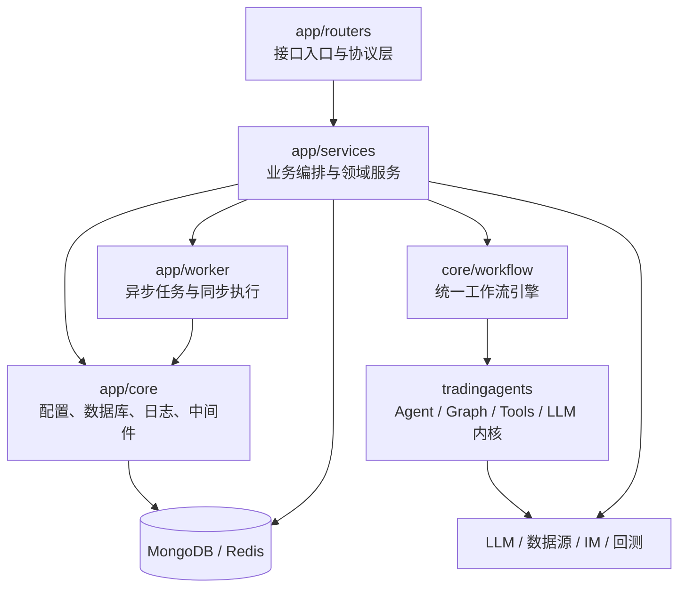

# TradingAgents-CN Pro 后端模块架构说明

> 适用版本：v3.0 主线  
> 更新时间：2026-05-28  
> 说明：本文档用于回答“后端代码该从哪看、每层分别负责什么、目录之间怎样协作”。

## 后端总览

当前后端并不是传统的三层 CRUD 项目，而是“业务平台层 + AI 工作流层 + 同步与任务层 + 基础设施层”的复合结构。

## 目录分层与职责

| 目录 | 角色 | 主要职责 |
| --- | --- | --- |
| `app/routers` | 协议层 | 定义 REST API、参数校验、权限入口、HTTP 响应模型 |
| `app/services` | 业务层 | 聚合业务规则、编排流程、调用数据库、调工作流、发通知 |
| `app/worker` | 后台执行层 | 数据同步、历史回补、独立任务处理、计划任务支持 |
| `app/core` | 基础设施层 | 配置、数据库连接、日志、中间件、权限、启动校验 |
| `core/workflow` | 当前统一工作流层 | 工作流定义、默认工作流提供者、执行引擎 |
| `tradingagents` | AI 内核层 | Agent、Graph、LLM 适配器、Tools、Dataflows |

## 1. `app/routers`：接口入口层

这一层的职责不是“写业务逻辑”，而是：

1. 暴露业务域 API。
2. 解析请求参数。
3. 调用 service。
4. 处理鉴权和响应模型。

### 当前路由域分类

| 路由类别 | 代表文件 | 说明 |
| --- | --- | --- |
| 认证与用户 | `auth_db.py` | 登录、会话、认证相关 |
| 分析与任务 | `analysis.py`、`queue.py`、`unified_tasks.py` | 单股/批量分析、任务查询、任务中心 |
| 筛选与股票 | `screening.py`、`intelligent_screening.py`、`stocks.py`、`stock_data.py` | 股票筛选、自然语言筛选、股票详情、股票数据查询 |
| 自选股与跟踪 | `favorites.py`、`watchlist_groups.py`、`scheduled_analysis.py` | 自选股、分组、定时跟踪配置 |
| 通知与消息 | `notifications.py`、`websocket_notifications.py`、`sse.py`、`internal_messages.py` | 站内通知、实时推送、内部消息 |
| 交易闭环 | `portfolio.py`、`review.py`、`trading_system.py`、`paper.py` | 持仓、复盘、交易计划、模拟交易 |
| 配置与运维 | `config.py`、`system_config.py`、`database.py`、`cache.py`、`logs.py`、`operation_logs.py` | 系统配置、数据库、缓存、日志、操作记录 |
| 数据同步 | `sync.py`、`multi_source_sync.py`、`tushare_init.py`、`akshare_init.py`、`baostock_init.py` | 手动触发同步和初始化 |
| AI 助手与工作流 | `intelligent_assistant.py`、`workflows.py`、`agents.py`、`tools.py`、`workflow_generation.py`、`workflow_growth.py` | 助手、工作流、Agent、工具、能力生长 |
| 提示词与模板 | `prompt_templates.py`、`analysis_preferences.py`、`user_template_configs.py`、`template_history.py`、`templates_debug.py` | 提示词模板、偏好、版本历史、调试 |
| 外部接入 | `gateway.py`、`email.py`、`backtest.py`、`license.py`、`update.py` | IM webhook、邮件、回测、授权、更新 |

### 路由层的边界原则

建议把路由层理解成“薄入口”，它应该：

1. 只做参数和协议转换。
2. 尽量不直接写复杂业务逻辑。
3. 复杂行为应下沉到 `app/services`。

## 2. `app/services`：业务编排层

这是当前项目最重的一层，几乎所有业务真逻辑都在这里。

### 服务层再分组

| 服务类别 | 代表文件 | 说明 |
| --- | --- | --- |
| 分析执行 | `unified_analysis_service.py`、`simple_analysis_service.py`、`analysis_service.py`、`unified_analysis_engine.py` | 统一分析执行、结果组织、兼容历史入口 |
| 助手与能力编排 | `intelligent_assistant_service.py`、`workflow_generation_service.py`、`workflow_growth_service.py`、`agent_workshop_service.py` | 助手多轮对话、工作流生成、技能扩展 |
| 任务与进度 | `queue_service.py`、`thread_worker.py`、`task_analysis_service.py`、`redis_progress_tracker.py` | 任务入队出队、后台消费、进度维护 |
| 通知与渠道 | `notifications_service.py`、`channel_notifier.py`、`websocket_manager.py`、`email_service.py` | 通知落库、站内推送、外部消息发送 |
| 配置与治理 | `config_service.py`、`config_provider.py`、`model_capability_service.py`、`prompt_template_service.py`、`template_history_service.py` | 配置加载、模型能力、提示词模板治理 |
| 股票与数据查询 | `stock_data_service.py`、`quotes_service.py`、`historical_data_service.py`、`financial_data_service.py`、`news_data_service.py` | 对股票、行情、财务、新闻等读写查询做统一封装 |
| 业务闭环 | `portfolio_service.py`、`trade_review_service.py`、`trading_system_service.py`、`favorites_service.py` | 持仓、复盘、交易计划、自选股等业务域 |
| 筛选与指标 | `screening_service.py`、`intelligent_screening_service.py`、`technical_indicator_materialization_service.py` | 筛选、自然语言选股、技术指标物化 |
| 基础资料同步 | `basics_sync_service.py`、`multi_source_basics_sync_service.py`、`official_industry_service.py` | 基础信息同步与标准化 |

### 服务层的主要作用

1. 把路由请求转成可执行的业务动作。
2. 聚合多个数据库读写步骤。
3. 统一调用工作流和 AI 内核，而不是让路由直接碰 `tradingagents`。
4. 屏蔽 Redis、Mongo、外部接口的细节差异。

## 3. `app/worker`：异步任务与同步执行层

`app/worker` 主要负责两类事：

1. 同步上游数据。
2. 在后台执行分析任务。

### worker 子域

| 类别 | 代表文件 | 说明 |
| --- | --- | --- |
| 数据源同步 | `tushare_sync_service.py`、`akshare_sync_service.py`、`baostock_sync_service.py`、`us_sync_service.py`、`hk_sync_service.py` | 不同市场与数据源的同步实现 |
| 初始化任务 | `tushare_init_service.py`、`akshare_init_service.py`、`baostock_init_service.py` | 初次建库和初始化拉取 |
| 历史与多周期 | `unified_historical_sync_service.py`、`multi_period_sync_service.py` | 历史行情、多周期数据处理 |
| 专项任务 | `watchlist_analysis_task.py`、`favorites_sync_task.py`、`news_data_sync_service.py` | 自选股跟踪、新闻同步等专项任务 |
| 分析 worker | `analysis_worker.py`、`worker_app.py`、`__main__.py` | 独立后台任务执行器与启动入口 |

### 当前 worker 运行模式

当前实际上存在两种模式：

1. 默认模式：后端启动时拉起内嵌 `ThreadWorker`，直接消费 Redis 队列。
2. 可选模式：独立启动 `app.worker.worker_app`，把任务执行和 API 进程分离。

因此文档和部署时要分清：

1. “任务处理能力”是必须的。
2. “独立 worker 进程”不是当前默认唯一方案。

## 4. `app/core`：基础设施层

这一层提供项目级公共能力。

### `tradingagents` 子域

| 类别 | 代表文件 | 说明 |
| --- | --- | --- |
| 配置 | `config.py`、`config_bridge.py`、`unified_config.py` | 环境变量、统一配置、向核心库桥接 |
| 数据库 | `database.py`、`redis_client.py` | MongoDB/Redis 生命周期、连接池、健康检查 |
| 启动校验 | `startup_validator.py` | 启动前环境校验 |
| 中间件 | `operation_log_middleware.py` 等 | 操作日志、请求处理相关横切逻辑 |
| 权限与安全 | `permissions.py` | 权限点和边界控制 |
| 日志 | `logging_config.py` | 统一日志初始化 |

### 这一层的设计价值

1. 避免每个 service 自己建连接。
2. 避免配置散落在各模块内部。
3. 把与业务无关但系统必须依赖的公共逻辑收敛到一层。

## 5. `core/workflow`：统一工作流层

这是当前后端和 TradingAgents 内核之间的“适配层”。

它的职责是：

1. 定义工作流模型。
2. 提供默认工作流。
3. 通过 `WorkflowEngine` 统一执行入口。

这层的价值在于：

1. 不让业务层直接耦合到某个单一 graph 实现。
2. 允许“工作流定义”和“执行引擎”演进，而不必全面改业务路由。

## 6. `tradingagents`：AI 内核层

这是系统里最接近“原生多智能体能力”的部分。

### 主要子域

| 子目录 | 角色 |
| --- | --- |
| `agents/` | 各类分析师、研究员、管理者、风险等 Agent 逻辑 |
| `graph/` | 图式分析流程、状态机、协作执行 |
| `tools/` | 工具定义、注册、上下文能力 |
| `llm_adapters/` | 不同模型 / 供应商适配 |
| `dataflows/` | 数据流和数据处理相关抽象 |
| `utils/` | 股票工具、模板客户端、通用辅助函数 |

### 它与 `app/services` 的关系

可以把两者理解为：

1. `app/services` 负责“平台业务为什么要调用 AI”。
2. `tradingagents` 负责“AI 分析在内部怎么协作完成”。

## 常见阅读路径

### 如果要看一个 HTTP 请求怎么走

建议顺序：

1. `app/routers/...`
2. `app/services/...`
3. `app/core/database.py` 或 `app/services/queue_service.py`
4. `core/workflow/...`
5. `tradingagents/...`

### 如果要看一个后台分析任务怎么走

建议顺序：

1. `app/services/queue_service.py`
2. `app/services/thread_worker.py`
3. `app/worker/analysis_worker.py`
4. `app/services/unified_analysis_service.py`
5. `core/workflow/...`
6. `tradingagents/...`

### 如果要看一个数据同步任务怎么走

建议顺序：

1. `app/main.py` 的 scheduler 注册
2. `app/worker/*_sync_service.py`
3. `app/services/*_data_service.py`
4. MongoDB collections 的落库结构

## 当前模块架构的核心特点

1. 路由很多，但大多数只是业务入口，不是主要复杂度来源。
2. 服务层最重，是当前系统的“真实中台”。
3. worker 层负责把高耗时行为从 API 请求中剥离。
4. `core/workflow` 和 `tradingagents` 共同构成 AI 执行内核。
5. `app/core` 保证所有上层都跑在统一配置和统一资源生命周期上。

## 相关文档

1. [当前系统架构](./system-architecture.md)
2. [部署拓扑图](./deployment-topology.md)
3. [当前数据流架构](./data-flow-architecture.md)
