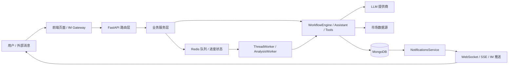
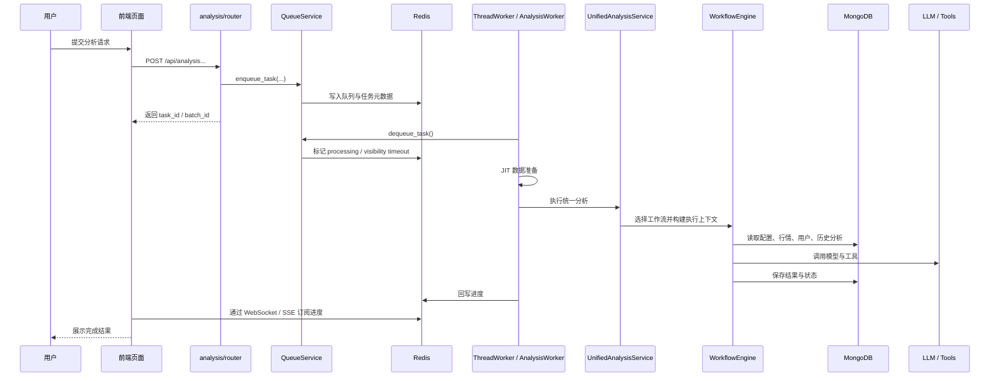
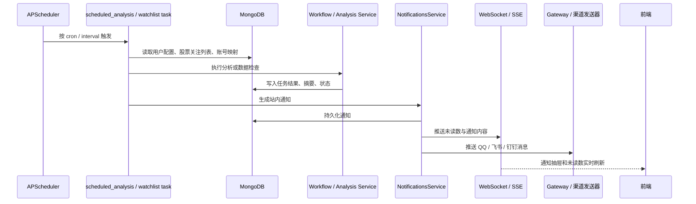
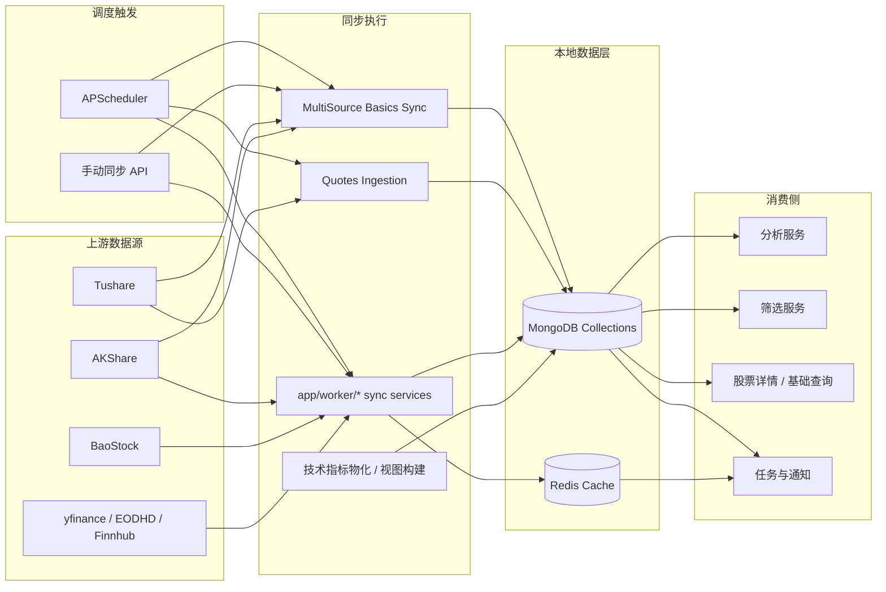
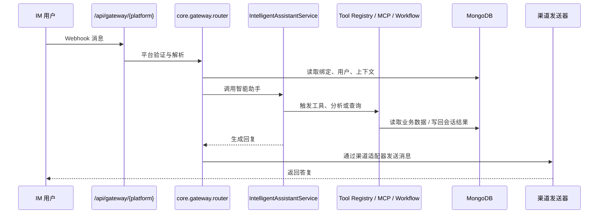

# TradingAgents-CN Pro 数据流架构

> 适用版本：v3.0 主线  
> 更新时间：2026-05-28  
> 说明：本文档聚焦“数据如何流动”，而不是“服务怎么部署”。重点覆盖三条主链路：分析链路、通知链路、数据同步链路，并补充 IM 助手链路。

## 数据流总览

当前系统的数据流可以分成四条主路径：

1. 交互式分析流：用户主动发起分析，任务进入队列，再由分析引擎执行。
2. 定时跟踪与通知流：调度器触发任务，结果转成站内通知和 IM 通知。
3. 数据同步与物化流：上游数据源进入本地数据库，为分析和筛选提供底座。
4. IM 助手对话流：外部聊天消息进入 gateway，再转到智能助手与工具系统。

## 总体数据流图

## 1. 交互式分析流

这条链路覆盖单股分析、批量分析、部分持仓/复盘内嵌分析能力。

关键流转节点：

1. 路由层负责参数校验和任务创建。
2. `QueueService` 负责任务入队、出队、可见性超时和处理状态切换。
3. `ThreadWorker` 或独立 `AnalysisWorker` 负责实际消费任务。
4. `UnifiedAnalysisService` 负责把业务请求转成统一分析执行。
5. `WorkflowEngine` 和 `tradingagents` 内核负责真正的多智能体 / 工具 / 模型调用。

## 2. 定时跟踪与通知流

这条链路覆盖定时分析、股票关注列表跟踪、分析完成后通知、IM 推送等能力。

关键事实：

1. 通知不只是前端行为，服务端会先把通知落库。
2. WebSocket 是当前主要实时通道，SSE 仍作为兼容流保留。
3. IM 推送在通知链路里属于“外部触达层”，不替代站内通知。

## 3. 数据同步与物化流

这条链路负责把外部行情、财务、基础资料、新闻等同步到本地，供分析、筛选和查询复用。

这一层的核心价值是：

1. 把高频分析尽量建立在本地库上，而不是每次都实时打上游接口。
2. 把数据同步与分析消费解耦。
3. 为筛选、股票详情、报告生成、通知系统复用同一份数据底座。

## 4. IM 助手对话流

这条链路解释 QQ/飞书/钉钉消息如何进入系统。

关键点：

1. IM 渠道不是单独的一套业务系统，而是系统已有能力的另一个入口。
2. 助手调用的仍然是统一的工具、工作流和业务数据层。
3. 用户绑定、会话上下文、历史对话主要依赖 MongoDB 中的业务状态。

## 数据分层原则

### 长期事实

长期事实通常进入 MongoDB，包括：

1. 用户和账号信息。
2. 配置、模板、提示词、工作流定义。
3. 股票基础信息、历史行情、财务数据。
4. 任务记录、通知记录、报告、交易计划、复盘。

### 运行时状态

运行时状态优先放 Redis，包括：

1. 队列 ready list。
2. processing / completed / failed 集合。
3. 任务可见性超时控制。
4. 实时进度、短期缓存和部分推送状态。

### 计算中间态

计算中间态通常在分析服务和工作流上下文里短暂存在，包括：

1. 当前分析步骤的上下文变量。
2. 工具调用结果的临时聚合。
3. LLM 消息历史和 prompt assembly 结果。

这类数据是否持久化，取决于业务是否需要审计、复盘或回显。

## 当前数据流的架构特点

1. “先本地库，后实时接口”是主策略，尽量降低上游限流和不稳定性影响。
2. 队列和分析执行是分开的，API 不直接承担长耗时计算。
3. 通知和分析不是同一个前端动作，而是服务端事件驱动链路。
4. 同一条能力链会被 Web 页面、定时任务和 IM 助手重复调用，因此服务层抽象较重。

## 相关文档

1. [当前系统架构](./system-architecture.md)
2. [部署拓扑图](./deployment-topology.md)
3. [后端模块架构](./backend-module-architecture.md)
