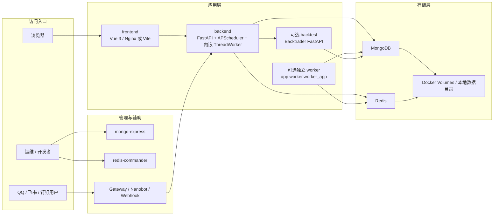
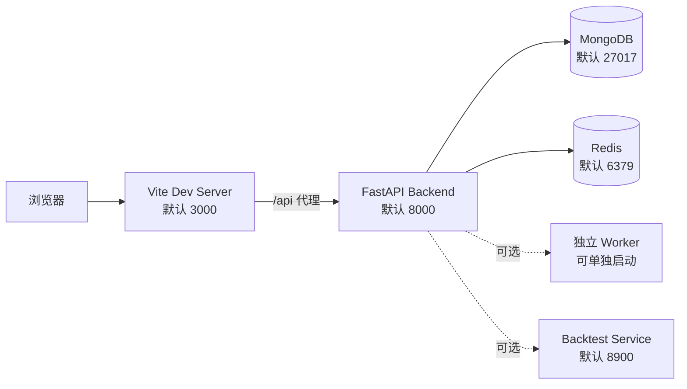
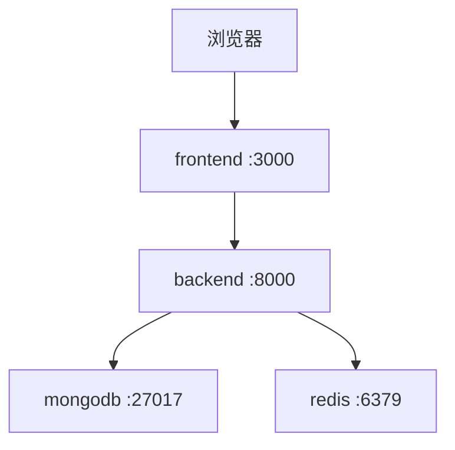
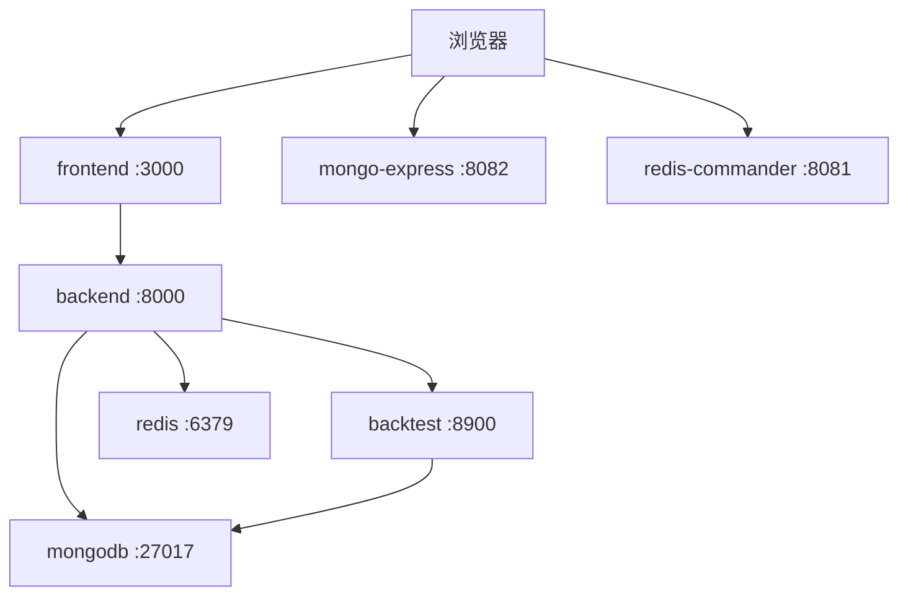

# TradingAgents-CN Pro 部署拓扑图

> 适用版本：v3.0 主线  
> 更新时间：2026-05-28  
> 说明：本文档描述当前项目的部署形态、端口关系、网络边界和运行模式。以 `docker-compose.yml`、`frontend/vite.config.ts`、`app/core/config.py`、`app/worker/worker_app.py` 为主要依据。

## 部署结论

当前项目的部署方式可以概括为三种：

1. 本地开发模式：前端开发服务器 + FastAPI 后端 + 本地或 Docker 的 MongoDB/Redis。
2. 默认容器模式：`backend`、`frontend`、`mongodb`、`redis` 四个主服务组成最小可运行环境。
3. 扩展容器模式：在最小环境上按需加 `backtest`、`mongo-express`、`redis-commander`，以及可选独立 worker。

## 拓扑总图

## 运行模式

### 1. 本地开发模式

该模式最适合开发、联调和问题定位。

特点：

1. 前端开发服务器默认使用 `frontend/vite.config.ts` 中的 `VITE_PORT`，缺省为 `3000`。
2. `/api` 和 WebSocket 会直接代理到本地后端，默认目标是 `http://localhost:8000`。
3. 后端默认监听 `0.0.0.0:8000`，开发脚本通常以 `127.0.0.1:8000` 启动。
4. 默认情况下，后端启动时会在同一生命周期内拉起内嵌 `ThreadWorker`。
5. 如需把后台任务独立出来，可额外启动 `app.worker.worker_app` 作为独立 worker 服务。

### 2. Docker 最小可运行模式

最小可运行环境由四个核心容器组成：

这套拓扑对应的核心事实是：

1. `frontend` 对外暴露 `3000` 端口。
2. `backend` 对外暴露 `8000` 端口。
3. `mongodb` 对外暴露 `27017` 端口。
4. `redis` 对外暴露 `6379` 端口。

### 3. Docker 扩展模式

扩展模式会在最小环境上追加侧车能力：

适用场景：

1. 需要在线查看 MongoDB 数据。
2. 需要查看 Redis Key、队列和实时状态。
3. 需要启用回测链路。

## 默认端口表

| 组件 | 场景 | 默认端口 | 说明 |
| --- | --- | --- | --- |
| 前端 Vite | 本地开发 | 3000 | `frontend/vite.config.ts` 默认值，可通过 `VITE_PORT` 覆盖 |
| 前端 Nginx 容器 | Docker | 3000 | 容器内部 80，对外映射为 3000 |
| FastAPI 后端 | 本地开发 / Docker | 8000 | API 主入口、Swagger、WebSocket、SSE 都挂在这里 |
| 独立 Worker | 可选本地/服务化 | 8001 | `app.worker.worker_app` 的独立服务端口示例 |
| Backtest 服务 | 可选 Docker / 本地 | 8900 | Backtrader 独立服务 |
| MongoDB | 本地开发 / Docker | 27017 | 主业务库 |
| Redis | 本地开发 / Docker | 6379 | 队列、缓存、进度、PubSub |
| redis-commander | Docker 管理 | 8081 | Redis 管理界面 |
| mongo-express | Docker 管理 | 8082 | MongoDB 管理界面 |

## 服务职责边界

### `frontend`

负责：

1. 页面渲染和交互。
2. 调用后端 REST API。
3. 建立 WebSocket 连接接收通知和进度。

不负责：

1. 直接访问数据库。
2. 直接执行分析任务。

### `backend`

负责：

1. 所有 Web API。
2. 鉴权与会话管理。
3. 调度器和默认内嵌 worker。
4. 工作流编排、任务入队、通知分发、配置加载。

### `mongodb`

负责：

1. 用户、配置、任务、报告、通知、计划、复盘等持久化事实。
2. 股票基础信息、历史行情、财务数据等主数据存储。

### `redis`

负责：

1. 队列就绪列表和处理中状态。
2. 任务进度和短期运行时状态。
3. 实时推送相关的 PubSub / 缓存辅助。

### `backtest`

负责：

1. 运行 GPLv3 Backtrader 引擎。
2. 通过 HTTP 与主平台解耦，避免主服务被 GPL 依赖传染。

### 独立 `worker`

负责：

1. 在需要时将分析任务处理能力从 `backend` 进程分离。
2. 独立消费任务并写回状态。

说明：当前主后端已经默认内嵌 `ThreadWorker`。因此独立 worker 更适合作为扩展部署模式，而不是唯一必选组件。

## 网络与数据卷

### 网络

Compose 默认把所有容器放在同一个 bridge 网络 `tradingagents-network` 下，因此：

1. `backend` 可以直接通过容器名访问 `mongodb`、`redis`、`backtest`。
2. 前端只对外暴露 HTTP，不直接访问存储层。
3. 运维管理容器只加入内部网络，不承载主业务逻辑。

### 数据卷

当前最关键的数据持久化位置为：

1. MongoDB volume：`tradingagents_mongodb_data`
2. Redis volume：`tradingagents_redis_data`
3. 后端日志目录：`./logs`
4. 数据目录：`./data`
5. 运行时目录：`./runtime`
6. Qdrant / 向量数据目录：`./data/qdrant`

## 推荐部署理解

如果从运维角度给当前系统做一句话描述，建议写成：

“TradingAgents-CN Pro 当前默认采用前后端分离、单后端主进程承载在线 API 与调度逻辑、MongoDB/Redis 提供状态支撑、回测与管理组件按需侧挂的部署拓扑。”

## 相关文档

1. [当前系统架构](./system-architecture.md)
2. [当前数据流架构](./data-flow-architecture.md)
3. [后端模块架构](./backend-module-architecture.md)
