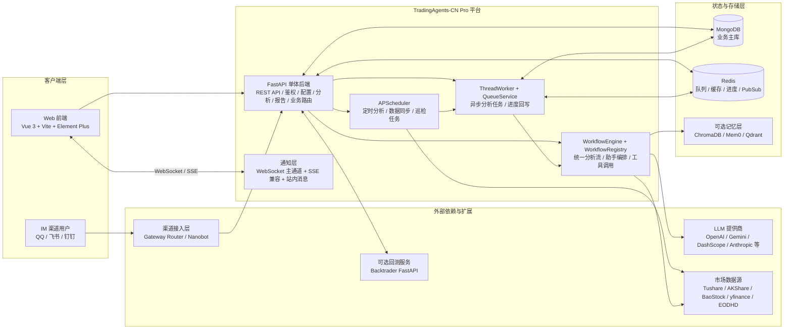
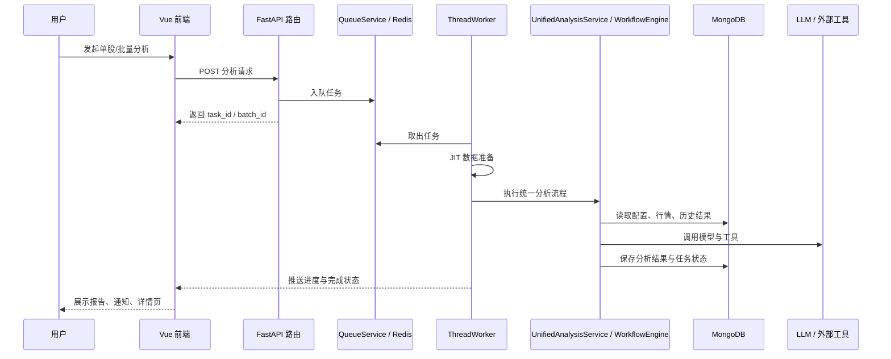
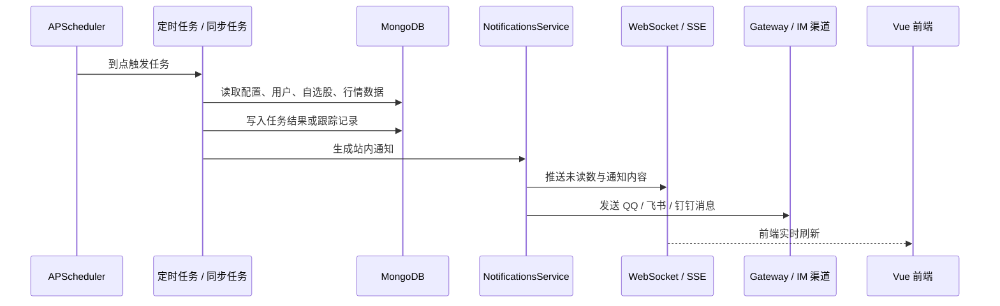
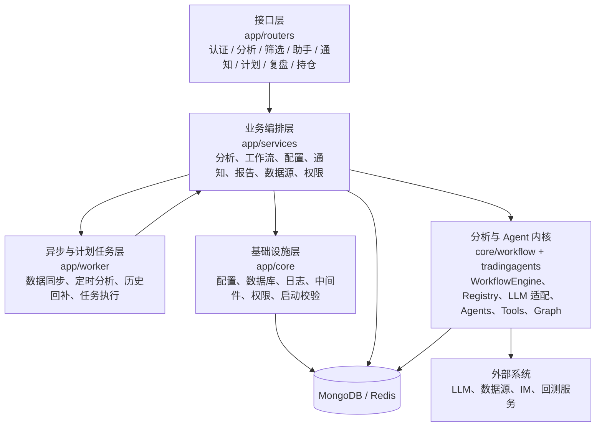

# TradingAgents-CN Pro 当前系统架构与技术框架

> 适用版本：v3.0 主线  
> 更新时间：2026-05-28  
> 口径说明：本文档以项目当前可运行实现为准，主要依据 `app/main.py`、`docker-compose.yml`、`frontend/package.json`、`pyproject.toml` 以及当前目录结构整理；`docs/architecture/v0.1.x/` 下文档仅作为历史参考。

## 一句话结论

TradingAgents-CN Pro 当前是一个“前后端分离 + 模块化单体后端 + 内嵌调度与异步任务处理 + 可选侧车服务”的系统：

1. Web 端使用 Vue 3 单页应用承载主要交互。
2. FastAPI 后端是业务中枢，统一承载鉴权、配置、分析、筛选、通知、计划、复盘、持仓、工作流和提示词治理能力。
3. MongoDB 是业务主存储，Redis 负责队列、缓存、进度、PubSub 等实时状态。
4. 分析执行由统一分析服务、工作流引擎、工具注册表和 TradingAgents 内核共同完成。
5. APScheduler、线程 Worker、数据同步任务目前都嵌在主后端进程内，而不是独立拆成多服务。
6. 回测服务、IM 渠道桥接、管理界面属于可选扩展或侧车组件。

## 架构定位

当前版本不应再按以下旧理解来描述：

1. 不是 Streamlit 单体应用。
2. 不是只有 LangGraph Demo 的研究原型。
3. 不是严格的微服务拆分架构。

更准确的定位是：

1. 一个以 FastAPI 为核心的模块化单体平台。
2. 一个面向“分析、跟踪、通知、复盘、计划、助手”闭环的业务平台。
3. 一个以工作流、工具调用、模型路由、数据同步为核心能力的 AI 研究系统。

## 整体系统架构图

## 关键运行链路

### 1. 交互式分析链路

### 2. 定时跟踪与通知闭环

## 后端分层图

## 技术框架总表

| 层级 | 主要技术 | 当前职责 |
| --- | --- | --- |
| 前端展示层 | Vue 3、TypeScript、Vite、Vue Router、Pinia、Element Plus、Axios、ECharts、Mermaid | 承载 SPA 页面、状态管理、路由跳转、配置界面、任务中心、通知抽屉、图表与 Markdown/流程图展示 |
| API 层 | FastAPI、Uvicorn、Pydantic、SessionMiddleware、CORS Middleware | 提供 REST API、鉴权、配置、业务编排入口、统一错误处理 |
| 业务服务层 | `app/services/*` | 组织分析、筛选、通知、交易计划、复盘、持仓、提示词、能力注册、配置生效等核心业务 |
| 分析执行层 | WorkflowEngine、WorkflowRegistry、DefaultWorkflowProvider、UnifiedAnalysisService | 统一封装单股分析、批量分析、计划分析、助手触发分析等执行入口 |
| Agent / Tool 内核 | LangGraph、TradingAgents 内核、UnifiedLLMClient、自定义 Tool Registry、MCP | 承载多智能体协作、工具调用、模型路由、工作流节点执行 |
| 数据存储层 | MongoDB、Motor、PyMongo | 保存用户、任务、报告、配置、股票基础信息、行情、通知、计划、复盘等主业务数据 |
| 缓存与实时状态层 | Redis | 任务队列、任务进度、PubSub、缓存、并发控制 |
| 调度与异步层 | APScheduler、asyncio、ThreadWorker、QueueService | 承载定时任务、数据同步、异步分析执行、进度推送 |
| 外部数据层 | Tushare、AKShare、BaoStock、yfinance、EODHD、Finnhub | 提供 A 股、港股、美股、ETF、新闻、财务、行情等上游数据 |
| 通知与渠道层 | WebSocket、SSE、Gateway Router、Nanobot | 负责站内通知、实时进度流、IM 消息推送与 webhook 接入 |
| 报告与导出层 | Markdown、python-docx、pypandoc、weasyprint、pdfkit | 输出分析报告、导出 Word/PDF/Markdown |
| 可选扩展层 | Backtrader 独立回测服务、Mem0、ChromaDB、Qdrant | 回测、长期记忆、向量检索等扩展能力 |
| 部署与运维 | Docker、Docker Compose、多架构镜像、Mongo Express、Redis Commander | 本地开发、容器化部署、管理面板、跨平台交付 |

## 目录与职责映射

| 目录 | 角色 |
| --- | --- |
| `frontend/` | Vue 3 前端应用，负责页面、路由、状态和用户交互 |
| `app/routers/` | FastAPI 接口入口，按业务域拆分 API |
| `app/services/` | 后端业务编排与领域服务，是主业务逻辑聚合层 |
| `app/worker/` | 定时任务、数据同步、异步执行相关实现 |
| `app/core/` | 配置、数据库连接、日志、中间件、权限等基础设施 |
| `tradingagents/` | TradingAgents 原生能力与扩展内核，包括 agents、graph、tools、llm adapters |
| `core/workflow/` | 当前统一工作流引擎与定义模型 |
| `backtest-service/` | 可选独立回测服务，通过 HTTP 与主平台通信 |
| `nanobot/` | 外部机器人桥接与相关 Web UI / bridge 能力 |
| `docs/` | 产品、架构、设计、部署、验收、变更等文档 |

## 配套文档

如果需要按主题继续深入，建议配合以下文档阅读：

1. [部署拓扑图](./deployment-topology.md)：看端口、容器、网络、数据卷和运行模式。
2. [当前数据流架构](./data-flow-architecture.md)：看分析、通知、同步、IM 助手四条主链路。
3. [后端模块架构](./backend-module-architecture.md)：看 `app/routers`、`app/services`、`app/worker`、`tradingagents` 的边界。

## 当前部署形态

### 1. 本地开发形态

最常见的开发方式是：

1. 前端以 Vite Dev Server 运行。
2. 后端以 Uvicorn/FastAPI 运行。
3. MongoDB、Redis 作为本地或 Docker 依赖启动。
4. 调度器和 ThreadWorker 跟随后端一起启动。
5. 如需回测，再额外启动 `backtest-service/`。

### 2. Docker 部署形态

主 Compose 编排的核心服务为：

1. `backend`
2. `frontend`
3. `mongodb`
4. `redis`

可选服务为：

1. `backtest`
2. `redis-commander`
3. `mongo-express`

这意味着项目本体仍然是“一个后端主服务 + 一个前端主服务 + 两个基础存储 + 若干可选侧车”的部署模型。

## 关键架构特征

### 1. 模块化单体优先

虽然功能很多，但当前大部分业务能力都仍聚合在一个 FastAPI 应用中，优点是：

1. 开发调试成本低。
2. 配置、权限、用户上下文更容易统一。
3. 工作流和通知链路更容易保持一致。

代价是：

1. `app/main.py` 路由装配和启动逻辑较重。
2. 调度、异步任务、业务 API 共享同一进程，运维边界不够清晰。
3. 后续若继续扩容，需要更明确地区分“在线请求链路”和“后台执行链路”。

### 2. 数据驱动 + 工作流驱动并存

系统不是纯 CRUD 平台，也不是纯 Agent 实验环境，而是两类架构并存：

1. 一类是典型业务系统能力：用户、通知、自选股、持仓、复盘、计划、配置。
2. 一类是 AI 工作流能力：统一分析、助手编排、工作流生成、技能扩展、提示词治理。

这也是为什么后端目录同时存在 `app/services/*` 和 `tradingagents/*` 两套明显不同的能力层。

### 3. 主数据在 MongoDB，实时状态在 Redis

这是当前架构最关键的状态划分：

1. MongoDB 负责持久化业务事实。
2. Redis 负责高频、短生命周期、可恢复的运行时状态。
3. 前端通知和任务中心看到的很多“实时感”，本质上来自 Redis + WebSocket/SSE 的组合。

### 4. Worker 目前是“内嵌式”而不是“独立式”

当前 Worker 并不是独立部署进程优先，而是由后端启动时在同一应用生命周期里拉起。这一设计意味着：

1. 部署简单。
2. 本地联调容易。
3. 但在高负载或长任务场景下，后端 API 与后台任务会共享同一运行资源池。

## 推荐的阅读顺序

如果要快速理解当前系统，建议按以下顺序阅读代码：

1. `app/main.py`：看系统启动、调度、路由装配。
2. `app/services/unified_analysis_service.py`：看统一分析入口。
3. `app/services/intelligent_assistant_service.py`：看助手编排与工具调用。
4. `app/services/thread_worker.py`：看异步任务执行链路。
5. `tradingagents/`：看 Agent、Graph、Tools、LLM 适配内核。

## 历史文档说明

以下文档仍有参考价值，但不应直接当作当前运行架构的唯一依据：

1. `docs/architecture/v0.1.16/system-architecture.md`
2. `docs/architecture/v0.1.13/agent-architecture.md`
3. `docs/architecture/v0.1.13/data-flow-architecture.md`
4. `docs/architecture/v0.1.13/graph-structure.md`

这些文档更适合回答“项目最初怎么设计”的问题；而本文档用于回答“项目现在实际上怎样运行”。
