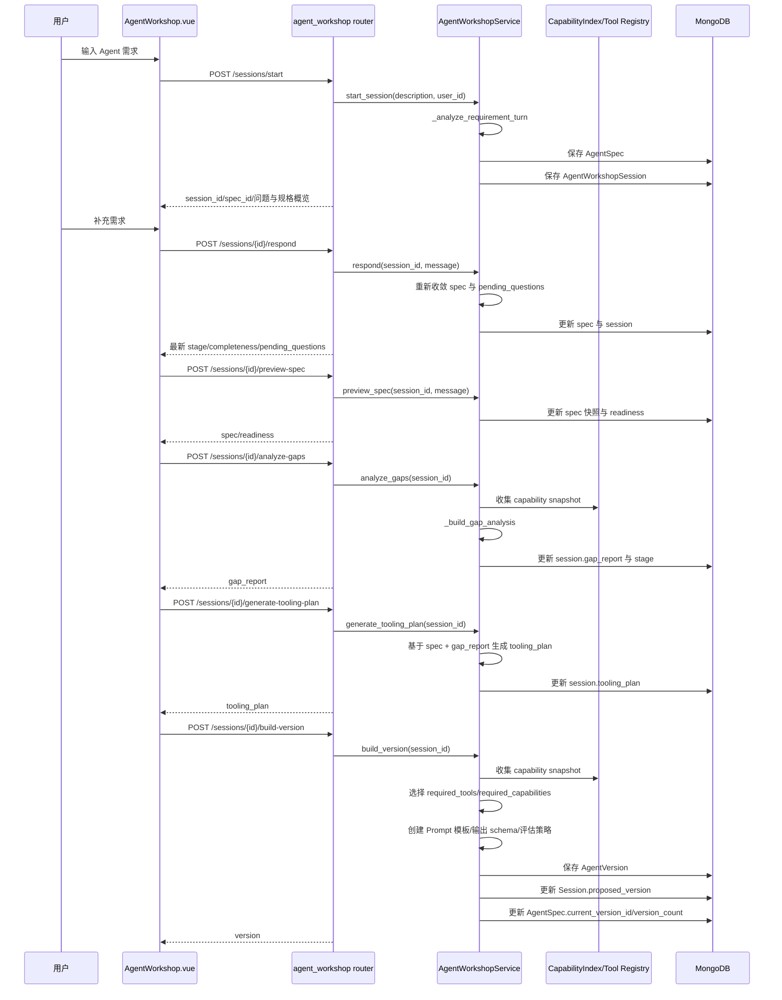
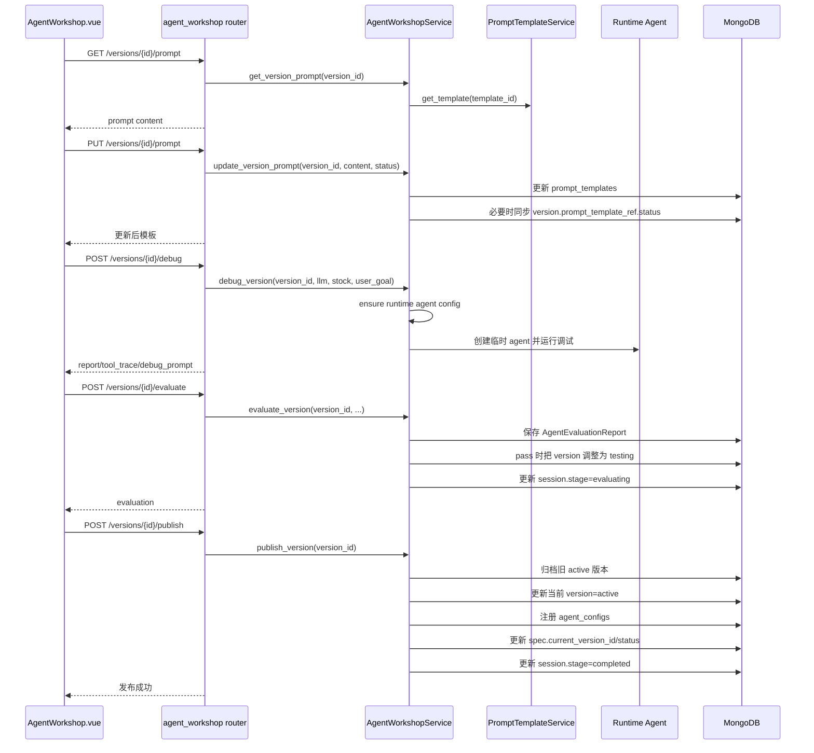

# TradingAgents-CN v3.0 - Agent 工坊接口与时序说明

> 更新时间：2026-04-01
>
> 本文档面向开发与维护，补充说明 Agent 工坊当前前后端交互、后端服务调用顺序、核心接口契约与持久化对象关系。产品目标与设计原则请优先参考主设计文档。

## 1. 文档范围

本文档回答四个工程问题：

1. 前端五步工作台分别调用哪些接口。
2. 后端在每一步会读写哪些对象。
3. 会话、规格、版本、评估之间如何串联。
4. 调试、迭代、发布这些后置动作如何回到主链路。

本文档基于当前实现整理，主要对应以下代码：

- 后端路由：app/routers/agent_workshop.py
- 后端服务：app/services/agent_workshop_service.py
- 前端 API：frontend/src/api/agentWorkshop.ts
- 前端工作台：frontend/src/views/Workflow/AgentWorkshop.vue
- 前端管理页：frontend/src/views/Workflow/AgentWorkshopManager.vue

## 2. 运行角色与核心对象

### 2.1 前端角色

- 管理页：负责会话、规格、版本列表与进入工作台。
- 工作台：围绕单个 spec/session 完成讨论、确认、缺口、构建、评估与迭代。

### 2.2 后端核心对象

| 对象 | 作用 | 主要持久化位置 |
| --- | --- | --- |
| AgentWorkshopSession | 记录一次需求澄清到版本构建的过程态 | agent_workshop_sessions |
| AgentSpec | 记录稳定的产品规格定义 | agent_specs |
| AgentVersion | 记录某个 Spec 的可运行版本草案或正式版本 | agent_versions |
| AgentEvaluationReport | 记录评估结果与建议 | agent_evaluations |
| Prompt Template | 记录版本对应的六段式提示词模板 | prompt_templates |
| Runtime Agent Config | 记录发布后可被工作流调度的运行时配置 | agent_configs |

### 2.3 关键关系

- 一个 AgentSpec 可以关联多次 AgentWorkshopSession。
- 一个 AgentSpec 可以生成多个 AgentVersion。
- 一个 AgentVersion 可以对应多次 AgentEvaluationReport。
- 一个 AgentVersion 持有一个 prompt_template_ref，用于调试与发布前审阅。
- 发布动作会把 AgentVersion 同步注册到 agent_configs，供运行时调度。

## 3. 前端步骤到后端接口的映射

| 前端步骤 | 典型入口动作 | 后端接口 | 核心返回 |
| --- | --- | --- | --- |
| 聊需求 | 新建会话 | POST /api/agent-workshop/sessions/start | session_id、spec_id、ai_message、spec_overview |
| 聊需求 | 继续追问/补充 | POST /api/agent-workshop/sessions/{session_id}/respond | 最新 pending_questions、completeness_score、spec_overview |
| 看规格 | 刷新规格/确认规格 | POST /api/agent-workshop/sessions/{session_id}/preview-spec | spec、readiness、pending_questions |
| 查缺口 | 分析能力缺口 | POST /api/agent-workshop/sessions/{session_id}/analyze-gaps | gap_report |
| 查缺口 | 生成工具需求草案 | POST /api/agent-workshop/sessions/{session_id}/generate-tooling-plan | tooling_plan |
| 生成版本 | 构建版本草案 | POST /api/agent-workshop/sessions/{session_id}/build-version | version |
| 生成版本 | 查看 Prompt | GET /api/agent-workshop/versions/{version_id}/prompt | prompt content、status、version |
| 生成版本 | 修改 Prompt | PUT /api/agent-workshop/versions/{version_id}/prompt | 更新后的模板内容 |
| 评估迭代 | 调试版本 | POST /api/agent-workshop/versions/{version_id}/debug | report、tool_trace、debug_prompt |
| 评估迭代 | 评估版本 | POST /api/agent-workshop/versions/{version_id}/evaluate | evaluation |
| 评估迭代 | 发起迭代 | POST /api/agent-workshop/versions/{version_id}/iterate | 新 session_id、新 ai_message |
| 评估迭代 | 发布版本 | POST /api/agent-workshop/versions/{version_id}/publish | active 状态确认 |

除此之外，管理页和工作台还会使用以下读取接口：

- GET /api/agent-workshop/sessions
- GET /api/agent-workshop/sessions/{session_id}
- GET /api/agent-workshop/specs
- GET /api/agent-workshop/specs/{spec_id}
- GET /api/agent-workshop/specs/{spec_id}/sample-sets
- GET /api/agent-workshop/versions
- GET /api/agent-workshop/versions/{version_id}
- GET /api/agent-workshop/versions/{version_id}/evaluations
- GET /api/agent-workshop/capability-snapshot

## 4. 主链路时序

### 4.1 从需求到版本草案

### 4.2 从调试到发布

## 5. 后端状态流转

### 5.1 Session.stage

当前会话阶段使用较粗粒度状态：

- gathering：需求仍在收集，问题未澄清完。
- planning：规格基本成型，可进入确认或构建前检查。
- gap-analysis：已经完成缺口分析。
- building：已经生成版本草案。
- evaluating：已经产生评估记录，处于调试/评估阶段。
- completed：已有版本正式发布。

几个关键触发点如下：

| 触发动作 | 典型结果 |
| --- | --- |
| start_session/respond | 根据 feasibility_status 和 completeness_score 推断 gathering 或 planning |
| preview_spec | 刷新 spec 快照，并重新计算 readiness |
| analyze_gaps | 强制进入 gap-analysis |
| build_version | 进入 building |
| evaluate_version | 进入 evaluating |
| publish_version | 进入 completed |

### 5.2 Version.status

当前版本状态流转更直接：

- draft：build_version 初始产物。
- testing：评估通过后可进入测试态。
- active：publish_version 后成为正式启用版本。
- archived：同 spec 下旧 active 版本在新版本发布时被归档。

## 6. 关键接口契约说明

### 6.1 需求澄清类接口

需求澄清相关返回都带有同一组控制字段：

- stage
- completeness_score
- feasibility_status
- refusal_reason
- pending_questions

这组字段的职责是把“还能不能继续推进”和“还差什么信息”显式反馈给前端，而不是让前端从自然语言消息中自行推断。

### 6.2 规格预览接口

preview-spec 返回的是完整 spec 与 readiness，而不是只返回一段确认话术。这样前端可以把规格确认区从聊天区剥离出来，单独展示结构化字段。

### 6.3 缺口分析与工具草案接口

gap_report 与 tooling_plan 已经拆分为两层对象：

- gap_report 关注“缺什么”。
- tooling_plan 关注“准备怎么补”。

这也是当前实现相对旧设计的关键变化，因为工具草案已经成为可单独失败、可单独展示、可单独复跑的步骤。

### 6.4 Prompt 读写接口

Prompt 相关接口只允许修改未发布版本：

- active 版本禁止修改提示词。
- archived 版本禁止修改提示词。
- 没有关联模板的版本不能直接进入 Prompt 编辑。

这样可以保证工作台只调整草案或测试中的版本，不会直接破坏线上已启用模板。

### 6.5 调试接口

debug_version 的入参分三块：

- llm：模型、provider、temperature、max_tokens、可选 backend_url/api_key
- stock：symbol、market_type、analysis_date
- user_goal 与 prompt_overrides：调试目标与临时覆盖项

返回里除了报告文本，还包含 debug_prompt 与 tool_trace，便于对 Prompt 和工具链做针对性诊断。

## 7. 持久化写入点

| 动作 | 主要写入 |
| --- | --- |
| start_session | agent_specs、agent_workshop_sessions |
| respond | agent_specs、agent_workshop_sessions |
| preview_spec | agent_specs、agent_workshop_sessions |
| analyze_gaps | agent_workshop_sessions.gap_report |
| generate_tooling_plan | agent_workshop_sessions.tooling_plan |
| build_version | agent_versions、agent_workshop_sessions.proposed_version、agent_specs.current_version_id/version_count |
| update_version_prompt | prompt_templates，必要时同步 agent_versions.prompt_template_ref.status |
| evaluate_version | agent_evaluations，必要时更新 agent_versions.status 与 session.stage |
| publish_version | agent_versions、agent_specs、agent_configs、session.stage |
| iterate_version | 新建 agent_specs 快照与新 session |

## 8. 观测与排障入口

### 8.1 LLM 过程日志

Agent 工坊当前单独写一份完整 LLM 轨迹日志：

- logs/agent_workshop_llm_full.log

这份日志会记录：

- 请求阶段的 system_prompt 与 user_prompt
- 原始 raw_response
- 阶段名与上下文元数据

它与普通应用日志分离，便于排查规格澄清、缺口分析和工具草案生成的问题。

### 8.2 前端定位建议

当前排查顺序建议固定为：

1. 先看工作台当前所处步骤是否与 session.stage 一致。
2. 再看接口返回中的 feasibility_status、pending_questions、readiness。
3. 再看 logs/agent_workshop_llm_full.log 中对应阶段的原始输入输出。
4. 如果问题发生在版本调试，再看 debug_version 返回里的 debug_prompt 与 tool_trace。

## 9. 当前边界与未完成项

以下能力仍未形成完整闭环，应视为当前接口文档中的边界，而不是遗漏：

- benchmark 样本基准评估入口目前仍禁用，评估主路径以 sandbox 或 production-review 为主。
- 工具需求草案和 Skill 工坊之间尚未做自动提单或自动回填。
- 发布链路已经能注册 agent_configs，但审批、灰度、回滚策略仍未纳入 Agent 工坊自身。
- 运行期反馈回流到下一轮规格优化，当前仍主要通过 iterate_version 人工触发。

## 10. 维护建议

后续只要出现下面任一变更，就应同步更新本文档：

1. 前端步骤名或步骤顺序变化。
2. 路由接口路径、请求体、返回体变化。
3. Session.stage 或 Version.status 语义变化。
4. Prompt 模板结构、调试返回结构或发布注册路径变化。
5. 持久化对象之间新增引用关系。