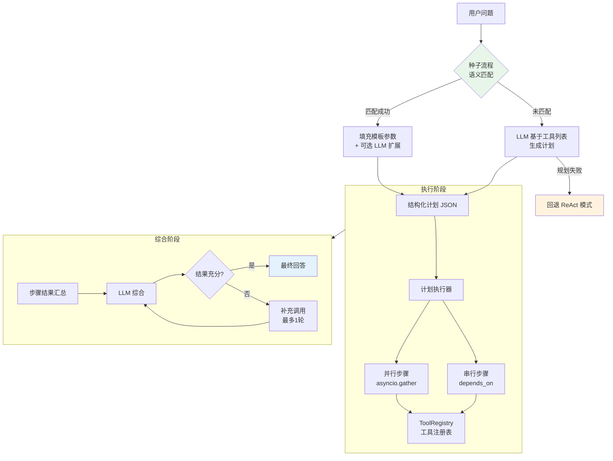
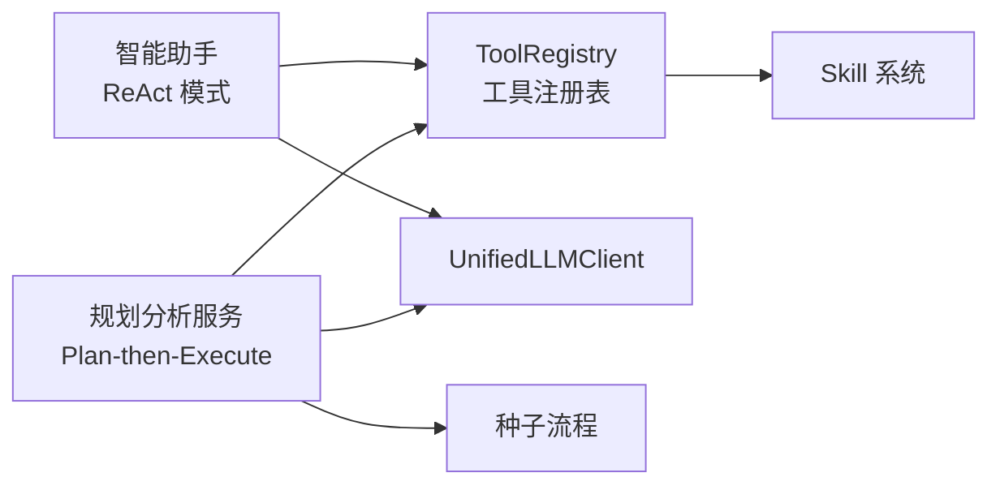

# Agent 自主规划分析设计

## 文档信息

| 项目 | 内容 |
|------|------|
| 版本 | v2.0 |
| 状态 | 设计文档（已优化） |
| 日期 | 2026-02-13 |
| 目录 | docs/design/v2.3 |

在现有智能助手 ReAct 模式基础上，新增「规划优先」分析模式。与 OpenClaw 等通用 Agent 不同，本方案面向**垂直金融分析领域**，强调**确定性保底**和**合规约束**，采用「种子流程 + LLM 规划 + ReAct 回退」三级保障机制。

---

## 一、现状与目标

### 当前实现（ReAct 模式）

- 位置：`app/services/intelligent_assistant_service.py`、`core/llm/unified_client.py`
- 流程：用户问题 → LLM（带 tools）→ 每轮决策调用哪个工具 → 执行 → 结果回传 LLM → 循环直至生成最终回答
- 特点：工具选择是**逐轮反应式**的，无显式规划；最多 8 轮工具调用，120s 超时

### 目标（Plan-then-Execute）

- 流程：用户问题 → **规划阶段**（匹配种子流程或 LLM 规划）→ **执行阶段**（按计划执行工具，可并行）→ **综合阶段**（基于结果生成回答，可有限补充）
- 特点：先规划再执行，计划可审计，常见场景有确定性保底

### 与通用 Agent（OpenClaw）的关键区别

| 维度 | OpenClaw（通用 Agent） | TradingAgents-CN（本系统） |
|------|----------------------|--------------------------|
| **领域** | 通用，什么都做 | 垂直，股票分析 |
| **容错** | 结果不好可以重来 | 结果不能出错，涉及投资决策 |
| **确定性** | 探索式，结果随机性高 | 需要保底，常见场景必须稳定 |
| **合规** | 无限制 | 严格合规（不能给买卖建议等） |
| **工具** | Agent 自己写代码造工具 | 预定义的、经过验证的工具集 |

**核心设计原则**：保留种子流程作为确定性保底机制，在此基础上用 LLM 提供弹性扩展能力。

---

## 二、架构设计



**SSE 进度事件流**（贯穿全流程）：

```
→ plan_started      规划开始
→ seed_matched      种子流程匹配结果
→ plan_generated    计划生成完成
→ step_started      步骤 N 开始执行
→ step_completed    步骤 N 执行完成
→ synthesizing      开始综合
→ supplement_needed 需要补充（可选）
→ reply_chunk       回答流式输出
→ completed         全部完成
```

---

## 三、三级保障机制

本系统的核心竞争力在于**确定性保底**。通过三级保障机制，确保常见场景 100% 有可靠输出：

### 第一级：种子流程匹配（最可靠）

```
用户问题 → LLM 语义匹配种子流程 → 匹配成功 → 使用预定义步骤执行
```

- **确定性**：最高。工具调用和参数模板都经过预定义和验证
- **适用**：常见分析场景（财报查询、个股速览、板块对比等）
- **优点**：结果可预测，不依赖 LLM 规划能力

### 第二级：LLM 自主规划（较可靠）

```
用户问题 → 种子流程未匹配 → LLM 基于工具列表生成计划 → 执行计划
```

- **确定性**：较高。受限于已注册的工具集，LLM 只能选择已验证的工具
- **适用**：不常见但可分析的场景（跨板块分析、事件影响等）
- **约束**：计划必须精确到 `tool` + `args`，不允许模糊意图

### 第三级：ReAct 回退（保底）

```
用户问题 → 规划失败（JSON 解析错误 / 工具不存在等） → 回退到现有 ReAct 模式
```

- **确定性**：一般。与现有智能助手一致
- **适用**：规划阶段异常时的兜底
- **保证**：至少不会白屏，用户总能得到回答

### 最终保底

```
全部失败 → 返回明确的错误信息 + 建议
"抱歉，暂时无法分析该问题。建议您尝试更具体的提问，例如..."
```

---

## 四、种子流程（Seed Flows）设计

### 4.1 核心思路

预定义若干**种子流程**作为可靠的分析模板。与旧版 `trigger_keywords` 关键词匹配不同，采用 **LLM 语义匹配**选择种子流程，解决关键词脆弱性问题。

### 4.2 匹配方式：LLM 语义匹配（替代关键词匹配）

**旧方案（已废弃）**：

```python
# ❌ 关键词匹配太脆弱
"trigger_keywords": ["财报", "年报", "披露"]
# 用户说 "BYD 的报表什么时候公布" → 匹配不到
```

**新方案：LLM 语义匹配**

```python
SEED_MATCH_PROMPT = """你是分析规划器。以下是可用的分析模板：

1. earnings_disclosure_date: 查询某公司历年财报披露时间，推断当年年报大致披露窗口
2. stock_overview: 个股综合速览，获取基本面、行情、新闻等综合信息
3. sector_screening: 板块内股票筛选和对比
4. event_impact: 特定事件对相关股票/板块的影响分析
5. peer_comparison: 同行业公司对比分析

用户问题：{question}

请选择最匹配的模板编号（1-5），如果都不匹配返回 "none"。
只返回编号或 "none"，不要解释。"""
```

**匹配效果对比**：

- "BYD 的报表什么时候公布" → 匹配到 `earnings_disclosure_date` ✅
- "茅台和五粮液比一比" → 匹配到 `peer_comparison` ✅
- "降准对银行股有什么影响" → 匹配到 `event_impact` ✅
- "帮我写一首诗" → 返回 `none` ✅

### 4.3 种子流程格式

```json
{
  "id": "earnings_disclosure_date",
  "name": "财报披露时间查询",
  "description": "查询某公司历年财报披露时间，推断当年年报大致披露窗口",
  "steps": [
    {
      "tool": "get_stock_fundamentals_unified",
      "args_template": {"ticker": "{ticker}", "curr_date": "{curr_date}"},
      "intent": "获取财务数据，查看报告期与披露信息",
      "depends_on": []
    },
    {
      "tool": "get_stock_news_unified",
      "args_template": {"ticker": "{ticker}", "curr_date": "{curr_date}"},
      "intent": "查询财报预约披露公告",
      "depends_on": []
    }
  ],
  "extensible": true
}
```

变更说明：

- ❌ 移除 `trigger_keywords`（改用 LLM 语义匹配）
- ✅ 新增 `intent` 字段（帮助综合阶段理解每步目的，替代原 `reason`）
- ✅ 保留 `tool` + `args_template`（确保执行确定性）
- ✅ 保留 `extensible`（允许 LLM 追加步骤）

### 4.4 内置种子流程

| id | name | 典型场景 |
| --- | --- | --- |
| earnings_disclosure_date | 财报披露时间查询 | "比亚迪2025年年报何时出" |
| stock_overview | 个股综合速览 | "茅台基本面怎么样" |
| sector_screening | 板块选股 | "白酒板块里哪几只值得关注" |
| event_impact | 事件影响分析 | "降准对银行股有什么影响" |
| peer_comparison | 同业对比 | "隆基和通威哪个好" |

### 4.5 存储与扩展

- **一期**：代码内嵌 `core/agents/seed_flows.py`，类似 `BUILTIN_TOOLS`
- **二期**：迁移至 MongoDB `analysis_flow_templates` 集合，支持界面配置和用户自定义

---

## 五、计划格式定义

```json
{
  "question": "比亚迪2025年财报何时发布？",
  "template_id": "earnings_disclosure_date",
  "steps": [
    {
      "id": 1,
      "tool": "get_stock_fundamentals_unified",
      "args": {"ticker": "002594", "curr_date": "2026-02-13"},
      "intent": "获取比亚迪基本面，查找历年财报披露时间",
      "depends_on": []
    },
    {
      "id": 2,
      "tool": "get_stock_news_unified",
      "args": {"ticker": "002594", "curr_date": "2026-02-13"},
      "intent": "查询是否有财报预约披露公告",
      "depends_on": []
    }
  ]
}
```

字段说明：

- `template_id`：可选，标识来源于哪个种子流程（第一级）；LLM 自主规划时（第二级）为 `null`
- `tool` + `args`：**精确到工具名和参数**，确保执行确定性
- `intent`：**新增**，描述该步骤的意图，帮助综合阶段理解语义（替代旧版 `reason`）
- `depends_on` 为空：可与其他无依赖步骤并行执行（`asyncio.gather`）
- `depends_on: [1]`：需等待步骤 1 完成

---

## 六、实现方案

### 6.1 模块划分

| 文件 | 职责 |
| --- | --- |
| `core/agents/seed_flows.py` | 种子流程定义：内置分析模板 |
| `core/agents/planner.py` | 规划逻辑：LLM 语义匹配种子流程、LLM 自主规划、计划生成 |
| `core/agents/plan_executor.py` | 执行逻辑：DAG 调度步骤（串行/并行）、收集结果 |
| `app/services/planned_analysis_service.py` | 服务层：编排 规划→执行→综合 全流程，SSE 进度推送 |

### 6.2 规划阶段（Planner）

**输入**：用户问题、会话历史（最近 N 条）、当前日期、种子流程列表、可用工具列表

**流程**：

```text
1. LLM 语义匹配：将所有种子流程的 description 列表 + 用户问题发给 LLM
   → 返回匹配的 template_id 或 "none"

2a. 若匹配成功（第一级）：
    → 填充 {ticker}、{curr_date} 等占位符
    → 若 extensible=true，让 LLM 决定是否追加 1-2 个步骤
    → 生成 AnalysisPlan

2b. 若未匹配（第二级）：
    → 传入工具列表（name + description + when_to_use + parameters）
    → 让 LLM 生成完整计划（精确到 tool + args）
    → 解析并验证 JSON

2c. 若规划失败（第三级）：
    → JSON 解析错误 / 工具名不存在 / 超时
    → 回退到 ReAct 模式（复用现有 IntelligentAssistantService.chat()）
```

**输出**：`AnalysisPlan` 对象（Pydantic 模型）

### 6.3 执行阶段（PlanExecutor）

- **依赖**：复用 `core/tools/registry.py`、`core/llm/tool_normalizer.py`
- **调度**：按 `depends_on` 构建 DAG，无依赖步骤用 `asyncio.gather` 并行执行
- **参数注入**：从系统上下文注入 `curr_date`、`trade_date`（若步骤未显式传入）
- **超时**：单步骤超时 60s，整体执行超时 120s
- **SSE**：每个步骤开始/完成时推送进度事件

### 6.4 综合阶段（含有限补充）

- **输入**：用户问题、计划（含 intent）、各步骤结果
- **Prompt**：将计划与结果整理为上下文，要求 LLM 综合生成回答
- **补充机制**（新增）：

```text
综合 LLM 判断结果是否充分
  → 充分：直接输出最终回答
  → 不足：指定补充 1-2 个工具调用（最多 1 轮）
            → 执行补充调用
            → 再次综合
            → 输出最终回答（不再补充）
```

- **输出**：与现有 ChatResponse 一致（`reply`、`tools_used`、`plan`）

### 6.5 会话上下文注入

支持追问场景（如 "帮我分析茅台" → "再看看它的财报"），通过注入历史上下文：

```python
# 从 assistant_conversations 集合获取最近 N 条消息
recent_messages = await db.assistant_conversations.find(
    {"conversation_id": conversation_id}
).sort("created_at", -1).limit(5).to_list()

# 注入到 Planner 的 messages 中
messages = [
    Message(role=MessageRole.SYSTEM, content=planner_system_prompt),
    *[Message(role=m["role"], content=m["content"]) for m in recent_messages],
    Message(role=MessageRole.USER, content=user_question),
]
```

### 6.6 共享层设计

规划分析服务与现有 ReAct 助手**独立但共享底层能力**：

```python
# ✅ 共享（不重复实现）
from app.services.intelligent_assistant_service import (
    _get_assistant_llm_config,  # LLM 配置获取
    _get_system_prompt,         # 基础 system prompt（合规要求、日期等）
    _get_latest_trade_date,     # 交易日计算
)
from core.tools import get_tool_registry, tool_metadata_list_to_openai

# ✅ 独立（隔离规划复杂度）
class PlannedAnalysisService:
    """规划分析服务 - 独立于 ReAct 助手"""

    async def analyze(self, question: str, conversation_id: str = None):
        # 1. 规划
        plan = await self._plan(question, conversation_id)
        # 2. 执行
        results = await self._execute(plan)
        # 3. 综合（含有限补充）
        answer = await self._synthesize(question, plan, results)
        return answer
```

---

## 七、API 设计

### SSE 流式接口（推荐）

```text
GET /api/assistant/planned-analysis/stream?message=用户问题&conversation_id=xxx

SSE 事件流:

event: plan_started
data: {"message": "正在分析您的问题..."}

event: seed_matched
data: {"template_id": "stock_overview", "template_name": "个股综合速览"}

event: plan_generated
data: {"plan": {"steps": [...]}, "total_steps": 3}

event: step_started
data: {"step_id": 1, "tool": "get_stock_fundamentals_unified", "intent": "获取基本面数据"}

event: step_completed
data: {"step_id": 1, "success": true, "duration_ms": 2300}

event: synthesizing
data: {"message": "正在综合分析结果..."}

event: reply_chunk
data: {"content": "根据数据分析..."}

event: completed
data: {"reply": "完整回答", "tools_used": [...], "plan": {...}}
```

### 同步接口（兼容）

```text
POST /api/assistant/planned-analysis
  body: { "message": "用户问题", "conversation_id": "xxx" }
  response: { "reply": "...", "plan": {...}, "tools_used": [...] }
```

---

## 八、与现有模块的关系



| 模块 | 角色 |
| --- | --- |
| 智能助手（ReAct） | 保留，用于轻量快速问答；同时作为规划失败的第三级回退 |
| 规划分析（新增） | 用于需多步、可并行的深度分析任务 |
| ToolRegistry | 共享，提供工具发现和执行能力 |
| UnifiedLLMClient | 共享，提供 LLM 调用能力 |
| Skill 系统 | 共享，Skill 自动注册到 ToolRegistry，规划分析可直接使用 |
| 种子流程 | 新增，提供确定性分析模板 |

---

## 九、开发步骤

| 阶段 | 任务 | 文件 |
| --- | --- | --- |
| 1 | 定义种子流程（3-5 个） | `core/agents/seed_flows.py` |
| 2 | 定义计划数据模型 | `core/agents/planner_models.py` |
| 3 | 实现 Planner（LLM 语义匹配 + 自主规划） | `core/agents/planner.py` |
| 4 | 实现 PlanExecutor（DAG 调度 + 并行执行） | `core/agents/plan_executor.py` |
| 5 | 实现 PlannedAnalysisService（编排 + 综合 + 补充） | `app/services/planned_analysis_service.py` |
| 6 | 新增 API 路由（SSE + 同步） | `app/routers/intelligent_assistant.py` |
| 7 | 前端：助手页面增加「深度分析」模式，展示计划和步骤进度 | `frontend/src/views/` |

---

## 十、风险与回退

| 风险 | 应对策略 |
| --- | --- |
| **LLM 语义匹配不准** | 种子流程 description 写得足够清晰；匹配结果缓存；可回退到 LLM 自主规划 |
| **LLM 规划质量不佳** | 计划中工具名必须在 ToolRegistry 中存在（校验）；失败回退 ReAct |
| **并行安全** | 工具层均为无状态查询；优先串行执行，后续按工具标注可并行 |
| **token 消耗** | 规划阶段仅传工具简要描述（name + when_to_use）；种子流程匹配只需极少 token |
| **补充机制失控** | 补充最多 1 轮，最多追加 2 个工具调用；超出则直接基于已有数据综合 |
| **会话上下文过长** | 仅注入最近 5 条消息；超长消息截断 |

---

## 相关文档

- [智能助手设计](intelligent-assistant-design.md) — ReAct 模式实现（第三级回退）
- [工具描述增强规范](tool-description-enhancement.md) — 工具元数据标准
- [Skill 机制评估](skill-mechanism-reassessment.md) — Skill 系统与 Function Calling
- [双向架构设计](two-direction-architecture.md)

---

**创建日期**: 2026-02-10
**最后更新**: 2026-02-13
