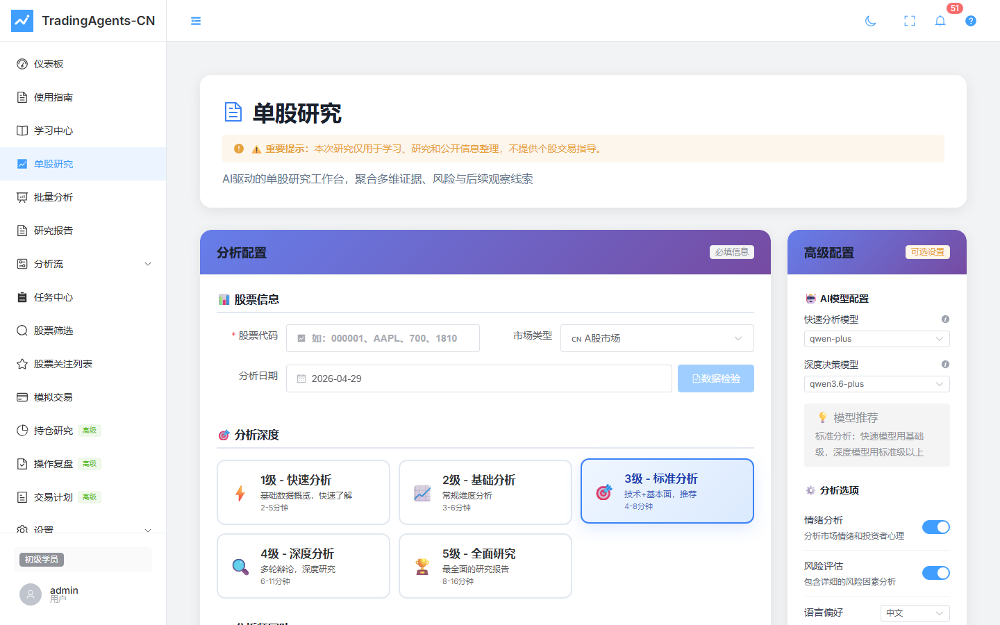
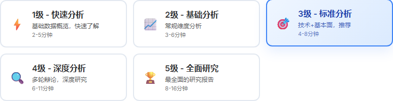
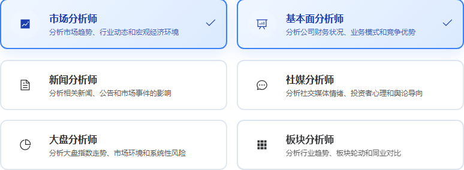
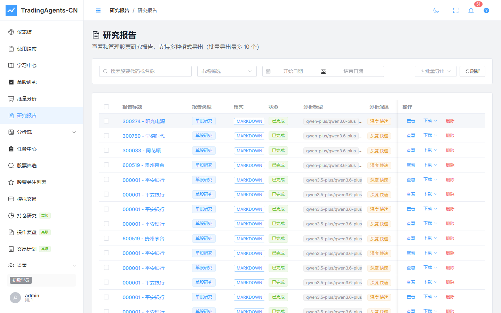
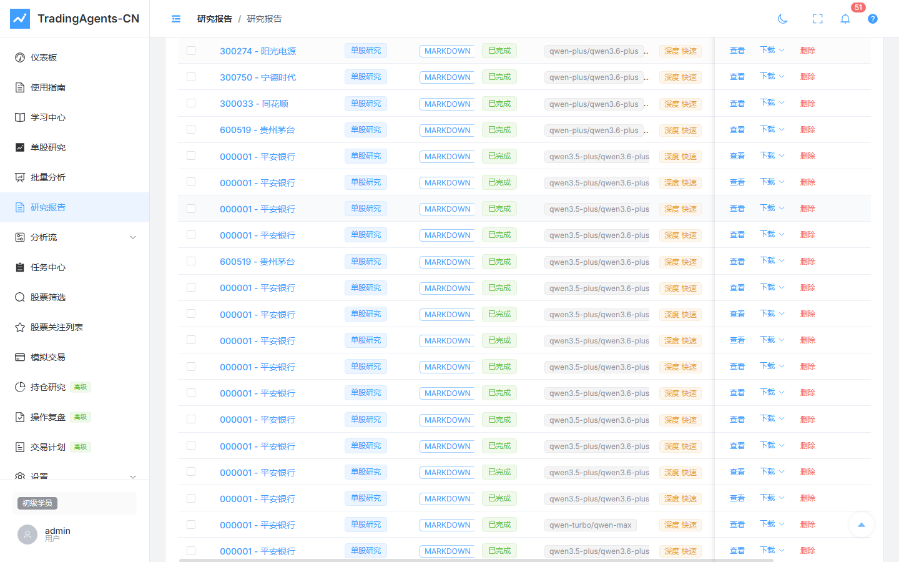
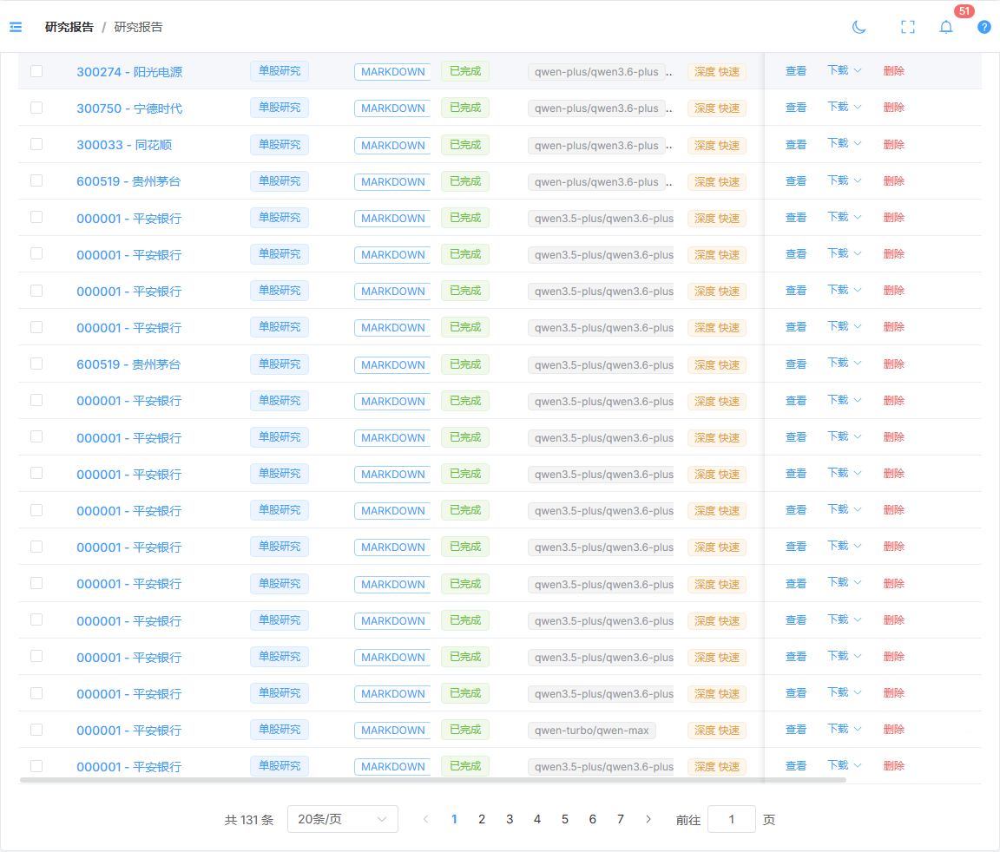

# 第二部分：选股篇 - 第3课：单股研究深度应用

**课时**：1课时
**目标**：掌握单股研究的完整流程，学会解读当前版本的研究结果卡片与证据结构，理解AI多智能体协作研究机制

---

## 3.1 为什么选股是最重要的环节？

在交易闭环中，选股是第一步，也是最重要的一步。有一句老话说得好：

> **"选股如选妻，选对了幸福一辈子，选错了痛苦一辈子。"**

**选股的重要性体现在**：

1. **决定了盈利的上限**
   - 再好的择时和仓位管理，也无法让一只烂股票变成好投资
   - 好股票即使买点不完美，长期持有也能获利

2. **影响持仓的心态**
   - 选对股票，持仓期间心态稳定
   - 选错股票，每天提心吊胆

3. **决定了风险的大小**
   - 优质股票，即使短期下跌，长期也能回来
   - 垃圾股票，可能一跌不起

---

## 3.2 系统单股研究功能概述

系统当前提供的是单股研究工作台。它以学习、研究和公开信息整理为目标，采用多智能体协作架构，对同一标的输出多维证据、风险摘要和后续观察线索。

### 3.2.1 访问单股研究功能

**操作步骤**：
1. 登录系统
2. 点击左侧菜单：`单股研究`
3. 或直接访问：`/analysis/single`

**页面布局**：
- 左侧：研究配置表单
- 右侧：研究结果展示区域



---

## 3.3 分析配置详解

### 3.3.1 股票信息配置

**必填项**：
- **股票代码**：输入股票代码（如：000001、AAPL、700）
- **市场类型**：选择市场（A股/港股/美股）
- **分析日期**：选择分析基准日期（默认今天）

**系统自动识别**：
- 系统会根据股票代码自动识别市场类型
- 支持A股（6位数字）、港股（1-5位数字）、美股（1-5个字母）

### 3.3.2 分析深度选择

系统提供5个研究深度级别：

| 级别 | 名称 | 描述 | 预计时间 |
|------|------|------|---------|
| 1级 | 快速分析 | 基础数据概览，快速决策 | 2-5分钟 |
| 2级 | 基础分析 | 常规投资决策 | 3-6分钟 |
| 3级 | 标准分析 | 技术+基本面，推荐 | 4-8分钟 |
| 4级 | 深度分析 | 多轮辩论，深度研究 | 6-11分钟 |
| 5级 | 全面分析 | 最全面的分析报告 | 8-16分钟 |

**选择建议**：
- 快速梳理公开信息：选择1-2级
- 形成较完整研究结论：选择3级
- 需要更充分的证据交叉验证：选择4-5级



---

## 3.4 分析师团队选择

系统提供多个专业分析师，你可以根据需要选择：

### 3.4.1 可选的分析师

| 分析师 | 职责 | 适用场景 |
|--------|------|---------|
| 市场分析师 | 价格行为、趋势状态与关键观察区间 | 所有场景 |
| 基本面分析师 | 财务质量、估值背景与盈利结构 | 财务与估值研究 |
| 新闻分析师 | 新闻事件、公告与监管动向 | 事件驱动研究 |
| 社交媒体分析师 | 市场情绪、讨论热度与噪音识别 | 情绪观察与舆论分析 |
| 大盘分析师 | 市场环境、流动性条件与系统性风险 | A股市场环境研究 |
| 板块分析师 | 行业景气度、竞争格局与板块轮动 | 行业与板块研究 |



**默认选择**：
- 系统默认选择：市场分析师、基本面分析师
- 你可以根据研究主题补充新闻分析师、社交媒体分析师、大盘分析师或板块分析师

### 3.4.2 分析师选择建议

**事件驱动研究配置**：
- 必选：市场分析师、新闻分析师、社交媒体分析师
- 可选：大盘分析师
- 适合快速梳理短期信息冲击和情绪变化

**中长期基本面研究配置**：
- 必选：基本面分析师、板块分析师、大盘分析师
- 可选：市场分析师
- 适合研究企业质量、行业位置和系统性风险背景

---

## 3.5 AI多智能体协作分析机制

### 3.5.1 多智能体协作流程

系统采用 v2.0 工作流引擎，实现多智能体并行协作：

```
分析流程：
│
├── 第一阶段：数据收集
│   └── 各分析师并行调用工具获取公开数据与上下文信息
│
├── 第二阶段：专业分析（并行执行）
│   ├── 市场分析师 → 技术分析报告
│   ├── 基本面分析师 → 财务分析报告
│   ├── 新闻分析师 → 新闻分析报告
│   ├── 社交媒体分析师 → 情绪分析报告
│   ├── 大盘分析师 → 市场环境报告
│   └── 板块分析师 → 行业分析报告
│
├── 第三阶段：多空辩论
│   ├── 看涨研究员 → 基于研究证据提出偏多观点
│   └── 看跌研究员 → 基于研究证据提出偏空观点
│
├── 第四阶段：研究经理综合评估
│   └── 综合多空观点，形成“研究结论汇总”
│
├── 第五阶段：风险辩论
│   ├── 高弹性情景分析师 → 识别高弹性机会与脆弱点
│   ├── 保守风险评估 → 识别潜在风险与约束条件
│   └── 中性风险评估 → 平衡分析与后续观察要求
│
└── 第六阶段：风险经理最终汇总
    └── 输出“风险评估摘要”“风险治理结论”和“综合研究结论”
```

### 3.5.2 各智能体的输出

**分析师输出**：
- 每个分析师生成独立的研究报告
- 报告通常包含：证据、分析过程、主要结论、风险提示与后续观察点

**研究员输出**：
- 看涨研究员：偏多理由、关键催化与失效条件
- 看跌研究员：偏空理由、风险点与证据缺口

**经理输出**：
- 研究经理：研究结论汇总、置信度、关键分歧点
- 风险经理：风险评估摘要、风险治理结论、综合研究结论

---

## 3.6 研究报告解读

### 3.6.1 报告结构

研究完成后，系统会生成完整的研究报告，包含以下部分：


**1. 报告顶部摘要区**
- 研究目的与限制提示
- 风险相关说明
- 当前任务状态与基本信息



**2. 研究结论卡片**
- 研究结论汇总
- 风险评估摘要
- 风险治理结论
- 综合研究结论

**3. 详细研究内容**
- 各分析师的详细研究报告
- 多空辩论内容
- 风险辩论内容



**4. 证据与分析依据**
- 研究依据（reasoning）
- 各模块证据来源
- 关键风险与关键观察位
- 后续可跟踪事项



### 3.6.2 如何解读“分析依据”、“分析概览”和“研究结论”

**分析依据（reasoning）**：
- 位置：在研究结果详情中
- 内容：200-500字的详细分析推理过程
- 来源：研究经理的综合分析
- 作用：帮助你理解 AI 为什么形成当前研究结论

**分析概览（summary）**：
- 位置：在摘要区或综合结论说明中
- 内容：200-500字的综合分析总结
- 来源：综合各分析师报告
- 作用：快速了解股票的整体情况

**研究结论**：
- 位置：在“研究结论汇总”“风险治理结论”“综合研究结论”等卡片中
- 内容：核心判断、证据权重、风险约束与后续观察要求
- 来源：研究经理与风险治理阶段的综合输出
- 作用：帮助你形成自己的研究判断，而不是替你做交易决定

**三者关系**：
```
分析依据（为什么） → 分析概览（是什么） → 研究结论（目前可以如何理解）
```

---

## 3.7 自定义分析流程

### 3.7.1 选择分析师

**操作步骤**：
1. 在"分析师团队"区域
2. 点击分析师卡片进行选择/取消
3. 选中的分析师会显示绿色勾选标记

**选择原则**：
- 至少选择2个分析师
- 根据交易风格选择
- 可以随时调整

### 3.7.2 设置分析深度

**操作步骤**：
1. 在"分析深度"区域
2. 点击对应的深度级别卡片
3. 选中的级别会高亮显示

**深度影响**：
- 深度越高，分析越全面，耗时越长
- 深度越高，多轮辩论越多，结论越可靠

### 3.7.3 偏好类型设置

系统支持三种偏好类型（在高级设置中）：

| 偏好类型 | 特点 | 适用人群 |
|---------|------|---------|
| 激进 | 更关注弹性与上行空间 | 偏好多情景推演的研究者 |
| 中性 | 平衡机会和风险 | 大多数研究场景 |
| 保守 | 更关注风险暴露与约束条件 | 风险敏感型研究场景 |

**设置方法**：
- 在分析配置的高级选项中设置
- 影响研究经理和风险经理的决策倾向

---

## 3.8 实战操作演示

### 3.8.1 完整操作流程

**步骤1：进入单股研究页面**
```
菜单：单股研究
或直接访问：/analysis/single
```

**步骤2：输入股票信息**
```
股票代码：000001
市场类型：A股（系统自动识别）
分析日期：今天（默认）
```

**步骤3：选择分析配置**
```
分析深度：3级 - 标准分析（推荐）
分析师：市场分析师、基本面分析师、新闻分析师
```

**步骤4：提交研究**
```
点击"开始智能分析"按钮
等待分析完成（4-8分钟）
```

**步骤5：查看研究结果**
```
1. 查看研究结论汇总和风险评估摘要
2. 阅读综合研究结论与分析概览
3. 查看详细报告（各分析师报告、多空辩论、风险辩论）
4. 记录关键观察点、证据缺口和后续跟踪线索
```

**步骤6：形成自己的研究判断**
```
1. AI分析是否合理？
2. 有没有遗漏的因素？
3. 你自己的结论是什么？
4. 是否需要加入股票关注列表继续跟踪？
```

### 3.8.2 报告解读示例

**示例：分析000001（平安银行）**

**研究结果摘要**：
- 研究结论汇总：平安银行具备估值修复讨论空间，但证据主要集中在低估值与盈利稳定性
- 风险评估摘要：中等风险，需持续关注银行板块景气度与信用风险暴露
- 风险治理结论：若继续跟踪，应重点观察业绩兑现、行业政策与市场环境变化

**分析概览**：
- 平安银行作为股份制银行龙头，当前估值处于历史低位区间，盈利能力与资产质量是研究重点。
- 当前报告更适合作为银行板块估值修复主题的研究样本，而不是直接操作依据。

**研究依据**：
- 基于基本面分析，当前 PE 与 PB 处于历史较低分位。
- 需要结合行业景气、资产质量变化和市场环境共同理解，不能孤立看待单一估值指标。

**解读要点**：
1. 核心不是“给出动作”，而是明确当前结论成立依赖哪些证据
2. 重点看风险治理结论里列出的约束条件是否会发生变化
3. 关键观察位只用于后续跟踪，不应被理解为平台下达的价格指令
4. 研究依据越完整，越有利于你后续复核这份报告是否仍然有效

---

## 3.9 各分析模块详细解读

### 3.9.1 市场分析师（技术分析）

**职责**：分析股价走势、技术指标、趋势方向

**分析内容**：
- 趋势方向（上涨/横盘/下跌）
- 重要均线位置（5日/10日/20日/60日）
- 支撑位和压力位
- 技术形态（突破/整理/见顶/见底）
- 量价关系

**关键指标解读**：

| 指标 | 多头信号 | 空头信号 |
|------|---------|---------|
| 均线 | 股价在均线上方，均线向上 | 股价在均线下方，均线向下 |
| 成交量 | 上涨放量，下跌缩量 | 上涨缩量，下跌放量 |
| 形态 | 突破整理平台，金叉 | 跌破支撑位，死叉 |

**技术分析的局限性**：
> 技术分析是对历史数据的分析，不能保证预测未来。应该结合基本面一起判断，而不是单独依赖技术分析。

### 3.9.2 基本面分析师

**职责**：评估公司的内在价值和投资价值

**分析内容**：
- **盈利能力**：毛利率、净利率、ROE
- **成长能力**：营收增长率、利润增长率
- **财务健康**：资产负债率、现金流
- **估值水平**：PE、PB、PS及历史分位

**关键指标解读**：

| 指标 | 优秀标准 | 警惕信号 |
|------|---------|---------|
| ROE（净资产收益率） | >15%持续3年 | <10%且下降 |
| 毛利率 | >30%（制造业>20%） | 毛利率持续下降 |
| 资产负债率 | <60%（非金融） | >70%且上升 |
| 营收增长率 | >20% | 连续下降 |
| 经营现金流 | 持续为正 | 连续为负 |

**估值判断框架**：

```
估值判断
│
├── PE（市盈率）
│   ├── 与历史PE对比：当前处于什么分位？
│   ├── 与行业PE对比：是否明显偏离？
│   └── 与增长率对比：PEG是否合理？（PEG=PE/增长率）
│
├── PB（市净率）
│   ├── 适用于重资产行业
│   └── PB<1可能被低估（也可能有问题）
│
└── 综合判断
    ├── 低估：估值低于历史平均且低于行业
    ├── 合理：估值处于历史中位数附近
    └── 高估：估值高于历史平均且高于行业
```

### 3.9.3 新闻分析师

**职责**：了解近期影响股价的重大事件

**分析内容**：
- 公司公告（财报、合同、增减持）
- 行业新闻（政策、竞争、技术）
- 宏观新闻（经济数据、货币政策）

**新闻的分类和影响**：

| 新闻类型 | 影响时效 | 关注要点 |
|---------|---------|---------|
| 业绩公告 | 中长期 | 是否超预期？趋势如何？ |
| 重大合同 | 中期 | 金额多大？占比多少？ |
| 政策变化 | 中长期 | 是实质利好还是情绪利好？ |
| 热点事件 | 短期 | 持续性如何？是否已反映在股价中？ |

### 3.9.4 社交媒体分析师

**职责**：了解市场情绪和舆论倾向

**分析内容**：
- 社交媒体讨论热度
- 投资者情绪倾向（乐观/悲观）
- 舆论主要观点
- 高影响力消息识别

**社媒分析的应用**：

```
社媒情绪的应用
│
├── 情绪极度乐观
│   └── 警惕！可能是短期高点
│       └── 不要追高，等待回调
│
├── 情绪极度悲观
│   └── 可能是机会！市场过度恐慌
│       └── 如果基本面没问题，可以考虑逢低买入
│
└── 情绪中性
    └── 正常状态
        └── 根据其他分析判断
```

**重要提示**：
> 社交媒体情绪往往更适合当作“情绪温度计”而不是结论本身。当所有人都在讨论同一标的时，更需要回到证据和基本面进行交叉验证。

**系统功能**：
- 支持从数据库读取用户上传的社媒数据
- 自动分析情绪倾向和关键词
- 识别高影响力消息

### 3.9.5 大盘分析师

**职责**：了解整体市场环境，判断是否适合入场

**分析内容**：
- 主要指数走势（上证、深证、创业板）
- 市场整体趋势（牛市/熊市/震荡）
- 成交量水平（活跃度）
- 市场情绪指标

**解读要点**：

| 大盘状态 | 含义 | 对选股的影响 |
|---------|------|-------------|
| **牛市** | 整体上涨趋势 | 可以积极选股，股票普涨 |
| **震荡市** | 箱体波动 | 精选个股，关注结构性机会 |
| **熊市** | 整体下跌趋势 | 谨慎选股，或选择防御性股票 |

**关键提示**：
> 覆巢之下无完卵。在熊市中，即使是好股票也可能跟着大盘下跌。大盘环境是选股的大背景，不可忽视。

### 3.9.6 板块分析师

**职责**：了解股票所属行业的景气度和发展前景

**分析内容**：
- 行业景气度（上行/平稳/下行）
- 政策环境（利好/中性/利空）
- 行业竞争格局
- 行业在经济周期中的位置

**解读要点**：

| 行业状态 | 投资策略 |
|---------|---------|
| 景气上行 + 政策利好 | 积极配置，可以给予更高估值 |
| 景气平稳 + 政策中性 | 精选龙头，关注个股alpha |
| 景气下行 + 政策利空 | 谨慎介入，或直接回避 |

**行业分析案例**：

```
假设分析结果显示：

行业：新能源汽车
景气度：高景气，产销两旺
政策：政策持续支持，补贴延续
竞争：龙头优势明显，集中度提升
周期位置：成长期

解读：行业处于良好的投资窗口，可以考虑配置行业龙头。
```

---

## 3.10 多空辩论与风险辩论解读

### 3.10.1 多空辩论机制

**流程**：

1. 看涨研究员：基于各分析师报告，提出偏多观点。
2. 看跌研究员：基于各分析师报告，提出偏空观点。
3. 研究经理：综合多空观点，形成“研究结论汇总”。

**你需要重点关注的不是谁“赢了”，而是以下三个问题**：

- 偏多观点依赖哪些关键前提？
- 偏空观点指出了哪些真实风险？
- 哪些证据仍然不足，需要后续补充？

### 3.10.2 风险辩论机制

**流程**：

1. 高弹性情景分析师：识别高弹性机会与脆弱点。
2. 保守风险评估：识别潜在风险与约束条件。
3. 中性风险评估：平衡分析与后续观察要求。
4. 风险经理：综合风险评估，输出“风险评估摘要”和“风险治理结论”。

**风险评估框架**：

| 风险等级 | 风险特征 | 适合的使用方式 |
| -------- | -------- | -------------- |
| 低风险 | 基本面相对稳定、证据链较完整 | 作为持续跟踪样本，验证研究框架 |
| 中风险 | 存在不确定因素或关键变量未证实 | 重点补充证据，观察核心变量变化 |
| 高风险 | 风险暴露集中、证据缺口大或争议明显 | 仅保留研究记录，谨慎解读结论 |

**如何使用风险治理结论**：

- 看清结论成立的前提条件。
- 记录报告明确列出的风险观察点。
- 在后续研究中优先核查这些风险是否发生变化。

---

## 3.11 综合研究结论的解读与应用

### 3.11.1 研究结论的含义

当前版本的单股研究页面不会把输出定位为交易指导，而是定位为研究支持信息。常见卡片名称包括：

- 研究结论汇总
- 风险评估摘要
- 风险治理结论
- 综合研究结论

这些卡片的作用分别是：

- 汇总主要证据和当前判断。
- 说明风险约束和争议点。
- 告诉你下一步应该补哪些信息、观察哪些变量。

### 3.11.2 关键价格区间如何理解

如果报告正文提到支撑位、阻力位、关键观察区间，这些内容应理解为：

- 市场分析师对价格行为的研究描述。
- 后续跟踪时值得复核的位置。
- 风险情景分析里用于验证观点是否失效的观察位。

不要把它们理解成平台向你下达的价格指令。

### 3.11.3 置信度如何使用

| 置信度 | 含义 | 阅读重点 |
| ------ | ---- | -------- |
| 高 | 多数分析模块结论一致，证据链较完整 | 重点看结论成立前提与失效条件 |
| 中 | 部分模块存在分歧 | 重点看关键分歧点和补证方向 |
| 低 | 证据不足或争议较大 | 重点看证据缺口，不急于下判断 |

### 3.11.4 如何把研究结果转成个人研究记录

推荐记录四类信息：

1. 当前核心结论是什么。
2. 哪些证据最支持这个结论。
3. 哪些风险最可能让结论失效。
4. 下一次复核时要观察哪些事件、数据或价格区间。

---

## 3.12 常见问题与最佳实践

### 3.12.1 常见问题

**Q1：研究时间太长怎么办？**

- 选择较低的研究深度（1-2级）。
- 减少分析师数量，先完成快速梳理。
- 系统支持后台执行，可以先提交任务再到任务中心查看进度。

**Q2：研究结果和我的判断不一致怎么办？**

- 先回到“分析依据”，看 AI 使用了哪些证据。
- 检查是否有你掌握但报告未覆盖的信息。
- 把差异写进你的研究记录，而不是直接否定或盲从报告。

**Q3：如何提高研究质量？**

- 选择更高的研究深度（4-5级）。
- 让研究覆盖更多维度的分析师。
- 对同一标的做多次复核，对比证据变化。

**Q4：如果报告里的 reasoning 很少怎么办？**

- 这通常意味着汇总层证据不够充分或输出结构不完整。
- 可以提高研究深度，或补充新闻、社交媒体、大盘、板块等维度后重新研究。

**Q5：如何保存研究报告？**

- 研究完成后，报告会自动保存到研究报告列表。
- 可以在详情页导出 Markdown、Word 或 PDF。
- 也可以把核心观察点转写到自己的研究笔记中。

### 3.12.2 最佳实践

**实践1：建立研究模板**

- 事件驱动模板：市场分析师 + 新闻分析师 + 社交媒体分析师，深度 1-2 级。
- 基本面模板：基本面分析师 + 板块分析师 + 大盘分析师，深度 3-5 级。

**实践2：定期更新研究**

- 股票关注列表中的标的：定期复核一次。
- 重点标的：遇到财报、公告、政策变化时及时补研究。

**实践3：对比研究**

- 对同一只股票尝试不同分析师组合。
- 对比不同研究深度的输出差异。
- 找出最适合自己研究目标的配置。

**实践4：记录研究结果**

- 记录每次研究的核心结论。
- 记录最关键的支持证据和风险点。
- 定期回顾，检查哪些结论经得起后续验证。

**实践5：与操作复盘联动**

- 如果后续有真实或模拟操作，可以在操作复盘中检查自己是否正确理解了研究证据。
- 对比研究结果与复盘反馈，持续优化自己的研究方法。

---

## 3.13 本课小结与思考

### 本课要点回顾

1. **功能入口已经更新**：当前页面名称统一为“单股研究”，应按现行页面文案理解课程内容。
2. **输出口径已经更新**：当前重点看“研究结论汇总”“风险评估摘要”“风险治理结论”“综合研究结论”。
3. **分析师名称已经更新**：当前使用“社交媒体分析师”等新命名。
4. **阅读重点已经更新**：更关注证据、分歧、风险约束和后续观察，而不是动作建议。
5. **研究结果的用途已经明确**：用于学习、研究和公开信息整理，不作为个股交易指导。

### 思考题

1. 访问系统，完成一次单股研究，记录你的研究配置和阅读顺序。
2. 对比不同研究深度（1 级、3 级、5 级）的输出差异，哪些信息是在高深度下才更完整的？
3. 尝试不同分析师组合，比较“结论一致度”和“证据丰富度”有什么变化。
4. 选一只你感兴趣的股票，记录：
    - 你选择了哪些分析师？
    - 研究深度是多少？
    - 报告里最关键的三条支持证据是什么？
    - 报告里最关键的两条风险观察点是什么？

---

**下一课预告**：第4课将学习批量分析与股票关注列表的配合使用，帮助你高效筛选和持续跟踪多只股票。

