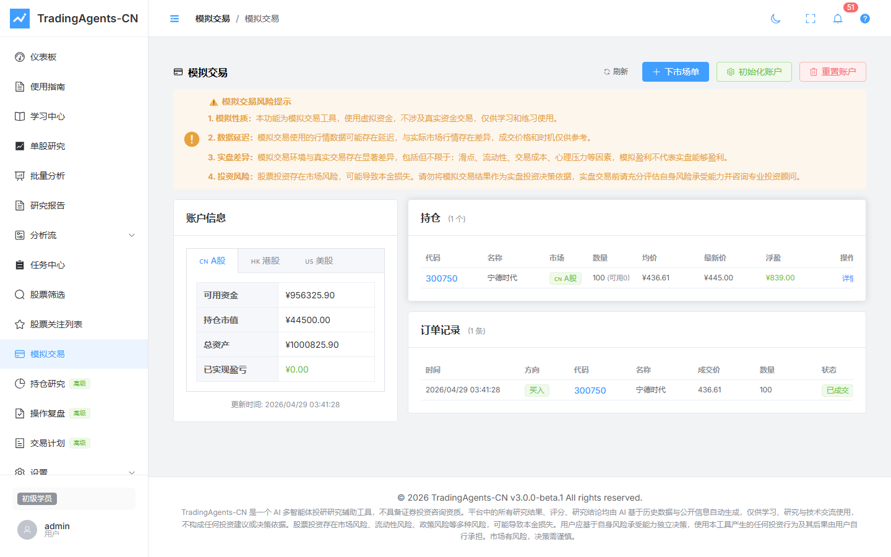

# 第10课：模拟交易实操

**课时**：1课时  
**目标**：掌握模拟交易的操作流程，学会利用AI分析辅助模拟交易决策

---

## 10.1 模拟交易的价值

### 10.1.1 为什么要先模拟交易？

```
模拟交易的价值
│
├── 零风险练习
│   ├── 不用真金白银
│   ├── 可以大胆尝试
│   └── 犯错不会有实际损失
│
├── 验证策略
│   ├── 测试你的交易计划是否有效
│   ├── 发现策略的问题
│   └── 优化和改进策略
│
├── 培养纪律
│   ├── 养成按规则执行的习惯
│   ├── 练习止盈止损
│   └── 克服情绪化交易
│
├── 积累经验
│   ├── 熟悉交易流程
│   ├── 了解市场规律
│   └── 为实盘做准备
│
└── 建立信心
    ├── 通过模拟盈利建立信心
    ├── 验证自己的判断能力
    └── 为实盘交易做好心理准备
```

### 10.1.2 模拟交易的正确态度

```
正确态度
│
├── 认真对待
│   ├── 把模拟交易当作真实交易
│   ├── 每一笔交易都要有理由
│   └── 严格执行交易规则
│
├── 记录复盘
│   ├── 记录每一笔交易
│   ├── 定期复盘总结
│   └── 不断改进策略
│
└── 不要急于实盘
    ├── 至少模拟3个月
    ├── 模拟盈利后再考虑实盘
    └── 实盘从小资金开始
```

---

## 10.2 模拟交易功能详解

### 10.2.1 访问模拟交易功能

**操作步骤**：
1. 登录系统
2. 点击左侧菜单：`交易工具` → `模拟交易`
3. 或直接访问：`/paper-trading`


### 10.2.2 功能概览

TradingAgentsCN系统提供了完整的模拟交易功能，支持A股、港股、美股三个市场：

```
┌─────────────────────────────────────────────────────────────┐
│                     模拟交易功能                             │
├─────────────────────────────────────────────────────────────┤
│                                                             │
│   ┌─────────────────────────────────────────────────────┐  │
│   │                    买入功能                          │  │
│   ├─────────────────────────────────────────────────────┤  │
│   │  市价单：按当前市场价格立即成交                       │  │
│   │  限价单：指定价格，等待市场价格到达后成交             │  │
│   └─────────────────────────────────────────────────────┘  │
│                                                             │
│   ┌─────────────────────────────────────────────────────┐  │
│   │                    卖出功能                          │  │
│   ├─────────────────────────────────────────────────────┤  │
│   │  市价单：按当前市场价格立即成交                       │  │
│   │  限价单：指定价格，等待市场价格到达后成交             │  │
│   └─────────────────────────────────────────────────────┘  │
│                                                             │
│   ┌─────────────────────────────────────────────────────┐  │
│   │                    持仓管理                          │  │
│   ├─────────────────────────────────────────────────────┤  │
│   │  查看持仓：查看当前持有的股票                        │  │
│   │  持仓研究：调用系统分析持仓股票                      │  │
│   │  交易记录：查看历史交易记录                          │  │
│   │  关联分析：查看每笔交易关联的分析报告                │  │
│   └─────────────────────────────────────────────────────┘  │
│                                                             │
│   特点：实时行情，与真实市场同步                            │
│                                                             │
└─────────────────────────────────────────────────────────────┘
```

### 10.2.2 账户信息

模拟交易账户支持多市场（A股、港股、美股），每个市场独立管理：

**账户信息包括**：
- **可用资金**：当前可用于交易的资金
- **持仓市值**：当前持有股票的总市值
- **总资产**：可用资金 + 持仓市值
- **已实现盈亏**：已卖出股票的盈亏总和

**如何查看账户信息**：
1. 进入"模拟交易"页面
2. 在左侧"账户信息"卡片中查看
3. 切换不同市场的标签页（A股/港股/美股）查看对应市场的账户信息

### 10.2.3 订单类型详解

#### 市价单

```
市价单
│
├── 定义
│   └── 按当前市场价格立即成交
│
├── 优点
│   ├── 成交速度快
│   └── 确保能够成交
│
├── 缺点
│   ├── 成交价格不确定
│   └── 可能有滑点（实盘）
│
└── 使用场景
    ├── 确定要买入/卖出，不在乎价格
    ├── 追涨时快速买入
    └── 止损时快速卖出
```

#### 限价单

```
限价单
│
├── 定义
│   └── 指定价格，等待市场价格到达后成交
│
├── 优点
│   ├── 成交价格确定
│   └── 可以买到更好的价格
│
├── 缺点
│   ├── 可能无法成交
│   └── 可能错过机会
│
└── 使用场景
    ├── 想在特定价格买入
    ├── 等待回调买入
    └── 不急于成交
```

---

## 10.3 模拟交易完整流程

### 10.3.1 买入流程



```
模拟交易买入流程
│
├── 步骤1：分析股票
│   ├── 使用系统进行单股研究
│   ├── 查看分析报告
│   └── 确认买入理由
│
├── 步骤2：确定买入计划
│   ├── 买入价格：参考当前价格和支撑位
│   ├── 买入数量：根据仓位规则计算
│   ├── 止盈价格：根据个人目标收益率自主设定
│   └── 止损价格：根据风险承受能力自主设定
│
├── 步骤3：下单买入
│   ├── 选择订单类型（市价/限价）
│   ├── 输入买入数量
│   └── 确认下单
│
├── 步骤4：记录交易
│   ├── 记录买入理由
│   ├── 记录买入价格和数量
│   └── 记录关联的分析报告ID
│
└── 步骤5：设置止盈止损（后续）
    ├── 设置止盈单
    └── 设置止损单
```

### 10.3.2 持仓管理流程

```
持仓管理流程
│
├── 步骤1：查看持仓
│   ├── 查看当前持有的股票
│   ├── 查看盈亏情况
│   └── 查看持仓详情
│
├── 步骤2：调用持仓研究
│   ├── 对持仓股票进行分析
│   ├── 查看持仓研究结论方向
│   └── 了解关键风险点与后续观察重点
│
├── 步骤3：决定操作
│   ├── 加仓：看好后市，增加仓位
│   ├── 减仓：部分止盈或降低风险
│   ├── 持有：继续持有，等待
│   └── 清仓：全部卖出
│
└── 步骤4：执行操作
    ├── 根据决定下单
    └── 记录交易理由
```

### 10.3.3 卖出流程

```
卖出流程
│
├── 触发卖出的情况
│   ├── 达到止盈价
│   ├── 触发止损价
│   ├── 基本面变化
│   ├── 发现更好的机会
│   └── 需要资金
│
├── 卖出决策
│   ├── 全部卖出：清仓
│   └── 部分卖出：减仓
│
├── 下单卖出
│   ├── 选择订单类型
│   ├── 输入卖出数量
│   └── 确认下单
│
└── 记录交易
    ├── 记录卖出理由
    ├── 记录卖出价格和数量
    └── 计算本次交易盈亏
```

---

## 10.4 AI辅助模拟交易

### 10.4.1 如何结合AI分析做模拟交易

TradingAgentsCN系统提供了强大的AI分析功能，可以帮助你在模拟交易中做出更明智的决策。

#### 方法1：从分析报告直接应用到交易

**功能说明**：
系统支持将分析报告中的投资建议一键应用到模拟交易，实现从分析到交易的无缝衔接。

**操作步骤**：

1. **查看分析报告**
   - 进入"分析报告"页面
   - 点击任意报告查看详情

2. **应用到交易**
   - 在报告详情页，点击右上角"**应用到交易**"按钮
   - 系统会自动解析投资建议（买入/卖出）
   - 弹出交易确认对话框

3. **确认交易信息**
   - 系统会自动填充以下信息：
     - **股票代码**：从报告中提取
     - **操作类型**：买入或卖出（根据报告中的研究结论方向参考）
     - **当前价格**：实时获取的当前市场价格
     - **交易价格**：可修改，默认为当前价格
     - **交易数量**：可修改，100股为单位
     - **预计金额**：自动计算
     - **置信度**：从报告中提取
     - **风险等级**：从报告中提取
     - **账户状态**：可用资金/当前持仓

4. **修改并确认**
   - 根据需要修改交易价格和数量
   - 确认信息无误后，点击"确认下单"
   - 系统提交订单到模拟交易
   - 自动跳转到模拟交易页面

**优势**：
- ✅ **一键操作**：无需手动输入股票代码和价格
- ✅ **智能计算**：自动计算交易数量和金额
- ✅ **信息完整**：显示置信度、风险等级等关键信息
- ✅ **关联记录**：自动关联分析报告，便于后续回测

#### 方法2：先分析后交易

**操作步骤**：

1. **进行单股研究**
   - 进入"单股研究"页面
   - 输入股票代码，选择分析配置
   - 提交分析，等待结果

2. **查看分析结果**
   - 查看研究结论方向（偏乐观/中性/偏谨慎）
   - 查看置信度评分
   - 查看关键风险点与后续观察重点

3. **制定交易计划**
   - 根据研究结论方向决定是否交易
   - 根据置信度参考确定仓位大小
   - 根据个人风险偏好**自主设定**止盈价
   - 根据个人止损规则**自主设定**止损价

4. **执行交易**
   - 进入"模拟交易"页面
   - 点击"下市场单"按钮
   - 输入股票代码、价格、数量
   - 确认下单

5. **记录关联**
   - 在交易记录中，可以手动关联分析报告ID
   - 便于后续回测和评估

#### 方法3：持仓后分析

**操作步骤**：

1. **查看持仓**
   - 进入"模拟交易"页面
   - 在持仓列表中查看当前持有的股票

2. **调用持仓研究**
   - 点击持仓股票的"分析"按钮
   - 系统会自动调用持仓研究功能
   - 等待分析结果（2-5分钟）

3. **查看研究结论**
   - 查看研究结论方向（偏积极/中性/偏谨慎）
   - 查看置信度评分
   - 查看关键风险点与后续观察重点
   - 查看风险评估和机会评估

4. **执行操作**
   - 根据分析建议决定是否调整仓位
   - 如果需要加仓或减仓，执行相应操作
   - 更新止盈止损设置

### 10.4.2 模拟交易中的AI决策支持

#### 买入决策支持

**AI分析提供的信息**：
- ✅ **研究结论方向**：偏乐观/中性/偏谨慎（研究层面判断，非交易建议）
- ✅ **置信度评分**：0-100%，表示AI对研究结论的信心程度
- ✅ **关键风险清单**：当前需要关注的主要风险
- ✅ **风险等级**：低/中/高
- ✅ **详细分析**：多维度分析报告（技术面、基本面、市场面等）

**如何利用这些信息（您自主决定）**：

1. **决定是否买入**
   - 研究结论偏乐观且置信度高（>70%），说明基本面/技术面支持，可结合个人判断决定是否买入
   - 研究结论中性或偏谨慎，需谨慎评估

2. **决定买入数量**
   - 根据置信度和风险等级，参考第9课的仓位决策矩阵
   - 仓位大小完全由您自主决定

3. **设置止盈止损（完全由您自主设定）**
   - **止盈价**：根据您的目标收益率自主设定，AI不提供价格建议
   - **止损价**：根据您的风险承受能力自主设定（可参考固定比例如-8%）

#### 持仓决策支持

**AI持仓研究提供的信息**：
- ✅ **研究结论方向**：偏积极/中性/偏谨慎（研究层面，非操作建议）
- ✅ **置信度评分**：对研究结论的信心程度
- ✅ **关键风险点**：当前风险观察重点
- ✅ **风险评估**：当前持仓的风险水平
- ✅ **机会评估**：研究层面对上行空间的判断

**如何利用这些信息（您自主决定）**：

1. **决定是否调整仓位**
   - 结论偏积极：支持继续持仓，具体是否加仓由您自主决定
   - 结论偏谨慎：研究层面出现风险信号，是否减仓由您自主决定
   - 结论中性：继续观察，定期复查

2. **决定调整幅度**
   - 仓位调整完全由您根据个人风险偏好决定

3. **更新止盈止损（完全由您自主完成）**
   - AI不提供目标价格或止损价格
   - 根据个人交易计划自主更新止盈止损设置

#### 卖出决策支持

**AI分析提供的信息**：
- ✅ **研究结论方向**：偏谨慎/中性等（研究层面参考，非卖出建议）
- ✅ **风险评估**：风险等级变化情况
- ✅ **关键风险点**：当前最重要的风险信号

**如何利用这些信息（您自主决定）**：

1. **决定是否卖出**
   - 研究结论转为偏谨慎时，审视持仓理由是否仍然成立
   - 风险等级上升时，评估是否需要调整仓位
   - 您自己的止盈目标触发时，执行止盈

2. **决定卖出数量**
   - 完全由您根据个人交易计划自主决定
   - 可以分批卖出（比例和价位由您设定）

### 10.4.3 如何记录AI分析结果

#### 记录方法

**方法1：自动关联（推荐）**

使用"应用到交易"功能时，系统会自动关联分析报告ID：
- ✅ 交易记录中会显示"关联分析"列
- ✅ 点击"查看报告"可以查看关联的分析报告
- ✅ 便于后续回测和评估

**方法2：手动记录**

如果手动下单，可以：
- ✅ 在交易备注中记录分析报告ID
- ✅ 记录买入理由（参考分析报告的关键结论）
- ✅ 记录置信度和风险等级

#### 记录内容

**买入时记录**：
- 股票代码和名称
- 买入价格和数量
- 买入理由（参考AI分析的关键结论）
- 关联的分析报告ID
- 置信度和风险等级
- 您自主设定的止盈止损价格

**持仓时记录**：
- 持仓研究的研究结论方向
- 持仓研究的置信度
- 关键风险点与后续观察重点
- 持仓研究的风险评估和机会评估

**卖出时记录**：
- 卖出价格和数量
- 卖出理由（参考AI研究结论或您自定的止盈止损触发）
- 本次交易盈亏
- 关联的分析报告ID（如果有）

### 10.4.4 实战：完成一轮AI辅助的模拟交易

#### 案例：某消费龙头股的完整交易流程

**步骤1：进行单股研究**

1. 进入"单股研究"页面
2. 输入股票代码：000001
3. 选择分析深度：3级（标准）
4. 选择分析师：大盘、基本面、新闻、技术
5. 提交分析，等待结果（约3-5分钟）

**步骤2：查看分析结果**

分析结果：
- **研究结论方向**：偏乐观
- **置信度**：80%
- **风险等级**：低
- **关键风险点**：行业政策不确定性
- **当前价格**：12元

**步骤3：制定交易计划（您自主完成）**

根据分析结果：
- **决定买入**：研究结论偏乐观，置信度高（80%），风险低，符合买入条件
- **仓位计算**：综合置信度与风险等级，自主决定仓位
  - 假设总资金10万，当前仓位50%（5万），可用资金5万
  - 计划买入金额：由您根据仓位规则自主决定
- **分批建仓**：分2批买入（时机和数量由您自主决定）
- **止盈止损（完全自主设定）**：
  - 止盈价：根据目标收益率，如成本+25% = 15元（您自定）
  - 止损价：根据最大可接受亏损，如成本-8% = 11元（您自定）

**步骤4：执行买入（使用"应用到交易"）**

1. 在分析报告详情页，点击"应用到交易"按钮
2. 系统自动填充：
   - 股票代码：000001
   - 操作类型：买入
   - 当前价格：12元
   - 交易价格：12元（可修改）
   - 交易数量：可修改
   - 置信度：80%
   - 风险等级：低
3. 根据您的仓位计划修改交易数量
4. 确认下单
5. 系统自动跳转到模拟交易页面

**步骤5：记录交易**

- 记录买入理由：基本面优秀，估值合理，研究结论偏乐观，置信度80%
- 记录买入价格：12元
- 记录买入数量：您自主决定的数量
- 记录关联的分析报告ID（系统自动关联）
- 记录您自定的止盈止损价格

**步骤6：设置止盈止损（后续功能）**

- 止盈单：按您自定价格分批执行
- 止损单：按您自定止损价执行

**步骤7：持仓管理（一周后）**

1. 进入"模拟交易"页面，查看持仓
2. 当前股价：11.5元（下跌4%）
3. 点击持仓股票的"分析"按钮
4. 等待持仓研究结果

**持仓研究结果**：
- **研究结论方向**：中性偏积极
- **置信度**：75%
- **关键风险点**：短期技术面回调压力
- **风险评估**：中风险（短期回调）
- **机会评估**：中机会（基本面未变）

**您的决策**：
- 研究结论仍偏积极，基本面未变，短期回调正常
- 是否加仓由您自主判断（如在合适位置加仓第二批）

**步骤8：执行第二批买入（您自主决定时机）**

1. 当股价回调到您认为合适的位置时
2. 进入"模拟交易"页面，点击"下市场单"
3. 输入股票代码和数量，确认下单

**步骤9：止盈卖出（当您的止盈价触发时）**

1. 股价达到您设定的止盈价
2. 按照您的计划执行止盈
3. 可参考持仓研究结论，但最终卖出决定由您自主做出

**步骤10：最终清仓**

1. 当股价到达您的最终止盈目标，或研究结论持续转为偏谨慎时
2. 执行清仓，锁定利润

**步骤11：复盘总结**

1. **查看交易记录**
   - 进入"模拟交易"页面
   - 查看订单记录，点击"查看报告"

2. **评估研究结论方向准确性**
   - 分析每次研究结论方向是否与后续价格趋势一致
   - 总结AI研究结论对您决策的参考价值

3. **总结经验**
   - ✅ AI研究结论提供了有价值的参考
   - ✅ 分批建仓降低了平均成本
   - ✅ 严格执行自定止盈止损锁定了利润
   - ✅ 持仓研究帮助及时了解研究结论的变化

---

## 10.5 模拟交易与真实交易的差异

### 10.5.1 主要差异

```
┌─────────────────────────────────────────────────────────────┐
│              模拟交易 vs 真实交易                            │
├─────────────────────────────────────────────────────────────┤
│                                                             │
│   差异点          模拟交易          真实交易                 │
│   ─────────      ─────────        ─────────                 │
│                                                             │
│   情绪压力        无                有（很大）               │
│                                                             │
│   滑点            无                有（尤其是大单）         │
│                                                             │
│   手续费          无/简化           有（佣金+印花税）        │
│                                                             │
│   成交率          100%              不一定（限价单）         │
│                                                             │
│   资金限制        虚拟资金          真实资金                 │
│                                                             │
│   心理影响        小                大                       │
│                                                             │
└─────────────────────────────────────────────────────────────┘
```

### 10.5.2 情绪差异

```
情绪差异
│
├── 模拟交易
│   ├── 亏损不心疼
│   ├── 容易执行止损
│   └── 心态平和
│
└── 真实交易
    ├── 亏损会心疼
    ├── 止损时会犹豫
    ├── 盈利时会贪婪
    └── 亏损时会恐惧
```

### 10.5.3 从模拟到实盘的过渡

```
从模拟到实盘的过渡
│
├── 阶段1：模拟交易（至少3个月）
│   ├── 熟悉交易流程
│   ├── 验证交易策略
│   ├── 利用AI分析辅助决策
│   └── 目标：模拟盈利
│
├── 阶段2：小资金实盘（3-6个月）
│   ├── 用小资金（如1万元）实盘
│   ├── 体验真实交易的情绪
│   ├── 继续使用AI分析辅助决策
│   └── 目标：适应实盘环境
│
├── 阶段3：逐步加大资金
│   ├── 实盘盈利后逐步加大资金
│   ├── 每次加大不超过50%
│   └── 目标：稳定盈利
│
└── 注意事项
    ├── 不要急于求成
    ├── 亏损时不要加大资金
    ├── 保持良好心态
    └── 继续利用AI分析辅助决策
```

---

## 10.6 本课小结与思考

### 本课要点回顾

1. **模拟交易的价值**：零风险练习、验证策略、培养纪律、积累经验、建立信心
2. **订单类型**：市价单、限价单
3. **完整流程**：分析→计划→下单→记录→持仓管理→卖出
4. **AI辅助交易**：
   - 从分析报告直接应用到交易
   - 先分析后交易
   - 持仓后分析
5. **AI决策支持**：买入决策、持仓决策、卖出决策
6. **记录AI分析结果**：自动关联、手动记录
7. **与真实交易的差异**：情绪、滑点、手续费、成交率

### 思考题

1. **实践题**：选择一只你感兴趣的股票，完成一次完整的AI辅助模拟交易，包括：
   - 进行单股研究
   - 使用"应用到交易"功能买入
   - 进行持仓研究
   - 根据分析建议调整仓位或卖出
   - 记录整个交易过程

2. **记录题**：记录你的交易理由、买入价格、止盈止损设置、关联的分析报告ID，并评估AI分析的准确性。

3. **进阶题**：完成至少3笔AI辅助的模拟交易，统计：
   - AI研究结论方向与后续趋势的一致性
   - 平均盈利/亏损
   - 止盈止损的执行情况
   - 哪些AI分析最有价值

4. **总结题**：总结你在模拟交易中使用AI分析的经验，包括：
   - 哪些AI分析信息最有价值？
   - 如何结合AI研究结论和自己的判断进行决策？
   - 如何利用AI分析提高决策质量？

---

**下一课预告**：第五部分"持仓管理篇"将学习如何管理已有持仓，包括持仓研究、加仓减仓决策、风险控制等实战技巧。

