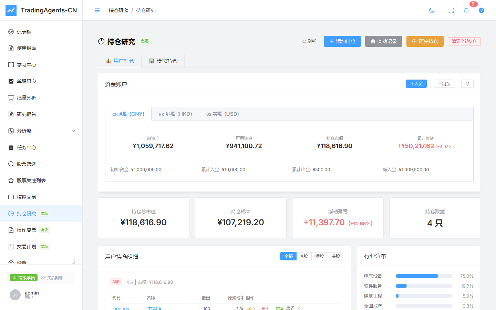
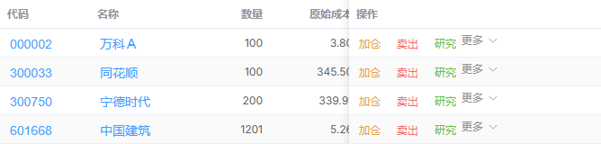

# 第11课：持仓研究的应用

**课时**：1课时  
**目标**：掌握持仓研究的使用方法，学会解读AI持仓研究报告，了解持仓研究工作流的配置

---

## 11.1 为什么需要持仓管理？

### 11.1.1 买入不是终点

很多投资者把大量精力放在选股和买入上，却忽视了持仓管理。

```
常见误区
│
├── 买入后就不管了
│   └── 结果：错过止盈机会，或者亏损扩大
│
├── 频繁查看，情绪化操作
│   └── 结果：追涨杀跌，损失惨重
│
└── 没有明确的持仓规则
    └── 结果：随意操作，收益不稳定
```

### 11.1.2 持仓管理的核心任务

```
持仓管理的核心任务
│
├── 监控持仓状态
│   ├── 盈亏情况
│   ├── 基本面变化
│   └── 技术面变化
│
├── 评估是否需要调整
│   ├── 是否需要加仓？
│   ├── 是否需要减仓？
│   └── 是否需要清仓？
│
├── 执行调整操作
│   ├── 按规则执行
│   └── 不情绪化操作
│
└── 记录和复盘
    ├── 记录每次调整的理由
    └── 定期复盘总结
```

---

## 11.2 什么时候需要持仓研究？

### 11.2.1 触发时机

```
┌─────────────────────────────────────────────────────────────┐
│                   持仓研究触发时机                           │
├─────────────────────────────────────────────────────────────┤
│                                                             │
│   触发时机              说明                  频率           │
│   ─────────            ─────                ─────           │
│                                                             │
│   定期检视              固定时间检视持仓      每周/每月       │
│                                                             │
│   重大事件              财报、重大新闻        事件发生时      │
│                                                             │
│   价格大幅变动          涨跌超过5%           变动发生时      │
│                                                             │
│   市场环境变化          大盘趋势改变          变化发生时      │
│                                                             │
│   心理动摇              不确定是否继续持有    随时            │
│                                                             │
│   接近止盈/止损价       价格接近预设价位      接近时          │
│                                                             │
└─────────────────────────────────────────────────────────────┘
```

### 11.2.2 不同投资风格的检视频率

| 投资风格 | 建议检视频率 | 说明 |
|---------|-------------|------|
| **短线** | 每天 | 短线变化快，需要密切关注 |
| **中线** | 每周 | 每周固定时间检视一次 |
| **长线** | 每月 | 每月检视一次，不需要太频繁 |

---

## 11.3 访问持仓研究功能

**操作步骤**：
1. 登录系统
2. 点击左侧菜单：`持仓研究`
3. 或直接访问：`/position-analysis`



---

## 11.4 持仓研究的输出内容

### 11.4.1 持仓研究报告结构

```
┌─────────────────────────────────────────────────────────────┐
│                     持仓研究报告                             │
├─────────────────────────────────────────────────────────────┤
│                                                             │
│   ┌─────────────────────────────────────────────────────┐  │
│   │                  当前持仓状态                         │  │
│   ├─────────────────────────────────────────────────────┤  │
│   │  股票名称：XXX                                       │  │
│   │  持仓数量：1000股                                    │  │
│   │  成本价：10.00元                                     │  │
│   │  现价：11.50元                                       │  │
│   │  盈亏金额：+1500元                                   │  │
│   │  盈亏比例：+15%                                      │  │
│   │  持仓天数：30天                                      │  │
│   └─────────────────────────────────────────────────────┘  │
│                                                             │
│   ┌─────────────────────────────────────────────────────┐  │
│   │                  分析结论                            │  │
│   ├─────────────────────────────────────────────────────┤  │
│   │  技术面分析：                                        │  │
│   │  - 股价处于上升趋势                                  │  │
│   │  - 均线多头排列                                      │  │
│   │  - 成交量配合良好                                    │  │
│   │                                                      │  │
│   │  基本面分析：                                        │  │
│   │  - 最新财报业绩超预期                                │  │
│   │  - 行业景气度持续向好                                │  │
│   │  - 公司竞争优势明显                                  │  │
│   │                                                      │  │
│   │  风险评估：                                          │  │
│   │  - 估值处于合理区间                                  │  │
│   │  - 短期可能有回调风险                                │  │
│   │  - 整体风险可控                                      │  │
│   └─────────────────────────────────────────────────────┘  │
│                                                             │
│   ┌─────────────────────────────────────────────────────┐  │
│   │                  研究结论                            │  │
│   ├─────────────────────────────────────────────────────┤  │
│   │  研究结论方向：中性偏积极                            │  │
│   │  研究理由：基本面良好，趋势向上                      │  │
│   │  置信度：高（75%）                                   │  │
│   │  关键风险点：短期可能有回调风险                      │  │
│   │  后续观察重点：估值和趋势变化                        │  │
│   └─────────────────────────────────────────────────────┘  │
│                                                             │
└─────────────────────────────────────────────────────────────┘
```

### 11.3.2 研究结论方向类型

| 结论方向 | 含义 | 常见触发条件 |
|---------|------|---------|
| **偏积极** | 研究层面看好，可关注加仓机会 | 基本面改善、回调到支撑位、趋势确认 |
| **中性偏积极** | 总体向好但存在不确定性 | 基本面未变、趋势向上、风险可控 |
| **中性** | 研究层面持观望，等待更多信号 | 基本面未变、趋势不明、风险与机会相当 |
| **偏谨慎** | 研究层面发现较多不确定性 | 触发失效条件、基本面恶化、买入逻辑不成立 |

> ⚠️ 以上为AI输出的**研究结论方向**，不是操作建议。持仓是否加仓/减仓/清仓，由您自主决策。

---

## 11.5 AI持仓研究深度应用

### 11.5.1 持仓研究的多维度AI评估



TradingAgentsCN系统的持仓研究功能采用**多智能体协作架构**，通过三个专业分析师并行分析，最后由整合节点综合生成研究建议。

#### 持仓研究工作流程

```
持仓研究工作流程（v2.0）
│
├── 阶段1：数据收集
│   ├── 获取持仓信息（股票代码、持仓数量、成本价、当前价等）
│   ├── 获取市场数据（K线数据、技术指标等）
│   └── 获取单股研究报告（如果有）
│
├── 阶段2：多维度并行分析
│   ├── 技术面分析师 v2.0 📈
│   │   ├── 分析K线走势和技术指标
│   │   ├── 评估支撑阻力位
│   │   ├── 判断短期走势
│   │   └── 输出：technical_analysis
│   │
│   ├── 基本面分析师 v2.0 📊
│   │   ├── 分析财务数据和估值水平
│   │   ├── 评估行业地位和成长性
│   │   ├── 判断基本面价值变化
│   │   └── 输出：fundamental_analysis
│   │
│   └── 风险评估师 v2.0 ⚠️
│       ├── 评估持仓风险水平
│       ├── 分析止损止盈合理性
│       ├── 识别潜在风险因素
│       └── 输出：risk_analysis
│
├── 阶段3：综合决策
│   └── 研究整合员 v2.0 📋
│       ├── 综合技术面、基本面、风险评估
│       ├── 输出研究结论方向（偏积极/中性/偏谨慎）
│       ├── 评估置信度和关键风险点
│       ├── 生成风险评估和机会评估
│       └── 输出：research_conclusion
│
└── 阶段4：生成报告
    ├── 研究结论方向（偏积极/中性/偏谨慎）
    ├── 置信度评分（0-100%）
    ├── 关键风险点与后续观察重点
    ├── 风险评估（低/中/高）
    ├── 机会评估（高/中/低）
    └── 详细分析报告（技术面、基本面、风险评估）
```

#### 各分析师的职责和输出

**1. 技术面分析师（Technical Analyst v2.0）**

**职责**：
- 分析K线走势和技术指标（MA、RSI、MACD、布林带等）
- 评估支撑阻力位
- 判断短期走势和趋势方向
- 识别技术形态（突破、回调、整理等）

**输出内容**：
- 当前技术形态描述
- 趋势方向判断（上涨/下跌/震荡）
- 关键支撑位和阻力位
- 技术指标分析
- 短期走势预测

**解读要点**：
- ✅ 如果技术面良好（趋势向上、均线多头排列），支持持有或加仓
- ⚠️ 如果技术面转弱（趋势向下、均线空头排列），考虑减仓或清仓
- 📊 关注关键支撑位和阻力位，这些位置可能是加仓或减仓的时机

**2. 基本面分析师（Fundamental Analyst v2.0）**

**职责**：
- 分析财务数据和估值水平
- 评估行业地位和成长性
- 判断基本面价值变化
- 识别基本面风险因素

**输出内容**：
- 财务数据变化（营收、利润、ROE等）
- 估值水平评估（PE、PB、PEG等）
- 行业地位和竞争优势
- 成长性评估
- 基本面风险提示

**解读要点**：
- ✅ 如果基本面改善（业绩增长、估值合理），支持持有或加仓
- ⚠️ 如果基本面恶化（业绩下滑、估值偏高），考虑减仓或清仓
- 📊 关注估值水平，如果估值过高，即使基本面良好也要谨慎

**3. 风险评估师（Risk Analyst v2.0）**

**职责**：
- 评估持仓风险水平
- 分析止损止盈合理性
- 识别潜在风险因素
- 提供风险控制建议

**输出内容**：
- 风险等级评估（低/中/高）
- 关键风险因素识别
- 潜在风险因素识别
- 风险控制建议

**解读要点**：
- ✅ 如果风险等级低，可以给予较大仓位或继续持有
- ⚠️ 如果风险等级高，应该考虑减仓或清仓
- 📊 关注关键风险因素，这些是制定您自己止损计划的重要参考

**4. 研究整合员（Research Integrator v2.0）**

**职责**：
- 综合技术面、基本面、风险评估三个维度的分析
- 输出最终的研究结论方向（偏积极/中性/偏谨慎）
- 评估置信度和关键风险点
- 生成风险评估和机会评估

> ⚠️ 研究整合员**不提供**目标价格、止损价格或仓位建议，这些均由用户自主决定。

**输出内容**：
- **研究结论方向**：偏积极/中性/偏谨慎，表示AI的研究判断方向
- **置信度评分**：0-100%，表示对研究结论的信心程度
- **关键风险点**：主要不确定因素和需关注的风险
- **后续观察重点**：建议持续跟踪的指标或事件
- **风险评估**：低/中/高，当前持仓的风险水平
- **机会评估**：高/中/低，当前持仓的上涨空间
- **详细分析报告**：综合各维度分析的详细报告

### 11.4.2 风险评估 vs 机会评估

持仓研究会从两个维度评估你的持仓：

#### 风险评估

**评估内容**：
- ⚠️ **技术风险**：技术形态是否破位，趋势是否转弱
- ⚠️ **基本面风险**：公司基本面是否恶化，业绩是否下滑
- ⚠️ **市场风险**：大盘环境是否不利，行业是否下行
- ⚠️ **估值风险**：当前估值是否过高，是否有回调风险
- ⚠️ **流动性风险**：是否有解禁、减持等压力

**风险等级**：
- **低风险**：风险可控，可以继续持有或加仓
- **中风险**：有一定风险，需要关注，谨慎操作
- **高风险**：风险较大，建议减仓或清仓
- **极高风险**：风险很大，建议立即清仓

**如何利用风险评估**：
- ✅ **低风险**：可以给予较大仓位，继续持有或加仓
- ⚠️ **中风险**：控制仓位，谨慎操作，定期检视
- ❌ **高风险**：应该考虑减仓或清仓，降低风险敞口

#### 机会评估

**评估内容**：
- ✅ **上涨空间**：是否还有上涨空间，基本面支撑是否充分
- ✅ **催化剂**：是否有上涨的催化剂（如业绩增长、政策利好等）
- ✅ **技术形态**：技术形态是否良好，趋势是否向上
- ✅ **资金流向**：是否有资金流入，机构是否看好
- ✅ **估值合理性**：当前估值是否合理，是否还有上涨空间

**机会等级**：
- **高机会**：有较大上涨空间，可以加仓或持有
- **中机会**：有一定上涨空间，可以持有
- **低机会**：上涨空间有限，可以考虑减仓
- **无机会**：没有上涨空间，建议清仓

**如何利用机会评估**：
- ✅ **高机会**：可以给予较大仓位，积极加仓
- ⚠️ **中机会**：正常仓位，继续持有
- ❌ **低机会**：应该考虑减仓，锁定利润

#### 风险评估与机会评估的组合决策

```
风险评估 × 机会评估 = 研究结论方向参考
│
├── 低风险 + 高机会 = 偏积极（研究层面最佳组合）
│   └── 风险可控，机会大，研究结论方向偏积极
│
├── 低风险 + 中机会 = 中性偏积极
│   └── 风险可控，有一定机会，研究结论方向中性偏积极
│
├── 中风险 + 高机会 = 中性偏积极
│   └── 有一定风险，但机会较大，研究结论方向中性偏积极
│
├── 中风险 + 中机会 = 中性
│   └── 风险和机会相当，研究结论方向中性
│
├── 中风险 + 低机会 = 偏谨慎
│   └── 有一定风险，机会有限，研究结论方向偏谨慎
│
├── 高风险 + 高机会 = 偏谨慎
│   └── 风险很大，即使有机会也要谨慎，研究结论方向偏谨慎
│
└── 高风险 + 低机会 = 偏谨慎（研究层面最差组合）
    └── 风险很大，没有机会，研究结论方向偏谨慎

> ⚠️ 上述矩阵为AI输出的**研究结论方向参考**，不是直接操作指令。最终是否持有、加仓、减仓或清仓，由您结合个人情况自主决策。
```

### 11.4.3 如何解读详细分析报告

持仓研究会生成一份详细的综合分析报告，包含技术面、基本面、风险评估三个维度的详细分析。

#### 报告结构

**1. 当前持仓状态**
- 股票代码和名称
- 持仓数量和成本价
- 当前价格和盈亏情况
- 持仓天数

**2. 技术面分析**
- 当前技术形态描述
- 趋势方向判断
- 关键支撑位和阻力位
- 技术指标分析（MA、RSI、MACD等）
- 短期走势预测

**3. 基本面分析**
- 财务数据变化（营收、利润、ROE等）
- 估值水平评估（PE、PB、PEG等）
- 行业地位和竞争优势
- 成长性评估
- 基本面风险提示

**4. 风险评估**
- 风险等级评估（低/中/高）
- 关键风险因素识别
- 潜在风险清单
- 风险等级综合说明

**5. 研究结论**
- 研究结论方向（偏积极/中性/偏谨慎）
- 置信度评分（0-100%）
- 关键风险点与后续观察重点
- 风险评估和机会评估
- 研究理由（详细说明）

#### 解读技巧

**1. 综合理解三个维度**
- 不要只看一个维度，要综合技术面、基本面、风险评估
- 如果三个维度都支持同一判断方向，置信度会更高
- 如果三个维度有分歧，需要权衡

**2. 关注关键信息**
- **研究结论方向**：这是AI输出的研究判断，供您参考
- **置信度**：表示AI对研究结论的信心程度，高置信度意味着判断更明确
- **关键风险点**：这是您制定止盈止损计划的重要参考，但止盈止损价格由您自主设定
- **风险评估和机会评估**：帮助你理解风险和机会的平衡

**3. 对比历史分析**
- 如果之前也做过持仓研究，可以对比两次分析的变化
- 关注哪些因素发生了变化
- 评估变化是否支持当前研究结论方向

**4. 结合自身情况**
- AI分析是基于客观数据，但不了解你的个人情况
- 需要结合你的资金情况、风险承受能力、投资目标
- 最终决策还是要你自己做出

### 11.4.4 实战：对持仓进行AI分析并决策

#### 案例：某消费龙头股的持仓研究

**步骤1：进入持仓研究**

1. 打开系统，进入"持仓研究"页面（或"模拟交易"页面）
2. 在持仓列表中，找到要分析的股票
3. 点击"分析"按钮
4. 系统会自动打开持仓研究对话框

**步骤2：设置分析参数**

1. **目标收益率**：设置你期望的收益率（如20%）
2. **是否分析加仓建议**：如果考虑加仓，勾选此选项
3. **启用资金风险分析**（可选）：
   - 输入投资资金总量（如10万元）
   - 设置单股最大仓位（如30%）
   - 设置最大亏损容忍（如10%）

**步骤3：提交分析**

1. 点击"开始分析"按钮
2. 等待2-5分钟，系统会自动完成分析
3. 分析过程中，系统会：
   - 调用技术面分析师分析K线和技术指标
   - 调用基本面分析师分析财务数据和估值
   - 调用风险评估师评估持仓风险
   - 最后由研究整合员综合生成研究结论简报

**步骤4：查看分析结果**

**当前持仓状态**：
- 股票代码：000001
- 持仓数量：1000股
- 成本价：10元
- 当前价：11.5元
- 盈亏金额：+1500元（+15%）
- 持仓天数：30天

**技术面分析**：
- 当前技术形态：股价突破前高，趋势向上
- 均线系统：5日、10日、20日均线多头排列
- 成交量：成交量配合良好，有资金流入
- 支撑位：11元（前期高点）
- 阻力位：13元（前期高点）

**基本面分析**：
- 财务数据：最新财报业绩超预期，营收增长20%，利润增长25%
- 估值水平：当前PE 25倍，处于合理区间
- 行业地位：行业龙头，竞争优势明显
- 成长性：行业景气度持续向好，公司成长性良好

**风险评估**：
- 风险等级：中风险
- 风险因素：短期可能有回调风险，但整体风险可控
- 关键风险点：均线支撑位有效性、宏观政策不确定性

**研究结论**：
- **研究结论方向**：中性偏积极
- **置信度**：75%
- **风险评估**：中风险
- **机会评估**：高机会
- **关键风险点**：短期可能有回调风险，建议关注均线支撑位
- **后续观察重点**：关注下季度业绩、行业景气度变化
- **研究理由**：基本面良好，趋势向上，短期有回调风险但整体向好。

**步骤5：解读分析结果**

**我的解读**：
1. **技术面**：✅ 良好，趋势向上，均线多头排列，总体积极
2. **基本面**：✅ 良好，业绩超预期，估值合理，总体积极
3. **风险评估**：⚠️ 中风险，短期可能有回调，但整体风险可控
4. **机会评估**：✅ 高机会，还有上涨空间，基本面支撑良好
5. **研究结论**：中性偏积极，置信度75%，参考价值较高

**我的决策（用户自主）**：
- ✅ **继续持有**：参考AI研究结论方向（中性偏积极），决定继续持有
- ✅ **调整止损计划**：当前盈利15%，我自主决定将止损价从成本价-5%上移至成本价+5%（保护利润），**止损价由我自己设定，非AI给出**
- ✅ **止盈目标自主设定**：参考上涨空间研究，我自主设定止盈目标，**目标价由我自己设定**
- ✅ **定期检视**：每周重新分析一次，关注风险变化

**步骤6：执行后续计划**

1. **更新止损计划**：根据自己的风险承受能力，将止损价上移（保护利润），由用户自主设定
2. **关注后续观察重点**：跟踪AI提示的关键风险点
3. **记录分析结果**：记录本次研究结论方向、置信度、关键风险点
4. **设置提醒**：设置价格提醒，当股价触及您自设的止盈止损价时提醒

---

## 11.5 持仓研究工作流配置

### 11.5.1 持仓研究流程的组成

TradingAgentsCN系统的持仓研究工作流采用**v2.0多智能体协作架构**，包含以下节点：

```
持仓研究工作流结构
│
├── 开始节点（START）
│   └── 工作流的入口
│
├── 并行分析开始节点（PARALLEL）
│   └── 启动三个分析师的并行分析
│
├── 技术面分析师 v2.0（pa_technical_v2）
│   ├── 类型：ANALYST
│   ├── 职责：分析K线走势和技术指标
│   └── 输出：technical_analysis
│
├── 基本面分析师 v2.0（pa_fundamental_v2）
│   ├── 类型：ANALYST
│   ├── 职责：分析财务数据和估值水平
│   └── 输出：fundamental_analysis
│
├── 风险评估师 v2.0（pa_risk_v2）
│   ├── 类型：ANALYST
│   ├── 职责：评估持仓风险水平
│   └── 输出：risk_analysis
│
├── 合并节点（MERGE）
│   └── 合并三个分析师的输出
│
├── 研究整合员 v2.0（pa_advisor_v2）
│   ├── 类型：MANAGER
│   ├── 职责：综合各维度分析，生成研究结论简报
│   └── 输出：research_conclusion
│
└── 结束节点（END）
    └── 工作流的出口
```

### 11.5.2 如何自定义持仓研究流程

#### 方法1：使用默认工作流

系统提供了默认的持仓研究工作流（`position_analysis_v2`），可以直接使用：

1. 进入"持仓研究"页面
2. 点击持仓股票的"分析"按钮
3. 系统会自动使用默认的持仓研究工作流
4. 无需额外配置

#### 方法2：创建工作流副本并自定义

如果你需要自定义持仓研究流程，可以：

**步骤1：创建分析流程副本**
1. 进入"分析流管理"页面
2. 找到"持仓研究流程 v2.0"分析流程
3. 点击"复制"按钮，创建分析流程副本
4. 给副本起一个名字（如"我的持仓研究流程"）

**步骤2：编辑分析流程**
1. 点击"编辑"按钮，进入分析流编辑器
2. 可以添加、删除、修改节点：
    - **添加节点**：可以添加其他分析师（如新闻分析师、社交媒体分析师）
   - **删除节点**：可以删除不需要的分析师
   - **修改节点配置**：可以修改节点的输出字段、提示词等

**步骤3：保存工作流**
1. 编辑完成后，点击"保存"按钮
2. 工作流会保存到你的账户下

**步骤4：使用自定义工作流**
1. 在持仓研究时，可以选择使用自定义工作流
2. 系统会使用你的自定义流程进行分析

### 11.5.3 如何调整分析重点

#### 调整方法1：修改节点配置

在分析流编辑器中，可以修改每个节点的配置：

**技术面分析师配置**：
```json
{
  "output_field": "technical_analysis",
  "focus": "K线走势、技术指标、支撑阻力位",
  "analysis_depth": "标准"  // 可以设置为"快速"、"标准"、"深度"
}
```

**基本面分析师配置**：
```json
{
  "output_field": "fundamental_analysis",
  "focus": "财务数据、估值水平、行业地位",
  "analysis_depth": "标准"
}
```

**风险评估师配置**：
```json
{
  "output_field": "risk_analysis",
  "focus": "风险水平、止损止盈、风险因素",
  "analysis_depth": "标准"
}
```

#### 调整方法2：添加或删除分析师

**添加分析师**：
- 可以添加新闻分析师，关注公司新闻和公告
- 可以添加社交媒体分析师，关注市场情绪
- 可以添加大盘分析师，关注市场环境

**删除分析师**：
- 如果不需要某个维度的分析，可以删除对应的分析师节点
- 例如，如果只关注技术面，可以删除基本面分析师和风险评估师

#### 调整方法3：修改研究整合员的提示词

可以修改研究整合员的提示词，调整其研究结论的侧重方向：

**示例：更注重风险识别的研究结论**
- 在提示词中强调风险识别和不确定性
- 要求更严格的风险评级
- 突出关键风险点的说明

**示例：更注重机会研究的结论**
- 在提示词中强调上涨空间分析
- 要求更详细的机会评估
- 突出后续可能的催化剂

### 11.5.4 实战：创建个人持仓研究流程

#### 场景：创建一个更关注风险控制的持仓研究流程

**步骤1：创建分析流程副本**

1. 进入"分析流管理"页面
2. 找到"持仓研究流程 v2.0"分析流程
3. 点击"复制"按钮
4. 命名为"保守型持仓研究流程"

**步骤2：添加风险评估节点**

1. 在分析流管理页面中，点击"编辑"按钮，进入分析流编辑器
2. 添加一个额外的风险评估节点（可以复制现有的风险评估师）
3. 配置为"防御情景分析师"，强调风险识别

**步骤3：修改研究整合员配置**

1. 选择研究整合员节点
2. 修改配置，添加更注重风险控制的研究逻辑：
   - 要求更详细的风险等级说明
   - 突出关键风险点描述
   - 增加后续观察重点的具体性

**步骤4：保存工作流**

1. 点击"保存"按钮
2. 工作流保存成功

**步骤5：使用自定义工作流**

1. 在持仓研究时，选择"保守型持仓研究流程"
2. 系统会使用你的自定义流程进行分析
3. 分析结果会更关注风险控制

---

## 11.6 如何解读持仓研究

### 11.6.1 解读框架

```
持仓研究解读框架
│
├── 第一步：理解当前状态
│   ├── 盈亏情况如何？
│   ├── 持仓时间多长？
│   └── 距离您自设的止盈止损价多远？
│
├── 第二步：理解分析结论
│   ├── 技术面分析说了什么？
│   ├── 基本面分析说了什么？
│   └── 风险评估说了什么？
│
├── 第三步：评估研究结论方向
│   ├── 研究结论方向是什么（偏积极/中性/偏谨慎）？
│   ├── 研究理由是否合理？
│   └── 与你的判断是否一致？
│
├── 第四步：评估关键风险点
│   ├── 关键风险点是否与您的持仓风险匹配？
│   ├── 是否需要调整您自设的止损计划？
│   └── 后续观察重点是否合理？
│
└── 第五步：做出自主决策
    ├── 采纳AI研究结论方向参考？
    ├── 部分采纳？
    └── 不采纳？（最终决策由您做出）
```

### 11.6.2 解读示例

```
解读示例
│
├── 持仓研究报告
│   ├── 当前盈利15%
│   ├── 研究结论方向：中性偏积极
│   ├── 置信度：75%
│   └── 关键风险点：短期回调风险，建议关注支撑位
│
├── 我的解读
│   ├── 盈利15%，研究结论方向偏积极
│   ├── 技术面和基本面都支持继续持有
│   ├── 关键风险点提示短期可能回调
│   └── AI不给目标价和止损价，由我自主设定
│
└── 我的决策（自主）
    ├── 继续持有（参考研究结论方向）
    ├── 将止损计划上移（保护已盈利部分，由我自设）
    └── 止盈目标自主设定（AI不提供目标价格）
```

---

## 11.7 持仓研究的局限性

### 11.7.1 AI不知道的事情

```
AI不知道的事情
│
├── 你的资金情况
│   ├── 你有多少资金？
│   ├── 这笔投资占你总资产的比例？
│   └── 你是否需要这笔钱？
│
├── 你的风险承受能力
│   ├── 你能承受多大的亏损？
│   ├── 你的心理承受能力如何？
│   └── 你的投资经验如何？
│
├── 你的投资目标
│   ├── 你是短线还是长线？
│   ├── 你的收益目标是多少？
│   └── 你的时间周期是多长？
│
└── 你的其他持仓
    ├── 你还持有哪些股票？
    ├── 整体仓位如何？
    └── 是否需要调整组合？
```

### 11.7.2 正确使用持仓研究

```
正确使用持仓研究
│
├── 作为参考，不是指令
│   └── 持仓研究提供信息，决策由你做
│
├── 结合自身情况
│   └── 考虑你的资金、风险承受能力、投资目标
│
├── 保持独立思考
│   └── 问自己：AI有没有遗漏什么？
│
└── 最终决策由你做出
    └── 你对自己的投资负责
```

---

## 11.8 本课小结与思考

### 本课要点回顾

1. **持仓管理的重要性**：买入不是终点，持仓管理决定最终收益
2. **触发时机**：定期检视、重大事件、价格变动、心理动摇、接近止盈/止损价
3. **AI持仓研究的多维度评估**：技术面、基本面、风险评估三个维度并行分析
4. **风险评估与机会评估**：两个维度的组合决策框架
5. **详细分析报告解读**：综合理解三个维度，关注关键信息
6. **持仓研究工作流配置**：可以自定义工作流，调整分析重点
7. **局限性**：AI不了解你的个人情况，最终决策由你做出

### 思考题

1. **实践题**：选择你当前持有的一只股票，使用系统的持仓研究功能进行分析，按照本课的框架进行解读，并制定你的持仓调整计划。

2. **分析题**：对比持仓研究中的技术面、基本面、风险评估三个维度，你认为哪个维度最重要？为什么？

3. **配置题**：尝试创建一个自定义的持仓研究工作流，根据你的投资风格（保守/中性/激进）调整分析重点。

4. **进阶题**：完成至少3次持仓研究，统计：
   - AI研究结论方向与后续趋势的一致性
   - 哪些维度的分析最有价值
   - 如何结合AI研究结论和自己的判断进行决策

---

**下一课预告**：第12课"加仓、减仓与清仓决策"将学习如何根据持仓研究结果做出具体的操作决策，包括加仓、减仓、清仓的决策框架和实战技巧。

